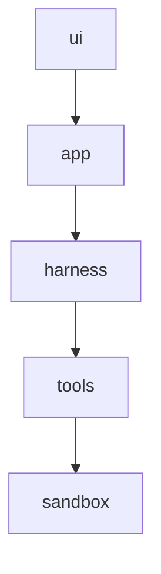
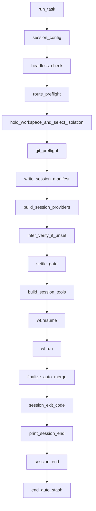
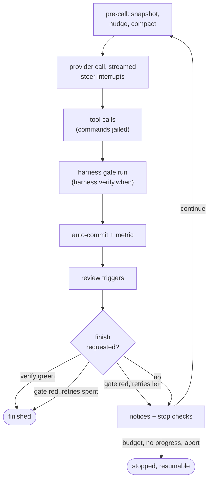
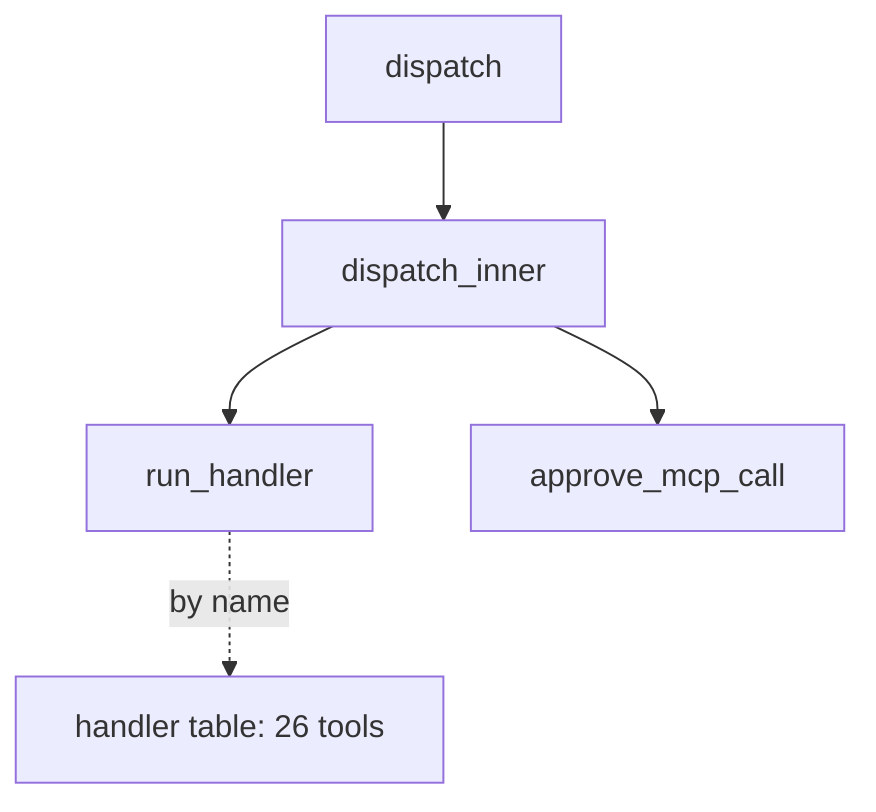

<!-- Generated from docs/architecture_template.md by docs/gen_diagrams.py; edit that, then regenerate. -->
# Architecture

How agent6 is built: the layers, the packages, one run, and the state it keeps.
`docs/gen_diagrams.py` builds three diagrams, the package list and two name lists from the source.
One diagram is drawn by hand and says so above its block.
What an operator sees is in [Usage](usage.md), every setting in [Configuration](config.md), the threat model in [Security](security.md), and the saved formats in [Formats](formats.md) and [Data contracts](data-contracts.md).

## Layering

The layers are `ui -> app -> harness -> tools -> sandbox`.
A layer imports only the layers below it.

- An edge means "imports from".
- A dashed edge would mark an import that climbs the stack.
- `harness` is the loop plus every primitive it calls in a turn.
- `app` composes executions into lifecycles.
- Any layer may also import the shared packages and modules: `budget`, `child_env`, `child_records`, `config`, `context`, `credit_usage`, `directive`, `errors`, `evidence`, `graph`, `journal_tail`, `kinds`, `llm_json`, `machine`, `media`, `models`, `operator_input`, `pack`, `pack_manifest`, `path_safety`, `paths`, `portable`, `prompts`, `providers`, `review_records`, `sessions`, `task_text`, `terminal`, `token_usage`, `vcs`, `viewmodel`, `words`.
- [tach](https://docs.gauge.sh/) records every edge in [tach.toml](https://github.com/agent6-dev/agent6/blob/master/tach.toml).

## Packages

Each entry is the package's docstring.

- **[`agent6`](https://github.com/agent6-dev/agent6/tree/master/src/agent6)**: agent6 is a coding agent that jails model commands and uses editable state machines.
    - The layers are `ui`, `app`, `harness`, `tools` and `sandbox`, and each imports only below itself.
    - Every other package and the modules at this level are shared: any layer may import them.
    - `__version__` here is the one version every surface reads.
    - Main modules: `kinds`, `paths`, `errors`, `budget`, `directive`, `evidence`, `pack`.
- **[`ui`](https://github.com/agent6-dev/agent6/tree/master/src/agent6/ui)**: Present agent6: the four front-ends and the helpers beside them.
    - The top layer and the composition root: it imports every layer, and no layer imports it.
    - The front-ends are `cli`, `tui`, `web` and `acp`, and `telemetry` exports session journals.
    - Main modules: `spawn`, `steer`, `directive_actions`, `keymap`, `notify`, `btw`, `mcp_server`.
- **[`ui/acp`](https://github.com/agent6-dev/agent6/tree/master/src/agent6/ui/acp)**: Serve the Agent Client Protocol: agent6 driven by an editor.
    - A front-end: it may import every layer and the shared `ui` helpers, never another front-end.
    - It reports through the viewmodel fold and acts through `SessionFrontend`, like the other three.
    - ACP's `initialize` is a capability exchange, so it maps onto `FrontendCapabilities`.
    - Every path is absolute and line numbers are 1-based, as the spec states.
    - ACP's client-owned `fs/*` and `terminal/*` are not adopted: the operator's jail does that work.
    - Main modules: `server`, `session`, `runner`, `updates`, `frontend`.
- **[`ui/cli`](https://github.com/agent6-dev/agent6/tree/master/src/agent6/ui/cli)**: The agent6 command-line interface.
    - The entry point that wires a run: it imports every other `ui` package, and none imports it.
    - `entry` parses argv and dispatches to one module per command family.
    - The console script and the tests enter through `main` and `cli_main`.
    - Main modules: `entry`, `run`, `sessions_cmds`, `machine_cmds`, `config_cmds`.
- **[`ui/telemetry`](https://github.com/agent6-dev/agent6/tree/master/src/agent6/ui/telemetry)**: The telemetry exporter: a reader of session journals beside the four front-ends.
    - It imports `viewmodel`, `sessions` and `config`, and no layer below `ui`.
    - `otlp` and `prometheus` encode the projection's records, and neither opens a socket.
    - Main modules: `export`, `otlp`, `prometheus`.
- **[`ui/tui`](https://github.com/agent6-dev/agent6/tree/master/src/agent6/ui/tui)**: The terminal UI: the hub and the run views over a session's event stream.
    - A front-end: it may import every layer and the shared `ui` helpers, never another front-end.
    - It runs outside the worker's process and reads `<session-dir>/logs.jsonl` from disk.
    - The render-ready state and the tailer live in `agent6.viewmodel`.
    - It answers through `agent6.sessions.ipc` and spawns through `agent6.ui.spawn`.
    - Main modules: `app`, `home`, `dashboard`, `conversation`, `composer`.
- **[`ui/web`](https://github.com/agent6-dev/agent6/tree/master/src/agent6/ui/web)**: Serve the browser front-end.
    - A front-end: it may import every layer and the shared `ui` helpers, never another front-end.
    - `agent6 web [target]` serves one page from a stdlib `http.server`, fed by JSON and SSE endpoints.
    - The endpoints use the folds (`agent6.viewmodel`), spawn (`agent6.ui.spawn`) and answer files (`agent6.sessions.ipc`) every other front-end uses.
    - The server binds loopback, and a non-loopback bind is opt-in under `[web]`.
    - Remote access is expected behind `tailscale serve`.
    - No secret is ever served.
    - Main modules: `server`, `page`, `model`, `actions`, `sse`.
- **[`app`](https://github.com/agent6-dev/agent6/tree/master/src/agent6/app)**: Compose executions into the run, resume, fork and machine lifecycles.
    - App owns what spans executions: the manifest, the writer lock and the providers.
    - The loop and every primitive it calls in a turn belong to `harness`.
    - App imports `harness` and the layers below it, never `ui`.
    - A front-end injects what app cannot do itself: `frontend.SessionFrontend` and `parallel.children.ChildRuntime`.
    - Output goes through the injected `reporter.Reporter`, never a direct `print`.
    - Main modules: `run`, `resume`, `fork`, `execution`, `parallel`, `merge`, `finalize`, `stop`.
- **[`app/machine`](https://github.com/agent6-dev/agent6/tree/master/src/agent6/app/machine)**: Compose the machine engine behind `agent6 machine run` and `create`.
    - Part of `app`: it imports `agent6.machine`, `harness` and the layers below, never `ui`.
    - It resolves one config per state and runs the sandbox, egress and budget preflight.
    - It spawns the runner of each `agent` state.
    - `ui/cli/machine_cmds.py` keeps argv adaptation and console rendering.
    - Main modules: `run`, `create`, `agent`, `check`, `state_configs`, `scriptcheck`.
- **[`app/parallel`](https://github.com/agent6-dev/agent6/tree/master/src/agent6/app/parallel)**: A group's child sessions: their launch files, spawning, relay, waiting, resume and import.
    - Part of `app`: it imports `harness` and the layers below, never `ui`.
    - The dispatcher the loop runs is `harness.parallel`.
    - Main modules: `children`, `launch`, `relay`, `wait`, `results`, `resume`.
- **[`app/review`](https://github.com/agent6-dev/agent6/tree/master/src/agent6/app/review)**: The reviews an operator starts or acts on: finding actions, `/review` and `sessions review`.
    - Part of `app`: it imports `harness` and the layers below, never `ui`.
    - The panel the loop runs itself is `harness.review`.
    - Main modules: `actions`, `directive`, `recap`.
- **[`app/session`](https://github.com/agent6-dev/agent6/tree/master/src/agent6/app/session)**: What the run and resume lifecycles share: a session's preparation, runtime, config and pruning.
    - Part of `app`: it imports `harness` and the layers below, never `ui`.
    - Main modules: `prepare`, `runtime`, `setup`, `prune`.
- **[`harness`](https://github.com/agent6-dev/agent6/tree/master/src/agent6/harness)**: Run the agent loop over one execution of a session.
    - Harness is the loop plus every primitive it calls in a turn.
    - `Harness` in `loop` drives one execution: provider calls, tool dispatch, guards, gates, snapshots.
    - What spans executions belongs to `app`, which composes executions into lifecycles.
    - Harness imports `tools`, `sandbox` and the shared packages, never `app` or `ui`.
    - The package re-exports nothing: import the submodules directly.
    - Main modules: `loop`, `provider_call`, `guards`, `finish_gates`, `parallel`, `run_chain`.
- **[`harness/compaction`](https://github.com/agent6-dev/agent6/tree/master/src/agent6/harness/compaction)**: Context compaction: its driver, the elision of old tool results, its rules and its window.
    - Part of `harness`: it imports `tools` and the layers below, never `app` or `ui`.
    - `default_strategy` picks the built-in strategy for the driving route.
    - Main modules: `driver`, `strategy`, `rules`, `elision`, `window`, `retention`, `cold_start`.
- **[`harness/parallel`](https://github.com/agent6-dev/agent6/tree/master/src/agent6/harness/parallel)**: The children a run dispatches: their dispatch, merge, ranking, panels and recovery.
    - Part of `harness`: it imports `tools` and the layers below, never `app` or `ui`.
    - `[harness.parallel]` configures it.
    - `app.parallel` clones, spawns, awaits and imports each child.
    - Main modules: `dispatch`, `merge`, `rank`, `panel`, `recovery`, `work`.
- **[`harness/prompt`](https://github.com/agent6-dev/agent6/tree/master/src/agent6/harness/prompt)**: The run's system prompt and first message: the block fillers, the repo context and the preview.
    - Part of `harness`: it imports `tools` and the layers below, never `app` or `ui`.
    - The text the fillers render is the leaf package `agent6.prompts`.
    - Main modules: `blocks`, `repo_context`, `preview`.
- **[`harness/review`](https://github.com/agent6-dev/agent6/tree/master/src/agent6/harness/review)**: The review panel the loop runs: its gate, reviewers and history.
    - Part of `harness`: it imports `tools` and the layers below, never `app` or `ui`.
    - The reviews an operator starts (`/review`, `sessions review`) are `app.review`.
    - Main modules: `gate`, `panel`, `verdict`, `history`.
- **[`harness/tasks`](https://github.com/agent6-dev/agent6/tree/master/src/agent6/harness/tasks)**: The run's task graph in the loop: the focus, the operator's tasks and the standing goal.
    - Part of `harness`: every module reads `graph`, and none imports `app` or `ui`.
    - Main modules: `focus`, `operator_tasks`, `standing`.
- **[`harness/verify`](https://github.com/agent6-dev/agent6/tree/master/src/agent6/harness/verify)**: The verify gate: when the harness runs it, its scoped retry and its verdict.
    - Part of `harness`: it imports `tools` and the layers below, never `app` or `ui`.
    - Main modules: `gate`, `scope`, `verdict`, `child`.
- **[`tools`](https://github.com/agent6-dev/agent6/tree/master/src/agent6/tools)**: Tool dispatch and the schemas exposed to the LLM.
    - A layer: it imports `sandbox` and the shared packages, never `harness`, `app` or `ui`.
    - The package itself loads nothing: import the submodule you need.
    - Main modules: `schema`, `dispatch`, `command_tools`, `fs_tools`, `policy`, `results`.
- **[`sandbox`](https://github.com/agent6-dev/agent6/tree/master/src/agent6/sandbox)**: Host and kernel detection, the Landlock ABI probe, and the jail launcher.
    - The bottom layer: every layer may import it, and it imports only root-level modules.
    - Main modules: `jail`, `jail_session`, `detect`, `container`, `landlock`.
- **[`config`](https://github.com/agent6-dev/agent6/tree/master/src/agent6/config)**: The config models, file IO and layered resolve.
    - A shared package: any layer may import it, and it imports no layer.
    - The models are the package's public API and are re-exported here.
    - The IO and layering are imported from `agent6.config.io` and `agent6.config.layer`.
    - Main modules: `model`, `layer`, `io`, `write`, `secret_store`.
- **[`context`](https://github.com/agent6-dev/agent6/tree/master/src/agent6/context)**: Store repository memory and discover operator-installed skills.
    - A shared package: any layer may import it, and it imports no layer.
    - Main modules: `memory`, `skills`.
- **[`graph`](https://github.com/agent6-dev/agent6/tree/master/src/agent6/graph)**: The task graph: one session's persistent plan.
    - A shared package: any layer may import it, and it imports no layer.
    - The worker, the planner and the operator's steering mutate it through one `GraphCurator`.
    - The curator owns the graph files in the session dir: `graph.jsonl`, `graph/*.md`, `cursor.json`.
    - The `worker.lock` flock keeps one writer, and the per-mutation flock also serialises fork's copy.
    - The session dir lives under the state base, which the jail masks under `full`.
    - Main modules: `curator`, `models`, `storage`, `order`, `replay`.
- **[`machine`](https://github.com/agent6-dev/agent6/tree/master/src/agent6/machine)**: State machines: declarative, replayable mini-agents.
    - A shared package: it imports `sandbox` and no layer above it.
    - The engine drives a machine deterministically over an append-only journal.
    - The journal gives crash recovery and offline replay.
    - An `agent` state runs an agent6 loop through an injected runner.
    - Main modules: `schema`, `semantics`, `engine`, `execution`, `journal`, `live_world`, `graph`.
- **[`models`](https://github.com/agent6-dev/agent6/tree/master/src/agent6/models)**: The provider model catalog: cached listings, prices, capabilities and validation.
    - A shared package: any layer may import it, and it imports no layer.
    - The package re-exports nothing.
    - That keeps `budget -> models.pricing` and `models.cache -> providers -> budget` acyclic.
    - Main modules: `cache`, `pricing`, `registry`, `validate`, `choices`.
- **[`prompts`](https://github.com/agent6-dev/agent6/tree/master/src/agent6/prompts)**: Static prompt text: the strings agent6 sends to models.
    - A shared leaf: any layer may import it, and it imports nothing from agent6.
    - The text is pure, with `{...}` placeholders its callers fill.
    - Main modules: `loop`, `review`, `review_directive`, `compaction`, `machine`.
- **[`providers`](https://github.com/agent6-dev/agent6/tree/master/src/agent6/providers)**: Model providers behind one `Provider` protocol.
    - A shared package: it imports `sandbox` and no layer above it.
    - The providers are interchangeable, and `[models.<role>]` routes each role.
    - Main modules: `anthropic`, `openai`, `responses`, `chatgpt`, `claude_code`, `provider_types`.
- **[`sessions`](https://github.com/agent6-dev/agent6/tree/master/src/agent6/sessions)**: Session identity and on-disk state.
    - A shared package: any layer may import it, and it imports no layer.
    - The package re-exports nothing: import the submodules directly.
    - Main modules: `id`, `layout`, `manifest`, `journal`, `event_log`, `lock`, `ipc`, `process`.
- **[`vcs`](https://github.com/agent6-dev/agent6/tree/master/src/agent6/vcs)**: Version control for agent6's own commits, refs and merges.
    - A shared package: it imports `sandbox` and no layer above it.
    - Git lives in the `git` sub-package, and only this package's modules import its runner.
    - The package spells no push, `--force`, history rewrite or `reset --hard`.
    - Main modules: `commit_message`, `commit_graph`, `review`, `review_rule_reader`.
- **[`vcs/git`](https://github.com/agent6-dev/agent6/tree/master/src/agent6/vcs/git)**: agent6's own git: the hardened runner, its policy, reads, writes, diffs and snapshots.
    - Part of `vcs`: it imports `sandbox` and no layer above it.
    - Main modules: `command`, `policy`, `ops`, `read`, `history`, `files`, `fetch`, `snapshots`.
- **[`viewmodel`](https://github.com/agent6-dev/agent6/tree/master/src/agent6/viewmodel)**: Fold the JSONL event stream into the render-ready state every front-end paints.
    - A shared package: any layer may import it, and it imports no layer.
    - The CLI, the TUI, the web UI and ACP fold the same `<session-dir>/logs.jsonl` through it.
    - The folds are pure functions over frozen dataclasses, with no I/O and no async.
    - A viewer in any language mirrors `SessionState` and `MachineState` field for field.
    - Main modules: `transcript`, `listing`, `review`, `receipt`, `wire`, `telemetry`, `tail`.
- **[`viewmodel/machine`](https://github.com/agent6-dev/agent6/tree/master/src/agent6/viewmodel/machine)**: A state machine as the surfaces read it: its logs, its state and its watch stream.
    - Part of `viewmodel`: it imports `agent6.machine` and no layer.
    - Main modules: `state`, `logs`, `watch`.
- **[`viewmodel/session`](https://github.com/agent6-dev/agent6/tree/master/src/agent6/viewmodel/session)**: A session as the surfaces read it: its core fold, its log scan and its status words.
    - Part of `viewmodel`: it imports no layer.
    - Main modules: `core`, `state`, `log`, `status`, `records`, `view`.

## Units of work

| unit | what it is | bounded by |
|---|---|---|
| machine | a state-machine instance: each of its agent states hands one task to the harness | the `.asm.toml` and its journal |
| group | a `/parallel` group: N sessions on one task | the parent's session |
| session | one task's durable record: its dir, journal, task graph, chain of commits and memory use | the id, which holds several executions |
| execution | one continuous run of the harness over a session, from a `run`, `resume` or `fork` to an end | `max_turns` and the budget cap, re-armed per execution |
| turn | one harness loop iteration: a model call and the tool dispatch, advisors, gates and notices for its answer (a prose-only answer is a turn too) | its number in the session: a resume continues the count, and each execution gets its own `max_turns` allowance |
| tool call | one tool the model asked for inside a turn (a finish is the last one executed) | one dispatch |
| commit | one entry in the session's git history | its sha |
| checkpoint | saved harness state for resume | its checkpoint file |
| task | one node in the task graph | its task id |

`run` is the mode beside `plan` and `ask`, and the command that opens a session.

## The run lifecycle

- `run_task` in `app/run.py` composes a run's stages, and `resume_task` in `app/resume.py` a resume's.
- The steps both take before the execution body live in `app/session/prepare.py`.
- The body both share is `run_execution` in `app/execution.py`.
- The diagram draws a run's stages in call order.
- `end_auto_stash` is last because it runs from `finally`, on every exit path.

## A run

- A run is one conversation: one system prompt, one model driving tool calls, a harness around it.
- The harness dispatches the tools, snapshots the state and meters the budget.
- Multi-step work is the next tool call in the same conversation: no planner-to-worker handoff, no separate reviewer by default.
- `harness/loop.py` holds the turn: the request, the model call, the tool dispatch, what the tools did, and the ends.
- The advisors (`guards`, `metric_rules`, `quiet_turns`) and the finish gates (`finish_gates`) run in a declared order, and the loop applies each answer.
- A run ends through `finish_session` in run mode and `finish_planning` in plan mode.
- Ask mode has neither and ends on its final prose.
- An accepted finish emits `session.stop` and returns control to the front-end.

Drawn by hand against `Harness._drive_loop`, the turn with its decisions:

## Snapshots

- `loop_state.json` is rewritten before each model call and again after the turn's tool results land (`loop_resume.save_resume_snapshot`).
- Only the pre-call write also writes `checkpoints/<NNNN>.json`, so `fork --at-turn N` has one meaning.
- `agent6 resume` rehydrates from `loop_state.json`, and `agent6 fork --at-turn N` materializes the matching checkpoint.
- `turn_in_flight.json` records a turn's tool calls, and each result that returned, while they dispatch.
- A resume after a death there runs none of that turn's calls again.
  The model gets the results that returned, and one line for each other call saying it was interrupted.

## Verification

- `harness/verify/gate.py` runs the gate only when `[harness.verify].when` asks (default `never`: the model's own `run_verify_command` calls are the verification).
- The harness's run goes through the same dispatcher path as the model's `run_verify_command`, approvals included.
- A pytest gate that names no paths and overruns `harness.verify.timeout_s` re-runs scoped to the tests nearest the run's diff (`harness/verify/scope.py`).
- A red finish returns to the model `harness.verify.retries` times (default 2), then the finish stands.
- After a green verify or an editing step, the settled stop ends a plain run at `harness.settled_stop_after` consecutive idle turns (default 12).
- `evidence.VerificationEvidence` records each attempt with its command, scope, before and after trees and outcome.
- A pass covers the final tree only when both observations and the end tree match.
- [Verification](usage.md#verification) and [`[harness.verify]`](config.md#harnessverify) state what each setting does.

## Commits and the working tree

- Per-turn commits go through `vcs/git/ops.py`, outside the jail, onto the run's detached chain `refs/agent6/<id>/head` (`harness/run_chain.py`, `harness/run_checkpoint.py`).
- Git runs in the agent's own process, so the read-only bind of `.git` stops the worker without stopping the harness's commits.
- Each commit is staged through a temp index, so the operator's HEAD never moves during a run.
- A turn the gate judged green commits as verified, and every other editing turn commits as a checkpoint.
- `git.branch_per_run` also advances a visible `agent6/<id>` branch.
- `sessions merge` consolidates the chain under `git.merge_method` (default `tasks`: one commit per task range).
- `[git].control = "model"` turns the chain off: the model's own commits are the record.
- Files untracked at start are the operator's: the run records them in `untracked-at-start` and never commits them.
- Uncommitted changes to tracked files follow `[git].dirty_tree` at a run's start and on a resume (`app/resume_tree.py`).
- `app/resume_chain.py` decides where a resumed run's chain continues from after a merge.
- [Git](security.md#7-git), [`[git]`](config.md#git) and [When a run goes wrong](usage.md#when-a-run-goes-wrong) state the rules.

## The curator and its locks

- An in-process `GraphCurator` (`graph/curator.py`) owns the task graph: `graph.jsonl`, `graph/**/*.md` and `cursor.json`.
- The agent constructs one curator per run.
- The worker, the planner and the operator's steering all mutate through it.
- Every mutation validates against a pydantic schema before it applies.
- One curator per run is an invariant: two live curators cache independently, and the second write drops the first's parent-child links.
- `run`, `resume` and `fork` take a single-writer flock on `<session-dir>/worker.lock`, and a second process refuses.
- A crashed writer releases on death, so a resume after a crash never blocks.
- A per-mutation flock on the session dir guards a concurrent `fork`'s read of the graph.
- One live run-mode worker per checkout is the level above: a flock on `<state-dir>/locks/<checkout-id>.lock` (`sessions/lock.py`).
- A second `agent6 run` parks: the manifest keeps its task (`parked_task`, `parked_reason`), and `agent6 resume <id>` starts it once the checkout is free.
- Plan and ask expose no edit tools and spawn freely.
- A run's children work in isolated clones.

The graph is a side store: it never picks the next tool.

- `add_task` and `update_task` write it, with cycle-checked `depends_on` edges, and `list_tasks` reads it back.
- Each turn the current task surfaces into the prompt (`harness/tasks/focus.py`).
- `finish_session` refuses while the worker's own subtasks are open, under a cap.
- A standing goal (`run --standing "<goal>"`, `/standing`) is the never-passing fallback: the soft endings re-enter it, and only the operator retires it.
- `[harness].standing_patience` bounds the re-entry rounds that run no tool (default `-1`: no bound).

## Compaction

- The driving route reports what its endpoint does with history (`provider_types.EndpointCompaction`).
- `harness.compaction.default_strategy` picks `driver.Endpoint` or `driver.Tiered` once per execution.
- Both strategies use the same size, manual and idle triggers.
- `Tiered` compacts locally: above `compaction.drop_at_chars` the oldest tool results become placeholders, and above `compaction.summarize_at_chars` the conversation restarts from a summary.
- `Endpoint` leaves earlier messages intact and asks the endpoint to clear results or write the summary.
- On a resume, `harness/compaction/cold_start.py` compares the last worker request's route and time with the current route and its idle limit.
- `retention.select` applies the same operator, turn and character caps to every restart.
- The task graph survives a restart: the current task re-surfaces.
- `/pin <text>` survives every restart word for word, under a 4000-character total cap.
- A custom strategy is an object with `compact(self, context: strategy.Context) -> bool`, passed as `Harness(compactor=...)`.
- `harness/compaction/strategy.py` defines that protocol and its optional siblings.
- [Compaction](usage.md#compaction), [Anthropic Messages](anthropic.md) and [`[compaction]`](config.md#compaction) state the behaviour.

## Memory, rulings and skills

- Repo memory is one fact per markdown file under `<state-dir>/memory/`, with an index rendered from each file's first non-empty line (`context/memory.py`).
- The index injects into every run's prompt as a capped `<memory>` block.
- The worker writes through the ordinary edit tools under a narrow grant, in-process only.
- The jail never mounts the store.
- Run mode writes, and plan and ask read.
- A machine's `read_only` state gets no index (`Harness._load_memory_index`).
- `<state-dir>/memory-use.json` records each fact's writes and reads, and `agent6 memory list` prints it.
- `<state-dir>/decisions.md` holds the operator's rulings: the harness appends every `ask_user` answer and every steer that answered a question.
- The model sees the rulings as a `<decisions>` block and never opens or writes the file.
- Skills resolve at run start from `<data-dir>/skills/` plus `[skills].extra_dirs` (`context/skills.py`), in run mode only.
- `always` skills inject their full text, and the rest get an index line and load through `use_skill`.

## Tool dispatch

- Every tool call passes the same gates: audit events wrap it, the mode backstop refuses an out-of-surface name, MCP calls take an approval, and the handler table routes the rest by name.
- `tools/schema.py` is the fixed tool surface, and `harness/toolset.py` picks the subset each mode exposes.
- `tools/dispatch.py` owns routing, approvals, verification evidence and the jail session lifecycle.
- Each built-in routes to its family function with a frozen `ToolContext` and the raw arguments.
- Commands and verify run jailed, and file tools resolve through the workspace boundary.
- Under `partial` and `none`, commands share a private `TMPDIR` named `agent6-<session>-*` in the system temp dir (`command_temp` in `tools/policy.py`).
- Under `full` the jail's own tmpfs `/tmp` is the run's.
- Command streams lose terminal escape sequences before their size caps (`terminal.py`).

The table routes `agent6_docs`, `read_file`, `list_dir`, `outline`, `find_definition`, `find_references`, `apply_edit`, `apply_patch`, `run_verify_command`, `run_command`, `read_session`, `fetch`, `read_background`, `stop_background`, `run_metric_command`, `finish_session`, `finish_planning`, `ask_user`, `list_findings`, `parallel`, `steer_child`, `merge_child`, `add_task`, `update_task`, `list_tasks`, `use_skill`.

## Execution targets

- `prepare_local_execution` in `app/session/runtime.py` resolves the local policy and opens its command session before gate inference or any workspace command.
- `JailAccess` in `tools/command_tools.py` carries that policy, session and the resolved grants into dispatch.
- Setup, baseline verification, model commands and later verification use that one session.
- `kinds.ExecutionTarget` holds the immutable facts of where commands run.
- `app/stamps.py` mirrors `kinds.ExecutionTargetStamp` into the manifest as history.
- `tools/policy.py` owns permission and grant assembly, and `tools/target_policy.py` resolves local controls, networking and HOME.
- `sandbox.isolation = "container"` runs commands in a dev container: `sandbox/container.py` discovers it (`discover`) and installs the launcher through its exec prefix (`prepare`).
- `app/environment_lease.py` keeps one lease per environment under `<state-dir>/environments/<key>.json`.
- The run whose own start made the container appear owns it, and every other run is a borrower.
- [Effective controls](security.md#effective-controls), the [container discovery boundary](security.md#container-discovery-boundary) and the [container transport boundary](security.md#container-transport-boundary) state what each target enforces.

## Jail supervisor protocol

- `sandbox/jail_session.py` owns one serving launcher per run, over local and container process transports.
- `jail/src/session.rs` owns its newline-delimited JSON protocol on stdin and stdout.
- The initial policy selects `mode = "serve"`.
- After confinement setup the launcher sends `{"ready":true,"protocol":4,"instance":"<32 hex digits>"}`.
- Python refuses malformed readiness or another protocol version before it sends a command.
- Each `run`, `background`, `status`, `read`, `stop`, `probe` or `mapping` request carries a positive, increasing `id`.
- Its one response carries the same `id` and the readiness `instance`.
- Only one request is active at a time.
- `{"kind":"cancel","id":N}` has no response of its own and applies only to the active request with that id.
- EOF stops the foreground command, then ends the session and its background jobs.
- Policy and request frames are capped at 1 MiB, readiness at 4 KiB, and responses at 128 MiB.
- Startup writes and readiness share a 10-second deadline.
- `sandbox/jail_protocol.py` frames requests and responses and drains launcher stderr, keeping its last 64 KiB.

## Jail job ownership

- `jail/src/session.rs` resolves opaque handles in its own job table.
- `status`, `read` and `stop` accept no command pid.
- `jail/src/jobs.rs` owns each job's private subreaper, so jobs and launchers sharing a PID namespace cannot claim each other's children.
- `jail/src/capture.rs` drains stdout and stderr into an anonymous launcher-owned file.
- A `read` request names a handle, a byte `offset` and a `limit` from 1 to 65536.
- `sandbox/jail_jobs.py` copies the capture into the host log and persists the last terminal response.
- An exit code received in a status or stop response stays authoritative after a cleanup failure or transport loss.
- No completion response means an unknown outcome, even if the transport exits successfully.
- `tools/background.py` keeps the host log descriptors, renders scrubbed tails, and stops jobs before closing their sessions.
- [Owned-process cleanup](security.md#owned-process-cleanup) and [Captured output](security.md#captured-output) state the boundary.

## A review

Three features share the word.

- The in-loop panel (`[review]`, `review.when = "never"` by default) is `harness/review`: `gate` schedules it, `panel` aggregates the verdicts, `verdict` parses each reviewer's completion, `history` restores panels on resume.
- `/review [TARGET]` is an ordinary session whose first message is the review instruction: `directive.parse_review` parses it, and `app/review/directive.py` builds the comparison and the message.
- `agent6 sessions review <id>` reviews a finished session's record in one provider call (`app/review/recap.py`), and writes nothing to the repo or the memory.

The pieces they share sit in their own layers.

- `review_records.py` owns the findings, verdicts, targets and observations ([Review records](data-contracts.md#review-records)).
- `viewmodel/review.py` folds panel evidence and finding history for the live state and for `scan_session_log`.
- `vcs/review.py` owns diff hunk ranges and line-origin classification.
- A panel's reviewers are children, dispatched through `harness/parallel/panel.py`.
- Panel preparation retains the exact comparison under `refs/agent6/<session>/review/<base-tree>-<head-tree>`.
- Retention never moves the operator's index, HEAD, visible branches or run chain.
- `app/review/actions.py` owns Fix, Resolve and Reopen for every front-end, and live requests cross `sessions.ipc`.
- `app.merge.execute_merge` enforces the merge guard for the CLI, the web, the TUI and auto-merge: an open grounded block refuses the merge unless `review.block_on = "none"`.
- [Session findings](usage.md#session-findings), [`[review]`](config.md#review) and the [finding actions API](web.md#finding-actions-api) state the behaviour.

## Parallel runs

A child runs a task in its own worktree, and its parent can merge the child's commits into its own chain.
One rule holds for every child and reviewer: the parent hands down, the child pushes up, and the root is the one owner.

- Handed down: the config snapshot, the task and pins, the turn cap and deadline, and what the parent's budget has left.
- Pushed up: the child's approvals and waiting questions, its spend while it runs, and at its end its branch, its record and its memory.
- Owned by the root alone: the operator's answers, the one budget ledger, and every write to the repository's branches and memory.

Four entries start children: `run --parallel`, the composers' `/parallel` directive, a live run's `/parallel` steer, and the model's `parallel` tool (`[harness.parallel].tool`, off by default).
All of them share `parse_spec` in `directive.py`, a stdlib leaf both `harness` and `ui` import.

- `child_records.py` holds the `ChildSpawner` and `GroupChildSpawner` protocols, and `app/parallel/children.py` implements them over the front-end's `ChildRuntime`.
- `harness/parallel/repo.py` is the git plumbing: `clone_worktree` and `import_run`, with no LLM and no process spawning.
- `ParallelDispatcher` in `harness/parallel/dispatch.py` starts a task's children and settles them at turn boundaries.
- `harness/parallel/rank.py` ranks a task's attempts: a judge is a reviewer child whose verdict is an order.
- `harness/parallel/recovery.py` settles the dispatches an earlier execution left behind, before a resumed one's first provider call.
- `app/parallel/launch.py` writes the child's launch file (`AGENT6_LAUNCH`, mode `0600`): its task, pins, caps, away mode and lineage.
- `app/parallel/results.py` imports a finished child and carries its memory and rulings back.
- `app/worktrees.py` places the clones (`[git.worktree].base_dir`) and removes imported ones.
- `sessions/child_dispatch.py` writes `<session-dir>/dispatch/<group>.json` before any child launches.
- A dispatch record's state advances `prepared`, `running`, `settling`, `ranking`, `merging`, `complete`.

The invariants:

- A dispatch reserves nothing: each child starts under what the parent has left (`BudgetTracker.available`), and its settlement charges its final usage once (`BudgetTracker.settle_child`).
- A child cannot dispatch work: every child bootstrap sets `AGENT6_CHILD=1`, and `app.parallel.launch.dispatch_authority` separates work dispatch from panel scheduling.
- Children end with the execution that started them (`ParallelDispatcher.close`).
- A stopped child never merges by itself.
- Under agent6-owned git a task's only child merges into the parent chain, and of several attempts only the first-ranked does.
- Under `git.control = "model"` every child keeps its ref.
- A child that fails to start, or whose import is refused, keeps its clone.
- [Children](usage.md#children), [Parallel children](security.md#10-parallel-children) and [`[harness.parallel]`](config.md#harnessparallel) state the behaviour.

## Session state on disk

- Per-repo state lives outside the workspace at `$XDG_STATE_HOME/agent6/<repo-id>/`, written `<state-dir>` on this page.
- A session directory is `<state-dir>/sessions/<bucket>/<session-id>/`.
- The bucket is named for the mode (`kinds.SessionKind.bucket`): `runs/`, `plans/`, `asks/`, `machines/` for `machine create` authoring, and `reviewers/`.
- Ids are one namespace across every bucket, since every surface addresses a session by bare id.
- [Carry your state with the workspace](usage.md#carry-your-state-with-the-workspace) covers the temporary `.agent6/` layout.

| File | Holds |
|---|---|
| `manifest.json` | the [session record and later stamps](formats.md#sessionmanifest) |
| `graph.jsonl` | append-only journal of every task-graph mutation (curator-owned) |
| `graph/**/*.md` | one markdown file per task node, nested under its parent, rewritten atomically (curator-owned) |
| `cursor.json` | the curator's current task pointer |
| `logs.jsonl` | the structured event stream |
| `conversations.json` | opaque conversation ids and completed-call counts |
| `loop_state.json` | the latest resume snapshot |
| `checkpoints/<NNNN>.json` | pre-call snapshots with message references, the run's chain tip (`head_sha`) and the curator `graph_version`, kept until explicit pruning |
| `turn_in_flight.json` | the turn whose tool calls are dispatching, with each result that returned, gone once the snapshot holds the turn or the execution ends itself |
| `plan.md` | the plan itself, in plan sessions |
| `transcripts/<timestamp>-<seq>.json` | provider attempt records with redacted request references, outcomes and response evidence |
| `objects/<sha256 hex>.json` | distinct sanitized JSON values shared by transcripts and numbered checkpoints, and each file's text before and after an edit, referenced by its `tool.result` |
| `pruned.json` | explicit artifact pruning time, file counts and last transcript sequence |
| `worker.pid` | the live worker's pid and start time, where every surface reads liveness |
| `approvals/`, `questions/` | one `<id>.answer` file per prompt, whichever front-end answers, and in `approvals/` the session-wide allow and deny marker per scope |
| `frontends/` | one file per front-end registered to answer this run, named for its pid |
| `review-actions/` | one request and one reply file per finding action (Fix, Resolve, Reopen) a surface put to the run |
| `queue/` | the operator's queued tasks, standing goal and retirements (`/task`, `/standing`, `/retire`), read at the turn boundary |
| `shells/` | the roster of background commands the run started |
| `steer.request`, `stop.request`, `compact.request` | the operator's pending asks, which the loop reads at its turn boundary |
| `steers/` | the instructions queued behind the steer in flight, one file each in the order sent, which the worker moves into the slot oldest first |
| `untracked-at-start` | the files the run treats as the operator's (repo-root-relative, NUL-separated): those untracked when it started, plus those that appeared between executions and it cannot show it wrote |

A fork clones a source run's state as of a checkpoint into a new session dir with a new id (`app/fork.py`).

- A run fork gets a worktree of its own (`[git.worktree].kind`), detached at the turn's sha.
- The fork materializes the checkpoint into its own `loop_state.json` and rebuilds the task graph at the checkpoint's `graph_version` (`graph/replay.py`).
- It cuts the chain ref `refs/agent6/<new>/head` at the turn's sha.
- A plan or ask fork commits nothing and cuts no ref.
- The source run and the operator's checkout are never mutated, except by `/undo`.
- One fork edge per line lands in a per-repo `lineage.jsonl`.
- A fork is a commit plus the conversation up to that turn: no checkpoint holds uncommitted bytes.
- The format pages cover the [provider transcripts](formats.md#provider-transcripts) and the [support levels](data-contracts.md#support-levels) of every saved format.

## Machines

- `agent6 machine` runs a journaled reducer ([machine/engine.py](https://github.com/agent6-dev/agent6/blob/master/src/agent6/machine/engine.py)): each impure step's result is validated and appended before the new blackboard replaces the old.
- A restart after a crash replays the journal and continues from the last completed step.
- `machine replay` reproduces the same path offline.
- `machine/journal.py` owns one instance directory, `<state-dir>/machines/<id>/`: the source the run started from, `journal.jsonl`, the snapshots and the single-writer lock.
- That directory is not the `sessions/machines/` bucket, where `machine create` authoring sessions live.
- `app/machine/check.py` owns the bundle, config and jail-PATH checks that `machine check`, `test` and the create gate share.
- [Workflows](state-machines.md) has the spec and the state kinds.

## Events

- Four front-ends share one headless core: the CLI, the Textual TUI, the browser UI (`agent6 web`) and the ACP agent an editor drives.
- All four fold the same `logs.jsonl` through `viewmodel` and render their own way.
- The read side's wire form is what `agent6 attach --json` and the web endpoints emit.
- The write side is `ui/spawn.py` for detached spawns and `sessions/ipc.py` for the file contract the harness polls: approvals, questions, finding actions, the task queue, steers, stop and compact requests.
- The journal is durable: an append failure on anything but the streaming deltas stops the run (`EventWriteError`), and in-process listeners see an event only after its write landed.
- Journal append order, not timestamps, orders events.
- [Formats](formats.md#journal) owns the journal envelope, event names and payload fields.
- One gate (`tools/operator_prompts.py`, held by the dispatcher) mints the prompt ids and journals every prompt and answer pair, whichever front-end answers.
- After the front-end stays dead 30 consecutive seconds, the answer poll follows the [away mode](security.md#6-approvals) or falls back to stdin in an interactive terminal run.
- Stopping a run is one function (`app/stop.py`) behind `agent6 stop`, the TUI's Run menu, `/stop` in every composer, the web stop route and an ACP cancel.
- `viewmodel/receipt.py` derives `ReceiptView` from the journal and manifest, with no second receipt file.
- [Exit codes and end reasons](cli.md#exit-codes-and-end-reasons) lists every end, and [Session receipts](usage.md#session-receipts) the receipt.

## Sign-in

- `providers/oauth.py` resolves a configured issuer or the fixed ChatGPT registration through `profile_for(entry)` into a frozen `OAuthProfile`.
- `OAuthCredential` pins the first account and refuses a different account on refresh.
- `app/role_providers.py` injects an observer that writes `provider.auth` to the run's journal.
- `ui/cli/connect_oauth.py` runs the browser, device and paste flows through the resolved profile.
- `agent6 connect` executes nothing a remote returns.
- [Secrets and `connect`](security.md#8-secrets-and-connect) states the bound store's rules.

## Media attachments

- `kinds.MediaAttachment` holds static image or PDF bytes in memory, and a tool result carries it beside unchanged text.
- The journal keeps the metadata, and no surface shows payload bytes.
- `inspect_media` in `tools/media_files.py` checks bounded container bytes without decoding pixels.
- `provider_call.call_with_media_recovery` retries one recognized `MediaInputError` without rerunning tools.
- Missing modality data means unknown: a model's name never implies support.
- [Tools](usage.md#tools) lists the image and PDF limits, and [Media retention](security.md#media-retention) covers persistence.

## Bench and development switches

These env vars are switches for benchmark arms, harness experiments and debugging, listed here so no behaviour keys off undocumented state:

- `AGENT6_SYMBOL_TOOLS`: selects a symbol-tool arm that hides part of the navigation surface, and a call to a hidden tool says so.
- `AGENT6_FORCE_STREAM=1`: streams the run's reasoning to stderr with no TTY, for a bench or CI log.
- `AGENT6_DEBUG=1`: re-raises an unexpected error with its traceback instead of writing a crash-report file, and prints the notices a run would keep to its log.

agent6 also sets markers for its own children:

- `AGENT6_CHILD=1`: a child of a session (a child, a machine state, a `/btw` question), which cannot dispatch work ([Parallel runs](#parallel-runs)).
- `AGENT6_STREAM_TO_LOG=1`: a detached spawn or child emits its stream deltas as events with no console echo.
- `AGENT6_LAUNCH=<path>`: the child's launch file (`app/parallel/launch.py`), which the bootstrap refuses when it is missing, malformed, foreign-owned or exposed.
