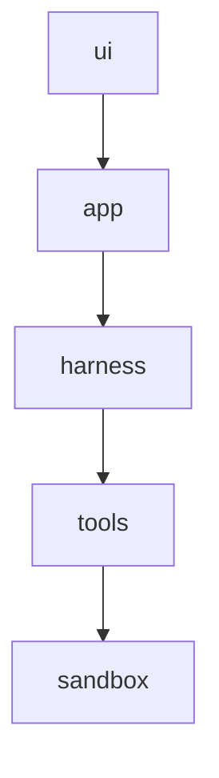
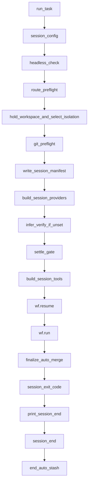
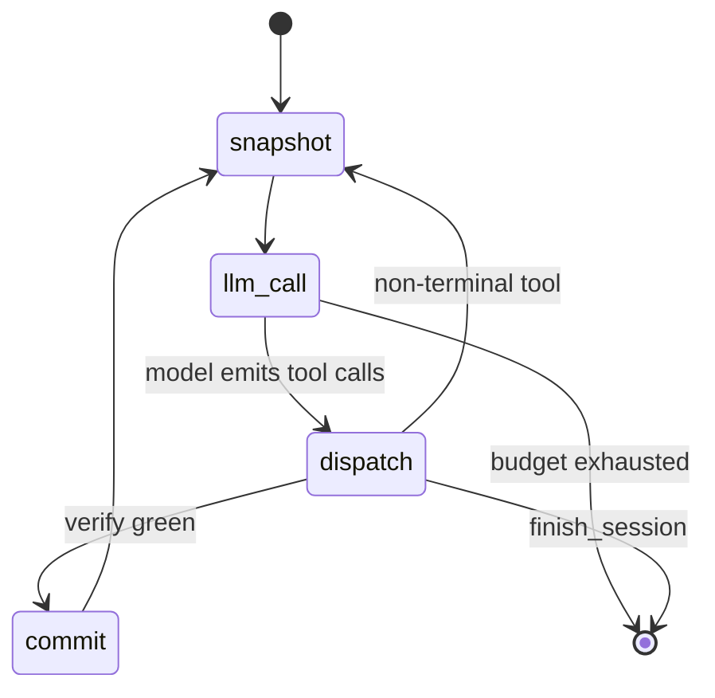
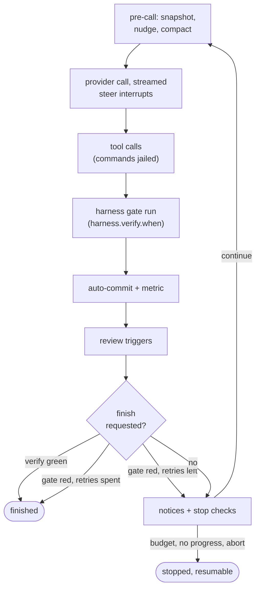
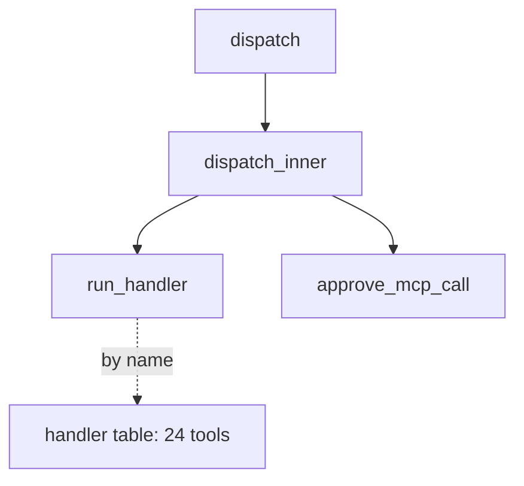
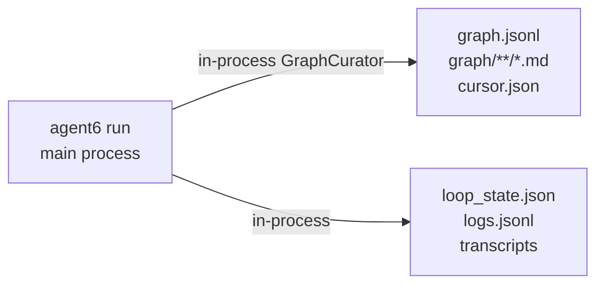

<!-- Generated from docs/architecture_template.md by docs/gen_diagrams.py; edit that, then regenerate. -->
# Architecture

How agent6 runs, end to end.
Three diagrams are built from the current source at site-build time (`docs/gen_diagrams.py`); the other three are drawn by hand, and each says so above its block.
[security.md](security.md) covers the threat model and what each isolation level enforces; [AGENTS.md](https://github.com/agent6-dev/agent6/blob/master/AGENTS.md) covers per-file conventions and stability rules.

## Layering

The layer stack is `ui -> app -> harness -> tools -> sandbox`.
An edge is "imports from"; a dashed edge would mark an import climbing the stack.
[tach](https://docs.gauge.sh/) records the map ([tach.toml](https://github.com/agent6-dev/agent6/blob/master/tach.toml)); the engine never imports the UI.

Any layer may also use the shared substrate: `budget`, `child_env`, `config`, `context`, `directive`, `errors`, `evidence`, `graph`, `journal_tail`, `kinds`, `lane_records`, `machine`, `media`, `models`, `pack`, `pack_manifest`, `path_safety`, `paths`, `portable`, `prompts`, `providers`, `review_records`, `sessions`, `task_text`, `terminal`, `vcs`, `viewmodel`, `words`.

The `vcs` package holds agent6's own git operations: `git_ops.py` writes, `git_read.py` queries, and `git_history.py` reads for display.
Only its modules import the runner, `git_command.py`.
`git_policy.py` holds those switches and the hook and driver policy; `errors.py` owns `GitError`.

- **ui** ([src/agent6/ui/](https://github.com/agent6-dev/agent6/tree/master/src/agent6/ui)): the presentation layer and composition root, over the shared read-model fold (`viewmodel`)
    - the four front-ends: `ui/cli`, `ui/tui`, `ui/web`, `ui/acp`
    - `ui/mcp_server.py`: agent6 as an MCP server
    - the write helpers: `ui/spawn`, `ui/notify`, `ui/steer` (the steer-file seam every front-end writes) and `ui/btw` (the side question a run answers without losing its place)
- **app** ([src/agent6/app/](https://github.com/agent6-dev/agent6/tree/master/src/agent6/app)): the pipelines composed over the engine: run/resume/fork/machine-agent lifecycles, merge and finalize, provider construction, the sandbox cross-checks (`app.confine`), the `--parallel` fan-out
    - what it cannot do itself (own a terminal, render, spawn detached) arrives as frozen injected callables (`SessionFrontend`, `LaneRuntime`); output goes through the injected `Reporter`
- **harness** ([src/agent6/harness/](https://github.com/agent6-dev/agent6/tree/master/src/agent6/harness)): `loop` (the agent loop behind `agent6 run` and `resume`), `review_session` (the read-only pass behind `agent6 sessions review`) and the review panel (`review_panel`, `review_seat`, `review_gate`); the agent loop makes its own provider calls through `provider_call`.
  `harness/loop_resume.py` owns snapshot carryover and persistence; `harness/loop_steer.py` applies steering at turn and execution boundaries.
- **tools** ([src/agent6/tools/](https://github.com/agent6-dev/agent6/tree/master/src/agent6/tools)): the fixed tool surface the LLM sees, plus dispatch.
  `harness/toolset.py` picks the subset each mode exposes, and appends the MCP tools in the modes that edit.
- **sandbox** ([src/agent6/sandbox/](https://github.com/agent6-dev/agent6/tree/master/src/agent6/sandbox)): the `agent6-jail` launcher and its policy.
  The jail bounds commands, one launcher per run; the agent process itself is never confined.

**Where the CLI resolves things.** `ui/cli` parses arguments, optionally spawns the TUI, and picks a mode.

- `cli_main` is the one error boundary: `OperatorError` (with `ConfigError`, `MemoryStoreError`) prints an `ERROR:` refusal at exit 2; a closed output pipe (`agent6 ... | head`) ends quietly at exit 141; anything else crash-reports with a saved traceback at exit 1
- config resolves through [config/layer.py](https://github.com/agent6-dev/agent6/blob/master/src/agent6/config/layer.py) (defaults, global, per-repo, `--config FILE`, then a machine's `[config]` overlay and one state's `config` table; a selected preset sits just above the layer that named it); paths and sudo/root through [paths.py](https://github.com/agent6-dev/agent6/blob/master/src/agent6/paths.py); keys through [secret_store.py](https://github.com/agent6-dev/agent6/blob/master/src/agent6/config/secret_store.py).
  `config/layer_data.py` discovers and merges layers with per-leaf provenance; `config/layer_presets.py` selects and lists presets.
- per-repo state lives out of the workspace at `$XDG_STATE_HOME/agent6/<repo-id>/`, written `<state-dir>` below, keyed on the repository (a subdirectory reaches the same runs, memory and config, and so does a linked worktree, through its `.git` file)
- `pack.py` copies and imports portable workspace state; `pack_manifest.py` validates its trust boundary without importing path resolution.
  `pack --repo-config` folds inherited global leaves into repo config through `config.write` before copying, using `config.layer_data`'s merge rules.
  `ui/cli/pack_cmds.py` owns the two command surfaces and shares init's `.gitignore` writer.
  `paths.project_root` refuses any pack until `unpack` imports it or the operator deletes it.
- every config edit goes through [config/write.py](https://github.com/agent6-dev/agent6/blob/master/src/agent6/config/write.py): one lock-held validate + revalidate + rollback cycle, or "kept as written" when the fail-open lock was not held

Every model call requires `models.default`.
The four optional roles inherit each unset field directly from it; their jobs are listed in [Usage](usage.md#connect-a-provider).

## Units of work

| unit | what it is | bounded by |
|---|---|---|
| machine | a state-machine instance; each of its agent states hands one task to the harness | the `.asm.toml` and its journal |
| fan-out | a `/parallel` group: N sessions on one task | the coordinator's session |
| session | one task's durable record: its dir, journal, task graph, chain of commits and memory use | the id; it holds several executions |
| execution | one continuous run of the harness over a session, from a `run`, `resume` or `fork` to an end | `max_turns` and the budget cap, re-armed per execution |
| turn | one harness loop iteration: a model call and the tool dispatch, advisors, gates and notices for its answer; a prose-only answer is a turn too | its number in the session: a resume continues the count, and each execution gets its own `max_turns` allowance |
| tool call | one tool the model asked for inside a turn; a finish is the last one executed | one dispatch |
| commit | one entry in the session's git history | its sha |
| checkpoint | saved harness state for resume | its checkpoint file |
| task | one node in the task graph | its task id |

A commit lands on the session's chain after a turn that changed the tree.
`git.commit_per_turn` controls whether editing turns commit; the diff pane's commit picker lists those commits.
`run` is the mode beside `plan` and `ask`, and the command that opens a session.

## The run lifecycle

`app/run.py`'s `run_task` composes the run's stages; `app/resume.py`'s `resume_task` composes a resume's.
The steps both share (the workspace lease and isolation, the session's writer lock, the headless check, the journal, transcript and operator channels, the gate pin) live in `app/session/prepare.py`, and each lifecycle calls them in its own order.
The diagram draws the run's in call order: refusals and clamps, the route preflight, isolation, git preflight, the manifest, provider construction, target preparation, gate inference, tool assembly, the loop, then auto-merge and the end report.
The stash finalize is last because it runs from `finally`, on every exit path, refusals included.

## A run

A run keeps one message history with one provider and one model.

- the model drives by calling tools; the harness dispatches, snapshots, tracks budget
- multi-step work is the next tool call in the same conversation: no planner-to-worker handoff, no separate reviewer by default
- the in-loop review panel is opt-in (`[review]`), layered on the same history
- `repo_context.review_rules` loads base-tree rule blobs through `vcs.review_rule_reader`; `review.start` records the paths, blob IDs, byte counts and completeness for the panel
- under `backend = "claude_code"` the provider keeps one `claude` process per execution and replays that history as labelled text and retained media whenever a call is not a continuation of its last round ([Config](config.md))

An in-loop panel records the run base and reviewed head's tree IDs, full grounded seat verdicts, and findings with durable IDs in `loop.review.*` events.
Panel preparation retains the exact comparison under `refs/agent6/<session>/review/<base-tree>-<head-tree>`, including uncommitted work after failed verification or with `git.commit_per_turn = false`.
The snapshot commit retains the base history as well as the head tree; an existing head commit is reused when it already retains both.
Before creating or reusing a snapshot, git checks the trees, retained history and every file object they reference.
Retention never moves the operator's index, HEAD, visible branches or run chain.
`Reviewer.prepare` binds the panel ID and target to an immutable `ReviewInput` containing complete historical rules, prior findings and verification evidence.
The current seat executor consumes that context; lane execution is not enabled by preparation.
Unreadable targets or failed retention skip the panel with `target_unreadable`, never substitute the chain tip for unreadable worktree content.
The refs survive chain pruning and are removed with their owning session record (`sessions remove`, including `--asks`).
`harness/review/history.py` restores those records on resume.
Only exact normalized finding content, location and the cited blob identify a repeat.
The journal keeps repeated observations even when the worker feedback omits them.
Findings cut from the feedback notice remain eligible for a later notice.

`vcs/review.py` owns diff hunk ranges and line-origin classification.
Before the panel event is written, each observation records its line origin against the immutable base and head blobs.
An exact unchanged range carries its base location and bounded blame attribution.
Unsupported files, ambiguous mappings and unavailable history carry an unknown reason.

Every execution start carries an `execution_id`, every panel has a unique `panel_id`, and every durable event has an `event_id`.
Journal append order, not timestamps, orders events.

`harness/loop.py` holds the turn: the request, the model call, the tool dispatch, what the tools did, and the ends.
What the turn leans on sits beside it, one module each:

- `run_chain` (the run's commit chain)
- `operator_bridge` (the operator's callables, the steer verbs, the pin cap, and what a steer's text means)
- `advice` (what an advisor answers with, a nudge, a stop or a refusal, and the turn's context it reads)
- `guards` (the advisors, one function per heuristic with its counters: no progress, settled, stagnation, the memory flip, the loop guard, the tool-error ladder, reachability, focus, the budget nudges)
- `metric_rules` (a metric run's plateau, ceiling and early-finish rules) and `metric_sampler` (the readings a run takes)
- `quiet_turns` (a turn with no tool call: the nudges it draws, the silent finish, the went-quiet end)
- `tool_effects` (what a dispatched tool did to the turn: the verify result, the metric sample, the tree edit, the memory touch, the finish, the error)
- `finish_gates` (what a finish call declares, what it must satisfy and what an end is called)
- `standing_goal` (the standing goal's re-entry)
- `operator_tasks` (the operator's writes to the task graph: the root, the goal, `/task` and `/retire`)
- `parallel_dispatch` (the `/parallel` fan-out)
- `run_checkpoint` (the per-turn commit and the final one)
- `compaction_driver` (the compaction driver over `compaction_rules`'s tier-1 rules, `compaction_elision`'s markers and caps, and `compaction_window`'s sizing and restart rules)
- `memory_touch` (what a tool call did to the memory store)
- the settings each sibling owns (`review_gate`, `compaction_window`, `provider_call`)

The loop runs the advisors and the gates in a declared order and applies each answer; a heuristic is one function and one test file.
After stop checks, a `finish_session` turn polls for queued answers before ending.
An answer found there reaches the model on another turn before it can finish; an unanswered question does not hold the run open.

Drawn by hand against `harness/loop.py`, the turn as a state machine:

The same turn with its decisions, also by hand, against `harness/loop.py`'s `_drive_loop`:

**Snapshot before every call.** `loop_state.json` is rewritten in full in the session directory before each provider request, with a per-turn snapshot under `checkpoints/<NNNN>.json` referencing shared message objects.
`agent6 resume` rehydrates from `loop_state.json` and `agent6 fork --at-turn N` materializes the matching checkpoint.
With the per-call transcripts, an interrupted run replays deterministically up to the next model call.
A turn's tool calls and each result that returned are recorded in `turn_in_flight.json` while they dispatch.
A resume after a death there runs none of the turn's calls again: the model gets the results that returned, and one line for each other call saying it was interrupted and not re-run.

**The harness runs the gate only when asked** (`[harness.verify].when`, default `never`: the model's own `run_verify_command` calls are the verification, and an end no run of the gate covers reads `unverified` and exits 0).

- Under `finish`, when `finish_session` arrives over a tree no verify verdict covers (green or red, nothing edited since), the loop runs `harness.verify.command` itself, through the same dispatcher path as the model's `run_verify_command`, approvals included.
- A denied approval withholds the gate for the rest of the execution, and the execution ends unverified.
- `turn` also runs it after every editing turn.
- A pytest gate naming no paths that overruns `harness.verify.timeout_s` (the harness's run or the model's own) re-runs scoped to the tests nearest the run's diff.
  It stays scoped until a full run of the gate passes.
  The notice lists the selected files, `session.stop` carries `scoped`, and a `finish_session` over a scoped green reads `passed · scoped gate` on every surface.
- A red finish certification returns to the model with the gate's output `harness.verify.retries` times (default 2), then the finish stands and the run is reported finished, never passed.
- The settled stop ends a plain run after `harness.settled_stop_after` consecutive idle turns (default 12) following a green verify of the run's own edits or an editing step no gate judged.
    - A green on the untouched base tree, from the start gate or the model's own call, is the baseline's verdict and arms nothing.
    - A verify run is neutral, as is a command start or selected-job read whose result says that command is still running.
      Completed commands, roster-only reads and reads of ended jobs count as idle even while another job runs.
    - An edit, a commit, a memory write, a tree change or an operator steer restarts the streak.
    - `-1` disables the stop, but the nudge at three idle turns still fires without announcing a stop; over a red gate the model must fix, the nudge is withheld while a finish would still go back.
    - Over a green gate of the run's own, the stop reads `finished · settled` and exits 0, since the worker called no `finish_session`.
    - A settled end whose only green was the base's carries `verification = "unverified"`: an unverified end.
    - Over a red gate it returns under the same cap, counted apart from the model's own finishes.

**Per-turn commits** fire when a gate run returns 0, through `git_ops.py` outside the jail, onto the run's detached chain (`refs/agent6/<id>/head`, temp-index staged).

- every other editing turn commits as a checkpoint, whatever the gate policy: a gateless run, a gate nobody may run (under `run_commands = "deny"`, or after a denial), a turn the model did not verify, a turn the gate judged red
- `branch_per_run` also advances a visible `agent6/<id>` branch
- HEAD never moves; when the run's own branch is the checked-out one, the index and the working tree are brought forward for the paths the commit changed, each only where it still matches the old tip
- consolidation is chosen at `sessions merge` time (`git.merge_method`: `tasks`, the default, one commit per task range; `squash`; `merge`; `ff_only`)
- `[git].control = "model"` turns the block off: no per-turn chain or run branch, the model's own commits are the record, and `sessions diff`/`commits`/`merge`, `/undo` and `fork` refuse for such a run

**The task DAG is a curator-owned side store.** `add_task` and `update_task` write it, with `depends_on` edges, cycle-checked; `list_tasks` reads it back. None of them picks the next tool.

- each turn the current task surfaces into the prompt (the cursor's subtask while it stays open, dependency-satisfied and undecomposed, else the first such subtask in tree order, else a ready standing task), advances as tasks pass, marks `in_progress`
- `finish_session` refuses while the worker's own subtasks are open, capped so an unclosable task cannot stall the run
- the surfaced banner survives tier-1 elision and re-injects after each tier-2 restart
- a focus task held without forward motion draws a split/pass/skip nudge, re-firing up to a small cap; progress resets it
- an end is final: `passed` takes only `obsolete`, and a `skipped` or `obsolete` task stays retired (needed again means a new task)

**A standing goal parks a run instead of ending it.** The operator's goal (`run --standing "<goal>"`, `/standing` on a live run) is the never-passing fallback, worked only when no ordinary subtask is ready; the model's `add_task` cannot set the flag.

- only the operator retires it: `/standing` with a new goal, `/retire`, or stopping the run
- while one exists, the soft out-of-work endings (`finish_session`, the settled family, a quiet turn) convert into re-entry
- faults, operator verbs, the turn cap, and a spent budget still end the run
- a re-entry round landing no executed tool call escalates the nudge; `[harness].standing_patience` bounds the streak (`-1` default: never self-ends; landed work resets)
- an interactive run parks the same way on a quiet turn: the conversation waits on the steer bridge; any composer or the pause menu continues it in place

**Context compaction has two tiers**, thresholds in `[compaction]`.

- tier 1, `drop_at_chars`: the oldest tool results become placeholders naming the elided call; reads of recently-edited files elide last
- a large `read_file` decays in two stages: a model-written gist first, the bare marker under continued pressure (oldest gists first); files changing under edits are never gisted
- tier 2, `summarise_at_chars`: the elided history is summarised by the `helper` model; the conversation restarts from the task, that summary, the pins and decisions block, the verify fact (the last full verification's command, verdict and tree, and whether the tree changed since), and the last `keep_recent_chars` (default 80000) of history verbatim
- the DAG survives the restart: the current task re-surfaces, the summariser reports finished/new tasks (finished marked `passed`, new queued)
- `/compact [focus]` compacts on demand
- `/pin <text>` survives every restart verbatim and persists in the snapshot; over the 4000-char total cap the pinning is refused loudly and the text still lands as an ordinary steer

**Repo memory**: one fact per markdown file under `<state-dir>/memory/`, with an index rendered from each file's first non-empty line.
A fact file is `<name>.md` under the name rule, a regular file; any other entry in the store is ignored, and `agent6 memory list` names it.

- the index injects into every run's prompt as a capped `<memory>` block; depth is a file read
- the worker writes through the ordinary edit tools under a narrow grant, in-process only; the jail never mounts it
- run mode writes; plan and ask read; machine modes see none
- models never write unprompted, so the loop sends one advisory per run, when verify first recovers green with nothing recorded; `[harness].memory_advisory = false` turns it off
- `agent6 memory add/list/show/remove` is the operator surface over the same files
- `<state-dir>/memory-use.json`, harness-written at each execution's end: per fact, the write that created it (when the record saw it), every write as a (session, when) touch in order, and its reads (count, last reader), the entry gone once the fact is deleted (by the model or `memory remove`); `memory list` prints it under each entry, so a stale or never-read fact is visible where it is pruned

Outside the store, `<state-dir>/decisions.md` holds the operator's rulings beside `memory-use.json`.
The harness appends every `ask_user` answer and every steer that answered a question, verbatim with its question, session and time; an identical ruling already on file is recorded once.
The model sees it first (a `<decisions>` block, re-shown after a compaction restart) and never opens or writes the file; `agent6 memory decisions` prints it.
A finish-time check reports any ruling missing from the file.

**Skills** resolve at run start from `<data-dir>/skills/` plus `[skills].extra_dirs`, through one resolution: the `<skills>` index and what `use_skill` serves cannot diverge.

- `always` skills inject full text; the rest get an index line and load on demand; run mode only

**The terminal tool** is `finish_session(summary)` in run mode and `finish_planning` in plan mode; ask mode has neither and ends on its final prose.
Either call, once accepted, emits a `session.stop` event and returns control to the front-end.

## OAuth credentials

`providers/oauth.py` resolves configured issuers and the fixed ChatGPT registration through `profile_for(entry)` into a frozen `OAuthProfile`.
The profile holds endpoints, encodings, callback settings, an account extractor and grant policies.
The registered ChatGPT redirect is `http://localhost:1455/auth/callback`; its listener host is `127.0.0.1`.
Configured redirect validation accepts only loopback literals.

`load_bound_grant(provider_name, entry, secrets=...)` validates a stored binding and account claim without refreshing or writing.
`OAuthCredential` pins the first account, preserves an omitted account on refresh, and refuses a different account on refresh, sibling adoption or rescue.
A stored grant without an account cannot replace a pinned identity; only a refresh of the known grant inherits its account.
A classified `OAuthError.code` of `refresh_token_reused` permits one reread after one second, accepting only a different, fresh, binding-valid, same-account grant.
The other classified codes are `refresh_token_expired`, `refresh_token_invalidated` and `invalid_grant`; unclassified refusals have `code=None`.
`oauth_exchange.py` owns the optional second exchange and its expiry parser.

Configured issuers and ChatGPT use `OAuthCredential` and bound `StoredGrant` records.
`app/role_providers.py` injects an observer that writes `provider.auth` to the run's journal.
A refresh or exchange reports success after persistence, or failure after its endpoint refuses; the observer runs outside both credential locks.
Recovery reports the answer to the one post-401 retry, not the decision to rotate.
A sibling adoption without a refresh, a cached read and an initial 403 refusal emit nothing.
Holders and transports built without an observer emit nothing.
ChatGPT model listings read through the holder with refresh disabled and fall back to the cache on failure.

`ui/cli/connect_oauth.py` selects and runs browser, device and paste flows through the resolved profile.
ChatGPT's proprietary device flow falls back to the displayed authorization URL and pasted callback on refusal or cancellation.
Entries outside the current grant format read as `missing` with the `agent6 connect <name>` remedy.
A successful connect replaces the entry atomically.
`app/session/setup.py::sign_in_refusal` shares the bound-grant diagnosis between run preflight, `check config` and `model`.
`connect --status` reads the same validator's `BoundGrantError.cause` and checks each locally usable credential without refreshing or exchanging it.
The bound store's security rules are in [Security](security.md#8-secrets-and-connect).

## Prepared execution targets

`app/session/runtime.py::prepare_local_execution` resolves a local policy and opens its command session before gate inference or workspace commands.
`tools/command_tools.py::JailAccess` carries that policy, session, resolved grants and owned local resources into dispatch; it contains no lazy session callback.
Setup, baseline verification, model commands and later verification use that same session.
A failed preparation propagates before dispatch exists.
A dispatcher without a prepared session serves the file and navigation tools; its command tools refuse.

`kinds.ExecutionTarget` holds immutable transport, workspace roots, user, HOME, environment policy, effective controls and observed protocol identity.
Unobserved runtime, container, launcher-instance, launcher-digest and lifecycle identities are `None`.
Readiness advertises the protocol version and a random launcher-instance identifier.
Container installation records the transferred binary's SHA-256 as `launcher_digest`; a local launcher's digest stays unobserved.
A record written as `launcher_version` reads as the digest (`kinds.read_target_stamp`).
The record is separate from live job state and resource cleanup.

`tools/policy.py` owns permission and grant assembly; `tools/target_policy.py` resolves local control descriptions, networking and HOME selection.
The dispatcher still gates tool availability and journals approvals before execution.
Preparing a transport grants no command permission.
`JailSession.connect` accepts a process transport and performs the common supervisor handshake; command handlers need no transport-specific argv or environment branches.
Verification inference accepts an executable-availability callable: active runs use their prepared session and its environment, while passive local previews explicitly use the advisory local PATH lookup.
Mid-run gate adoption uses the same lookup.
Source discovery still reads the host workspace.

## Environment ownership

`app/environment_lease.py` keeps one lease per selected environment under `<state-dir>/environments/<key>.json`, written under a sibling lock so lanes in other processes see one record.
The key names the selection: the manual exec prefix, or the workspace's discovery under its runtime prefix.
A replacement of a discovered container keeps the key, so the lease sees the swap.

`acquire` discovers the container; when none runs and the operator set a start command, it runs that command (fixed argv, no shell, 120 seconds, bounded output, the curated environment) and discovers again.
It says the start before running it: a `container: starting:` line and an `environment.starting` row.
The lease the run holds is journaled as `environment.acquired`, with the role, the reason and how long the start took; the policy row and the receipt show it.
The run owns the environment only when its own start made one container appear; the lease records what was observed before and after, never an assumed creation.
A container already running, an opaque exec prefix (whose presence nothing can observe), an ambiguous result and a replacement of an owned container all leave the run a borrower, with the reason recorded.
A resumed owner keeps ownership of the same container and loses it to a replacement.

`release` removes the session's borrower entry.
The owner stops the environment through the stop command only when no borrower is live, none ended without releasing, and a stop command is set; the observation afterwards decides `stopped` or `unknown`.
Every other case looks for the container first: `left_running` with its reason when discovery sees it, `stopped` when no dev container runs, `unknown` behind `container.exec` or when the look fails.
A lease whose owner's worker died is reported as orphaned, never inherited.
`session_runtime.prepare_container_execution` composes acquisition, the checkout mapping check (`container.check_checkout`: a checkout or a `.git` pointer outside the mounted workspace, or a linked worktree where the container mounts the workspace at another path than the host's, refuses before any command; the commands' root is the session's own checkout at its path under the mount), launcher preparation and the lifecycle hook on `JailAccess`; the dispatcher reports the hook's outcome as `execution.environment` after the session closed and its jobs settled.
`sandbox.isolation = "container"` selects this path: `execution.run_execution` prepares it in place of the local session, the fan-out and the machine lifecycles refuse under it, and `agent6 exec` names the runtime's own exec instead.

## Container discovery

`sandbox/container.py::discover` accepts an internal frozen `ContainerOptions`, not a public config model.
It returns a `ContainerDiscovery` with an exec prefix, unprepared `ExecutionTarget` facts and unexpanded `remote_env` metadata.
`sandbox.isolation = "container"` activates it; `[container].start` is the one way a run starts a container.
Config conversion belongs in app/tools, not sandbox.

- A nonempty `exec` bypasses runtime and definition discovery; each argv element is preserved unchanged, including sudo wrappers and an operator-installed devcontainer CLI.
  The command root is the `workspace` override or the host root; runtime, container and user identities remain unknown.
- Otherwise, an explicit `runtime` prefix selects the CLI; without one, discovery searches Docker then Podman found on PATH.
  Runtime executables resolve against the caller's cwd/PATH and become absolute before queries change cwd; remaining explicit prefix arguments stay unchanged.
  Automatic discovery queries symlink and hardlink aliases of one executable once, keeping the first name.
  Distinct wrapper executables remain separate; select an explicit `runtime` when wrappers reach the same backend.
  Each query appends fixed argv to that prefix, without a shell, automatic sudo or the devcontainer CLI.
- Running queries are `ps --quiet --no-trunc --filter label=devcontainer.local_folder=<root>` for the lexical and resolved host roots, deduplicated when equal.
  IDs are deduplicated within a runtime and sorted; several matches across either runtime refuse with their IDs rather than picking one.
  A missing runtime or failed query is a refusal, not an empty result or permission to skip that runtime.
- Only when no running match exists, `ps -a` with the same flags finds labelled containers for the no-running diagnostic.
  It never selects a stopped container or starts one.
  Existence of `.devcontainer.json` or `.devcontainer/devcontainer.json` also improves that diagnostic; contents are never opened, and editor-only custom definitions may be unobservable.
- One match gets `inspect --type container <id>`; pydantic validates the JSON shape, then discovery checks identity, running state and workspace label before selection.
  `devcontainer.metadata` accepts an object or ordered array of objects; the last supplied `remoteUser` wins over the runtime's `Config.User`, whose empty value means container UID 0.
  `remoteEnv` merges in metadata order and stays unexpanded data, outside the target's execution environment.
  Preparation must resolve supported container-only substitutions and refuse host or unsupported substitutions before use.
- Bind sources resolve host aliases and parent mounts to candidate command roots.
  The deepest destination mount covering a candidate must map back to the host workspace; a shadowed path or several different mappings refuses.
  An absolute `workspace` override takes precedence and creates no mount.

The derived prefix is `<runtime> exec -i --user <selected-user> <id>`, never a tty command.
Discovery does not execute it, install a launcher, prove a live shared-tree mapping, observe HOME or acquire lifecycle ownership.
The [security boundary](security.md#container-discovery-boundary) defines query bounds and runtime authority.

## Container transport

`sandbox/container.py::prepare` installs a validated static Linux launcher through the selected exec prefix, then hands its raw stdin/stdout channel to `JailSession.connect`.
`sandbox.isolation = "container"` activates this transport; lifecycle authority is the lease's ([environment ownership](#environment-ownership)).
The application remains responsible for selecting transports and resolving effective controls.
`sandbox/container_install.py` owns ELF validation, fixed bootstrap code and the host half of the mount proof; `jail_session` imports neither container module.

The bootstrap requires `/bin/sh`, `uname`, `mktemp`, `head -c` and `chmod` inside the target.
Its only positional inputs are the validated binary's byte count and architecture; model commands, workspace paths and metadata are not shell text.
It transfers the bytes once into a fresh selected-user-owned mode-0700 `/tmp/a6.XXXXXXXX` directory, then replaces itself with the launcher without a tty.
The host withholds the policy until the bootstrap acknowledges installation, so buffered reads cannot consume policy bytes.
Transfer and readiness share a 10-second deadline; stderr drains independently throughout.
The launcher checks its installed file identity and unlinks the executable before accepting commands.
The directory supplies target-local `TMPDIR` and anonymous capture storage.
Clean shutdown removes the directory only if empty; command-created files or abrupt transport loss may leave it behind.
Cleanup never recursively deletes target files.

A protocol probe observes effective UID/GID, architecture, the inherited environment and `/proc/self/mountinfo`.
Preparation resolves `${containerEnv:NAME}` against that environment, supports null removals, and refuses other substitutions by name.
Host HOME, PATH and TMPDIR are not copied into target commands; TMPDIR always belongs to the installation.
Environment values remain in memory; existing target stamps persist policy and variable names, not values.
Executable lookup uses this same prepared command environment.

The host creates and opens a random probe directory under a private staging directory, publishes it in the workspace, and writes a random nonce through its retained descriptor.
The selected user reads it through the command root and writes an independent nonce for the host to check.
Both sides use no-follow directory descriptors, exclusive file creation and bounded reads; cleanup unlinks only the probe entries through retained descriptors.
The probe contains no secrets and permits differing host and target UIDs.
Its writable directory proves shared visibility and rejects read-only mounts, not permission to write elsewhere in the workspace.
A mismatched, read-only or symlinked mapping refuses before model commands run.
The proof creates no mount, translates no argv strings and does not establish linked-worktree git-dir visibility.

## Jail supervisor protocol

`sandbox/jail_session.py` owns one serving launcher per run over local and prepared container process transports.
`jail/src/session.rs` owns its newline-delimited JSON protocol on stdin and stdout.
The initial policy selects `mode = "serve"`; after confinement setup, the launcher sends `{"ready":true,"protocol":4,"instance":"<32 hex digits>"}`.
Python refuses malformed readiness or a different protocol version before sending any command.

- Each `run`, `background`, `status`, `read`, `stop`, `probe` or `mapping` request carries a positive, increasing `id`; its single response carries the same `id` and the readiness `instance`.
- Only one request may be active; Python is the command-channel writer, and the Rust serve loop is the response writer.
- `{"kind":"cancel","id":N}` has no response of its own and applies only to the active request with that ID.
  Cancellation requests early hand-back when `checkin_s > 0`; otherwise it stops the active job and returns its exit result.
- Cancellation for any other ID is ignored, including one that races a completed request.
- One nonblocking stdin reader belongs to the serve loop and is polled while it waits for the job supervisor.
  It forwards cancellation and EOF over the private job channel without waiting for the command deadline; a partial frame never blocks command polling.
- EOF stops the foreground command instead of handing it back, then ends the session and its background jobs.
  Malformed input also closes the session after command cleanup.

Policy and request frames are capped at 1 MiB, including the newline.
Python caps readiness at 4 KiB and gives startup writes and readiness a shared 10-second deadline.
Responses are capped at 128 MiB, enough for JSON escaping of the retained command output (4 MiB head and 4 MiB tail per stream).
Python rejects a response with the wrong request ID or launcher instance and closes that session rather than using it for another request.
`sandbox/jail_protocol.py` frames requests and responses and drains launcher stderr throughout setup and execution, retaining its last 64 KiB with a truncation marker.
Startup diagnostics are surfaced once; the retained tail accompanies later protocol failures.
Command stdout and stderr are captured separately from these protocol streams.
Closing the session shuts stdin and discards pending response bytes while stderr keeps draining.
Python waits up to 10 seconds for launcher exit before killing and reaping it.

## Jail job ownership

`jail/src/session.rs` resolves opaque handles in its own job table; handles combine a random launcher-instance identifier with the starting request's ID.
Neither `status`, `read` nor `stop` accepts a command pid.
`jail/src/jobs.rs` owns each job's private subreaper, control channel and retained stop response.
The kernel reparents detached descendants to that job owner, so jobs and launchers sharing a PID namespace cannot claim each other's children.
The [cleanup boundary and failure limits](security.md#owned-process-cleanup) apply under `full`, `partial` and `none`.

`sandbox/jail_jobs.py` keeps the last terminal response and persists it on the host.
An exit code received in status or stop remains authoritative after cleanup failure or transport loss.
No completion response means an unknown outcome, even if the transport exits successfully.
Closing a session discards unread command responses and reports unconfirmed cleanup if the supervisor does not exit cleanly.
Host process snapshots are not part of the command-session lifecycle.

## Command capture and host records

`jail/src/capture.rs` drains stdout and stderr into an anonymous launcher-owned file, retaining bounded foreground excerpts separately.
Explicit background starts run the original argv without a redirection wrapper; hand-backs carry a handle and excerpts, never a target path.
A `read` request names that handle, a byte `offset` and a `limit` from 1 to 65536.
The response carries raw bytes as a JSON integer array, the next offset, the size observed before reading and any retained `capture_error`.
The capture remains readable after stop and disappears when the session closes.

`sandbox/jail_jobs.py` copies a size snapshot into the host log through its retained descriptor, advancing the offset only for successfully written bytes.
A failed host write can retry without skipping or duplicating bytes.
`tools/background.py` retains these host descriptors, renders scrubbed tails with explicit truncation, and stops jobs and copies their final bytes before closing their sessions.
Dispatcher teardown retains capture owners, host log descriptors, temporary storage and owned networks when host persistence fails.
A later successful close releases them.
The host log directory is not a command grant.
Terminal outcomes and channel-loss reasons are host records, separate from output; replay never infers completion from log text or a command-writable status file.
An unavailable capture leaves already copied bytes intact and reports incomplete output.
Read, status and stop responses carry capture failures separately from the exit code and cleanup outcome; the host persists and displays both.

## Tool dispatch

Every LLM tool call passes the same gates: audit events wrap it, the mode backstop refuses an out-of-surface name, MCP calls take an approval, and the handler table routes the rest by name.
Commands and verify run jailed; file tools resolve through the workspace boundary.
`tools/command_tools.py` holds jailed execution, command check-ins, and background read and stop handlers.
`tools/dispatch.py` owns routing, approvals, verify and metric events, and the jail-session lifecycle.
Under `partial` and `none`, `prepare_local_execution` gives commands a shared `TMPDIR` in a private `agent6-<session>-*` (the id's first 12 characters) directory in the system temp dir, falling back to `/tmp` when that root exceeds 32 bytes to leave room for Unix socket names.
Under `full` the jail's own tmpfs `/tmp` is the run's.
The start gate, verify tool, foreground commands and background commands use this directory; the dispatcher removes it after stopping commands at teardown.
`agent6 exec SESSION -- CMD` and `agent6 exec --new` use the same rule, with a fresh directory per exec, removed when the command exits and never shared with a live run.
Programs that ignore `TMPDIR` are not redirected by this environment setting.
A killed agent can leave this directory behind in the system temp dir.
CLI crash reports go beside the active session's log, or to the system temporary directory when no session has been attached.

Command streams lose terminal escape sequences before their 20,000-character tail cap and the model's result-byte cap.
Background reads scrub the decoded tail before selecting lines; the 1 MiB file-read cap still counts raw bytes.
The shared patterns live in `terminal.py`; command shaping preserves non-escape characters, including carriage returns, while rendering drops stray controls.
Metric scores parse raw, unclipped output, including escape bytes.

The table routes `agent6_docs`, `read_file`, `list_dir`, `outline`, `find_definition`, `find_references`, `apply_edit`, `apply_patch`, `run_verify_command`, `run_command`, `read_session`, `fetch`, `read_background`, `stop_background`, `run_metric_command`, `finish_session`, `finish_planning`, `ask_user`, `list_findings`, `parallel`, `add_task`, `update_task`, `list_tasks`, `use_skill`.

## A review

The in-loop review panel returns structured findings over the run's diff.

[Review records](data-contracts.md#review-records) owns the shared findings, seat replies, verdicts, immutable target identifiers, observations and operator request models in `review_records.py`.

`viewmodel/review.py` folds panel evidence and finding history for both live `SessionState` updates and `scan_session_log`.
`prompts.review.panel_prompt` renders both seat scopes.
An observation opens a new finding but does not reopen a resolved one.
Only resolution and reopening events change that state.
In the journal fold, a Fix request leaves the finding open and reads as delivery unknown until a submission or failure event arrives.
The fold retains action reasons in append order and never treats a fixed disposition as proof that verification passed.
Freshness compares both tree IDs and path coverage with an explicit requested comparison.
Without that comparison, freshness is unknown.
Legacy counts carry an unknown-evidence notice; an unreadable journal or structured record retains its error in `MergeReviewGuard`.

`app.merge_plan.run_merge()` is the merge the CLI, the TUI and the web each run in their own process: it validates, then calls `app.merge.execute_merge()`.
`app.merge.execute_merge()` enforces the guard for CLI, web, TUI and auto-merge, and runs its git under the hook and driver policy of the config it was given (`git_policy.use`), so a merge inside the web server leaves the server's policy as it was.
It holds the existing session writer lock while re-reading the review fold, merging a pinned source commit, and recording that tip.
Auto-merge uses the lock its lifecycle already holds; live dispositions wait in the IPC queue.
An open grounded block or unreadable evidence refuses the merge with its reason.
Missing, stale and legacy count-only reviews do not block a merge.

`app/review/actions.py` owns Fix, Resolve and Reopen for every front-end.
Live requests cross `sessions.ipc` as typed envelopes; `app/execution.py` drains them before polling the steer bridge.
The worker checks the expected version and journals the action in append order.
Offline actions use the existing session writer lock and recheck that no worker is alive.
A repeated request ID returns its journal result or retained worker reply before checking the supplied version.
A worker refusal is final for that request ID; a new attempt needs a new ID.
Fix records its request before submitting the server-built instruction, so a crash between those writes leaves delivery unknown rather than a claimed success.
An explicit resume releases the writer lock before the injected launcher runs; the resumed worker records submission when it takes that instruction.
After a successful launcher handoff, an otherwise unknown-delivery response says `run resumed to fix finding <id>; submission acknowledgement pending`.
It uses the existing `queued` status and retains the request's recorded version.
Recorded failures and submissions take precedence.
An acknowledged resume uses `submitted` and the resume-specific message without the pending qualifier.
A live submission keeps `steer submitted`.
Launch confirmation creates no journal event: a retry before acknowledgement still reads as delivery unknown and never launches again.

The web Findings card reads the same review fold as the merge guard.
`ui/web/review_routes.py` serves recorded comparisons and files from immutable tree IDs, without a checkout or private review refs.
`client_git_diff.js` owns each diff request's lifetime; `client_review.js` attaches findings through the source renderer's line attributes only when both comparison trees match.
Reviewed file links keep the panel and side, so Files reads the cited version rather than the working tree.

`agent6 sessions review <id>` ([harness/review/session.py](https://github.com/agent6-dev/agent6/blob/master/src/agent6/harness/review/session.py)) reviews a finished session's record: the journal folds into a digest (the task, the steers and rulings, the verify runs, the tool errors, the harness notices, the memory facts the session wrote, the conversation's tail, every list capped and the cap named), the reviewer role reads it beside the repo's memory index, and the markdown names how the run ended, what went wrong and why, what the operator corrected, candidate memory facts and AGENTS.md lines with their evidence, and the memory entries the record contradicts.
It writes nothing to the repo or the memory: the operator turns a candidate into `agent6 memory add` or an AGENTS.md line, or leaves it.

## Session review directive

`directive.parse_review` parses `/review [TARGET]` without importing the engine.
`app/review/directive.py` resolves its reviewed side through `vcs.review.comparison`, loads base rules through `harness.repo_context.review_rules`, and builds the bounded message from `prompts/review_directive.py`.
`app.run` prepares a detached worktree through `app.fork_worktrees` when the range needs another checkout, for both ask and run.
`app.execution` injects the live review preparer through `OperatorBridge`; a live request for another tree returns a new-session command without changing the checkout.
`steer.feedback` carries refusals and no-op answers to the shared transcript fold without a model call.
The directive uses the session's tools and permissions and returns markdown, without writing findings or a review journal.

## Parallel runs

The primitive is a task run as a subordinate isolated run whose branch joins back.
One rule holds for every child (a lane, a review seat): the parent hands down, the child pushes up, and the root is the one owner.

- handed down: the config snapshot, the task and pins, the turn cap and deadline, and what the parent's budget has left
- pushed up: the child's approvals and waiting questions, its spend while it runs, and at its end its branch, its record and its memory, which the parent imports
- owned by the root alone: the operator's answers, the one budget ledger, and every write to the repository's branches and memory

Three consumers drive it: `run --parallel`, the web and TUI composers' `/parallel` new-work directive, and a live run's `/parallel` steer.

All three share `parse_spec` in [directive.py](https://github.com/agent6-dev/agent6/blob/master/src/agent6/directive.py), a pure-stdlib leaf both `harness` and `ui` import.
It maps a lane count or model list to one model per lane.
The composers and steering use `parse_directive` to split `/parallel [SPEC --] TASK` segments ([grammar and examples](usage.md#parallel-directive)).

Before any clone, a spec's models are checked against what a lane can run.

- a lane keeps the worker's provider unless the spec names another configured one; the model is checked against what the roles name on that provider plus its cached listing ([models/validate.py](https://github.com/agent6-dev/agent6/blob/master/src/agent6/models/validate.py))
- unknown model: a miss against an existing cache re-checks that provider's live listing, and refuses with a did-you-mean only when the fresh listing confirms it; no cache, or a re-fetch that fails, proceeds with a warning (offline machines never block on a regenerable cache)
- all three consumers validate through the one helper, keeping `harness` free of a models dependency

The primitive is git plumbing in [subrun.py](https://github.com/agent6-dev/agent6/blob/master/src/agent6/harness/subrun.py), with no LLM, no UI, and no process spawning:

- `clone_workspace(origin, dest)`: a plain `git clone` of a disposable lane workspace.
- `import_run(origin, lane_repo, branch, lane_session_dir, origin_state)`: fetches the lane's branch into the origin and moves its session dir under `<origin_state>/sessions/runs/`, refusing to overwrite an existing branch or session dir.
  With model git control it fetches HEAD into the lane's chain ref and creates its checked-out branch only when that name is free.
  Cleanup keeps a clone whose HEAD or ref tips the origin cannot reach, unless a merge stamp covers them.
- `LaneSpawner` / `GroupLaneSpawner`: the Protocols for dispatching one lane, or a sibling group, and awaiting completion.

[app/lanes.py](https://github.com/agent6-dev/agent6/blob/master/src/agent6/app/lanes.py) implements those Protocols: it holds the front-end's `LaneRuntime`, plans the lanes, clones, spawns, awaits and imports one lane, and builds the coordinator's `/parallel` dispatcher.
[app/parallel.py](https://github.com/agent6-dev/agent6/blob/master/src/agent6/app/parallel.py) is a fan-out driver no command calls.
[app/parallel_results.py](https://github.com/agent6-dev/agent6/blob/master/src/agent6/app/parallel_results.py) imports the finished lanes, carries memory and decisions back, and stamps and prints the ranking.
[app/workdirs.py](https://github.com/agent6-dev/agent6/blob/master/src/agent6/app/workdirs.py) places clones and linked worktrees (`[git.worktree].base_dir`; `[container].worktree_base_dir` under a container), keeps a base inside the repository out of its git, writes lane configs, recovers orphaned lanes and removes imported or safely swept clones.
The detached spawn `app/lanes.py` drives (`ui.spawn`'s `spawn_lane`: the fixed `python -P -E -m agent6.ui.cli.lane_agent` argv, the child's pid kept) is injected as a `LaneRuntime` by the CLI adapter `ui/cli/parallel.py`; liveness probes use `sessions.process` and stop requests use the run-dir bridge (`sessions.ipc`).
A lane's task, pins, caps, away mode and lineage travel in its launch file (`app/lane_launch.py`, `0600` under `<origin_state>/launch/<group>/`), beside its config snapshot; the bootstrap validates both and drives `app.run.run_task` with the CLI's session seam.
A launch file that carries a `kinds.ConversationContract` starts a `read_only` session instead of a run: the same bootstrap, `run_task` and `Harness`, with the contract's system prompt and opening in place of the task block, a call ceiling counted at the provider caller (retries included), the navigation tools plus `finish_session` (`no_tools`: none), and no baseline, setup command, MCP server, compaction, advisor, review trigger or finish gate.
A response with no tool call ends it `answered`, on the last allowed call too; a last allowed call that still asks for tools ends it `calls_exhausted` with that response's text; either way `completion.json` (`sessions/completion.py`) holds the text, the stop reason, the attempts and what the ceiling cut.
Its session dir is `sessions/read_only/<id>` in the lane's clone and imports under the same bucket in the origin (`lane_watch.lane_link`, `subrun.import_run` read the bucket from the lane's mode); `resume` refuses it.

**`agent6 run --parallel N|selector,...`** resolves each selector (a role name, or `[provider/]model` on the worker's effort and temperature) to one `kinds.ModelSettings` through `Config.lane_settings`, the resolver every entry point shares, and plans one `LaneSpec` per lane, each started through the lane bootstrap as an ordinary detached run with its own jail and `run_commands` policy.

`app.workdirs.write_lane_config` uses `config.lane_snapshot` to materialize the parent's resolved worker, planner, reviewer and helper routes and sampling settings, with the lane's worker route override applied.
The snapshot keeps only the route in `models.default`; it omits sampling keys only for resolved `None` values.
On the internal child path, `app.session.setup.load_session_config` replaces only `[models]` after normal layer discovery and preset selection, discarding lower-layer model values and their provenance.
Other sections retain normal merging and explicit-default resets, including sandbox values and budgets; ordinary operator `--config` remains a merge.

TOML cannot preserve a selected `None` temperature with the unchanged sampling vocabulary: the omitted key reloads as the existing `0.0` default.
The snapshot records each affected field in `parallel.config_notes`, written with the lane's first manifest and printed in the lane's end report and fan-out lane report.
These notes survive manifest rewrites, import and temporary config cleanup; they document the loss and do not override the child config.

- `run --parallel` is a run: `ExecutionInputs.opening` carries its spec and task to the harness, and the loop's opening step (`loop_steer.ranked_opening`) dispatches the group under the join policy `rank` in place of the first model call
    - the dispatcher asks its ranker once the lanes settle (`app_lanes.build_lane_ranker`: `[harness.parallel].judges` over each lane's diff from the base, its gate verdict and its cost, billed to the run's own tracker), writes the order on the dispatch record before any join, joins the first lane onto the run's chain and records each other lane as `ranked` with its place
    - the journal: the dispatch, the judges' streamed `model.*` events (`role = "judge"`), `parallel.compared` with the ranking and rationale, `parallel.joined`, the end (`lanes_ranked`, `no_lane_result` or `budget_exhausted`)
    - a manifest comparison record: the group id, ranking, method, rationale and judge cost; lane manifests keep only their placement and group id
    - `VerifyGate.after_rank_join` runs the run's own gate on the joined tree, and `git.auto_merge` lands the run as it lands any run (`finalize.LANDING_ENDS`)
    - under `git.control = "model"` the run has no chain: every lane is placed and none is joined
    - a resume with a steer continues from the joined work with the worker model
- every lane's manifest names the session that dispatched it (`parallel.coordinator`, stamped from the private launch), so each listing nests lanes under their coordinator, folded into a count
- each lane's live session dir symlinks into its mode's bucket under `<origin_state>/sessions/` on locate: a fan-out is visible in every hub while it runs
- on completion a lane imports and the symlink becomes the real directory; a failed-to-start lane keeps its clone, and a refused lane keeps its clone and symlink (never the only copy lost)
- a lane is the coordinator's own child, tied to it with PDEATHSIG (SIGTERM): a coordinator that dies ends its lanes as a Ctrl-C would; a lane that does not stop when asked (an interrupt, a deadline) is TERMed, KILLed after the kill grace and reaped by its recorded pid, reported failed with its clone kept, and a lane that never reported a session dir is stopped the same way
- a lane's approval or waiting `ask_user` is asked on its parent: `lane_watch.await_lane` calls the parent's watch (`app/child_watch.py`) on each poll, which, while the lane reads `waiting`, puts the lane's open prompt through the parent's `OperatorPrompts` and writes the outcome into the lane's answer slot (the answers, or the note that the parent's operator gave none); a lane under a relay runs with the away mode `wait`, so a chain relays itself
- a dispatch reserves nothing: each lane starts under what the parent has left in each finite ledger (`BudgetTracker.available`, `-1` and `0` passing through per currency) as its own caps, through its launch file, and a panel's later batch under what is left then; while a lane runs, the parent's watch reads its journal on each poll and counts its spend so far against the parent's caps (`BudgetTracker.note_running`), the lane's own running lanes included (`usd_running_lanes` and `tokens_running_lanes` on its `budget.update` row, which the watch writes as that spend moves, ten seconds apart at most); a running lane's spend is inside `available`, `fraction_remaining` and the breaker and outside `usd_total`; the lanes together reaching a cap ends them at once, so the total can pass the cap by what was in flight and one poll; a lane's settlement (`settle_lane`) charges its final usage once and folds its plan readings through the parent's high-water rule so movement two lanes both saw counts once; a lane whose usage is unknown stays unsettled, its last reading counted for that execution; a resumed execution takes the lanes its journal already names as settled (`mark_settled`) and charges none of them again; `run --parallel` hands down nothing (its lanes keep the config's caps and `--max-usd`)
- every live dispatch is recorded before any lane launches (`sessions/lane_dispatch.py`, `<session_dir>/dispatch/<group>.json`, version 2, written atomically): the identity, source, join policy, owner execution, base, segments with their DAG nodes, each lane's share and limits; an unwritable record refuses the dispatch; the record advances `prepared`, `running`, `settling` (each lane's usage charged once, or marked outstanding), `joining` (each join written as it lands with the chain tip before and after) and `complete` with the delivered message, then `delivered`
- the read model (`viewmodel/lanes.py`) shows every session's children: from its dispatch records when it has any (each lane's source, selector, join outcome and sha, the branch the join read, its settled spend, and whether it ever launched: a lane with no session dir reads `failed: never started`), else from its lanes' lineage (a `run --parallel` fan-out, an older session) with no join to report; the session header carries `lanes` for every session that has any and `dispatches` when records exist, `fanout` only for a true fan-out; the receipt's `children` and its `Lanes` section name each lane and the spend the lanes added to the parent's inclusive total
- the model's `parallel` tool (`[harness.parallel].tool`, off by default) runs through the same dispatcher with `source = "model"`: the dispatcher's `parallel_handler` is the loop's `_parallel_tool`, which validates the arguments, applies the model-lane ceilings (200 turns, 1,800 s) as `LaneLimits` the lanes' launch files enforce again, dispatches for the turn in progress and returns the result as the tool's answer; the tool is listed only when `ToolDispatcher.parallel_available()` holds (the knob, run mode, not a subordinate, a handler installed), and the same gates refuse a call that slips past the list
- a resumed execution reconciles every record that is not complete or whose panel charges lack journal confirmation before its first provider call: the grant is restored as recorded (settled lanes released, never a second split), the recoverer finds the lanes by their session dirs (a live one is stopped as `agent6 stop` stops a run, one whose record is only in its clone is imported, one already imported is read as it stands), usage is settled exactly once, a lane whose work the chain already reaches is recorded joined at the merge that landed it and never merged twice, the rest join in order, and the result is delivered once for the original call; a record with no lane found completes as `dispatch interrupted before launch; nothing ran`; a complete record never delivered is delivered; a session older than the records has none to reconcile
- a dispatch may give a lane `LaneLimits` (a turn cap and a wall-clock deadline) in its launch file: the bootstrap clamps `harness.max_turns` (a configured `-1` cannot lift the cap) and arms its own backstop, the stop bridges at the deadline and SIGTERM to itself a grace later; the coordinator's await ends at the same deadline, and a lane that reaches it reads `ended at its deadline`, never a success
- the ranking is `app.compare.rank`: each of `[harness.parallel].judges` ranks once ([judge.py](https://github.com/agent6-dev/agent6/blob/master/src/agent6/harness/judge.py)) and the lowest sum of ranks wins; a tie, or a config with no judge, falls to verify-then-cost
- the compare stamps each lane's manifest (`placement`, one writer): every view shows the rank and why; listings star the winner
- only the first-ranked lane joins; the other lanes keep their branches for `sessions merge <lane>`
- `--max-usd` is the run's cap: the lanes and the judges bill one tracker

**A `/parallel` steer dispatches a sibling group** through `OperatorBridge.lane_spawner`, on `Harness.bridge` (the injection point keeping `harness` from importing `ui`; `app/execution.py` wires the front-end's spawner, run mode only).

- the loop blocks with no provider calls while lanes run, in this order:
    - expand each segment into its lanes
    - chain-commit the worktree (lanes cut from the chain tip)
    - clone, spawn, await and import the lanes
    - merge each branch onto the chain in dispatch order (`chain_merge` syncs merged files into the worktree)
- a lane that ended with a result and no commit beyond its base joins as `no_changes` and merges nothing
- each segment gets one DAG node: `passed` with the last joined sha (none when every lane made no changes), or `failed` when every lane failed or conflicted; a conflict aborts that merge and tells the model; the run continues either way
- `parallel.dispatched` / `joined` / `failed` render as conversation markers, so the blocked wait is visible

**Subordinate work cannot fan out.** `app.lane_launch.dispatch_authority` separates work dispatch from configured harness-panel scheduling on `OperatorBridge.lane_authority`.
Every lane bootstrap sets `AGENT6_SUBRUN=1`; a matching private worker launch retains panel authority under `[review]`, but its model and steer cannot dispatch work even with `harness.parallel.tool = true`.
An unproven subordinate run, including unrelated machine-state execution, gets neither authority.
A read-only conversation contract grants neither authority, ending the structure at the review leaf.

`ParallelDispatcher.dispatch_panel` accepts bounded read-only conversations and a retained target through an internal record-only policy, independent of `harness.parallel.tool`.
It shares the work dispatch's executor, reservation, import, settlement and recovery paths; `parallel_join` owns merge and DAG projections.
`review_gate.run_panel` prepares ordered requests using provider-free seats resolved by `app.role_providers.resolve_review_seats`.
The dispatcher reserves the entire roster before launching batches of at most `min(review.concurrency, harness.parallel.max_lanes)` seats; no seat is dropped.
Diff seats use the existing prompt, one call, a 1,500-token output cap and no tools.
Repo seats use the existing prompt, a 2,000-token per-call cap and `review.repo_max_turns` on the common bounded Harness path, including media recovery and final-turn verdict handling.
`review_seat` owns message preparation, finding coercion, verdict parsing and abstention diagnostics, not execution.
The parent validates each completion's session, panel, seat and retained target before parsing and grounding; an ordinary worker answer or successful exit is not evidence.
Events, replay and receipts keep each seat's session ID.
Configured top-level ask and plan reviews can schedule panels, but cannot dispatch work.
Panel shares come from the worker's remaining allowance, and their deadlines take the minimum of the requested bound, the 1,800-second panel ceiling and the owning lane's deadline.

Worker import preserves descendant session directories, dispatch records, objects and lineage in the original state directory, and fetches hidden session-owned target refs before removing the clone.
Stop and cleanup discover descendants through live symlinks, across buckets and through dead intermediaries.
Cleanup retains live descendants and unimported records.
The worker's usage is inclusive of settled descendants; importing their records does not charge them again.
The dispatcher journals the cumulative budget with `settled_lanes` before recording settlement; ancestor settlement retains its hold until those rows confirm every panel child's inclusion.
Recovery preserves journaled charges across executions and charges only children missing from that durable accounting.
Provider calls, lane settlement and finalization share `sessions.budget_events` so every cumulative row carries the same accounting fields.
Plan-window readings keep their recorded providers and replay in timestamp order across worker and descendant journals.
Child panel evidence binds only its retained target: importing or merging the worker does not certify the top-level tree.

## Enforcement layering

- `git_ops.py` runs outside the jail, in the agent's own process, so the read-only bind of `.git` stops the worker without stopping the harness's commits.

[security.md](security.md) states which guarantee each layer provides.

## The curator and its locks

An in-process `GraphCurator` (`graph/curator.py`) owns the task graph; the agent constructs one per run, and the worker, the planner and the operator's own steering all mutate through it.
The same process writes the rest of the run state.
Every mutation validates against a pydantic schema before it applies.

Drawn by hand, the one writer and what it writes:

One curator per run is an invariant (two live curators cache independently; the second write drops the first's parent-child links).

- `run`/`resume`/`fork` take a single-writer flock on `<run-dir>/worker.lock`; a second process refuses
- a crashed writer releases on death: resume-after-crash never blocks
- a per-mutation flock on the session dir guards a concurrent `fork`'s read of the graph
- a write-path fault after the in-memory update reloads from disk before surfacing: no read ever observes an unpersisted node

One live run-mode worker per checkout is the level above (`sessions/lock.py`, a flock on `<state-dir>/locks/<checkout-id>.lock`).
Run-mode workers share one working tree, so a second would interleave two runs' edits into each other's chain commits.
A second `agent6 run` parks.
The submitted task is saved verbatim in the new run's manifest (`parked_task`, with `parked_reason`, shown as "parked · checkout busy" in listings), and `agent6 resume <id>` starts it once the checkout is free.
Plan and ask expose no edit tools and spawn freely; a `run --parallel` fan-out takes no checkout lock, and its lanes work in isolated clones.

Files that are untracked at start are the operator's: the run records them (`untracked-at-start`) and neither commits them nor counts them as dirt.
A resume adds the files that appeared between executions and the run cannot show it wrote, and its note names them.
An edit to one of them, or to a path git ignores, stays out of the run's commits: the edit's tool result says so (`checkpoint.left_out`), and the end summary lists the paths still on disk and absent from the commits.
After an execution that died mid-turn the rule turns over: a call of that turn may have written what appeared, so those files stay the run's, and the note names them.

Uncommitted changes to tracked files are asked about over the `ask_user` channel: stash for the run, include them in its commits, or cancel, which parks the run with `parked_reason` "uncommitted changes".
`[git].dirty_tree = "stash"` and `"include"` answer without asking, and a run nobody can answer refuses before writing a manifest, discarding the empty dir.
An included tree that is exactly an unmerged run's tip is recorded (`includes` in the manifest): when the including run merges and that run is still at the tip, it is stamped merged too (`merged.via`), so its own merge has nothing left to land.

Every end the loop reaches records the tree the run left (`session.stop.tree`), and a resume applies the same policy to the paths that differ from it: those changed outside the run.
`stash` sets aside those tracked changes, including staged renames and deletions.
`include` leaves them in place and names them to the model before its first call.
It refuses when the run also changed one of those paths, since stashing it would take the run's work with the edit.
A resume after a death, a detach or an older session has no recorded tree: the changes no commit has and no tool of the run wrote follow the same policy, and its note names what the next commit takes.

A resume whose merge stamp covers everything the run committed, in a checkout whose HEAD holds the landing commit, continues from HEAD (`app/resume_chain.py`).
The chain ref and run branch only move forward: to HEAD after a `merge` or `ff_only` landing, else to a commit that joins the landed tip to HEAD's tree, so the earlier commits stay reachable for `fork --at-turn`.
The manifest's `base_sha` and the merge stamp's tip move to that commit, so `sessions diff`, `sessions commits`, the squash message, the review diff and the next merge read only the new work.
`base_branch` moves to the branch the merge landed on when the checkout has it out.
Where the workspace's HEAD does not hold the landing commit (a worktree run, a fork of a squash-merged run), the chain stays as it is and a resume moves `base_sha` alone, to the commit the next merge into `base_branch` starts from.
`app/merge_message.py` builds the squash message from the commits after the base its own merge starts from, so it names what that merge lands.
A run branch that is not at the chain tip (a commit made on `agent6/<id>`) refuses the resume, naming the commit; `--force` continues on the chain and leaves the branch.

## Session state on disk

The temporary workspace `.agent6/` layout and the transfer rules are documented under [Carry your state with the workspace](usage.md#carry-your-state-with-the-workspace).

Each session directory is `<state-dir>/sessions/<bucket>/<session-id>/`, where the bucket is named for the mode (`kinds.SessionKind.bucket`): `runs/`, `plans/`, `asks/`, `machines/` for `machine create` authoring, and `read_only/` for the bounded conversations lanes run under a contract.
Ids are one namespace across every bucket, since every surface addresses a session by bare id.
Minting picks an id no bucket holds; `run --session-id` refuses one another bucket holds (reusing a same-bucket id is the resume or parked-start path), and `fork --session-id` refuses one any bucket holds.

| File | Holds |
|---|---|
| `manifest.json` | the [session record and later stamps](formats.md#sessionmanifest) |
| `graph.jsonl` | append-only journal of every task-graph mutation (curator-owned) |
| `graph/**/*.md` | one markdown file per task node, nested under its parent, rewritten atomically (curator-owned) |
| `cursor.json` | the curator's current task pointer |
| `logs.jsonl` | the structured event stream |
| `loop_state.json` | the latest resume snapshot, written before each LLM call and at turn end |
| `checkpoints/<NNNN>.json` | pre-call snapshots with message references, the run's chain tip (`head_sha`) and the curator `graph_version`; kept until explicit pruning |
| `turn_in_flight.json` | the turn whose tool calls are dispatching, with each result that returned; gone once the snapshot holds the turn or the execution ends itself |
| `plan.md` | the plan itself, in plan sessions |
| `transcripts/<timestamp>-<seq>.json` | provider attempt records with redacted request references, outcomes and response evidence |
| `objects/<sha256 hex>.json` | distinct sanitized JSON values shared by transcripts and numbered checkpoints |
| `pruned.json` | explicit artifact pruning time, file counts and last transcript sequence |
| `worker.pid` | the live worker's pid and start time; every surface reads liveness here |
| `approvals/`, `questions/` | one `<id>.answer` file per prompt, whichever front-end answers; `approvals/` also holds the session-wide allow and deny marker per scope |
| `frontends/` | one file per front-end registered to answer this run, named for its pid |
| `review-actions/` | one request and one reply file per finding action (Fix, Resolve, Reopen) a surface put to the run |
| `queue/` | the operator's queued tasks, standing goal and retirements (`/task`, `/standing`, `/retire`), read at the turn boundary |
| `shells/` | the roster of background commands the run started |
| `steer.request`, `stop.request`, `compact.request` | the operator's pending asks, which the loop reads at its turn boundary |
| `steers/` | the instructions queued behind the steer in flight, one file each in the order sent; the worker moves the oldest into the slot when it clears |
| `untracked-at-start` | the files the run treats as the operator's (repo-root-relative, NUL-separated): those untracked when it started, plus those that appeared between executions and it cannot show it wrote; left out of every chain commit and dirty check; a fork records its own checkout's set, and an `/undo` fork the set of the checkout it keeps |

Transcript callers supply the object directory explicitly: sessions use the layout's `objects/`, and `sessions review` uses `<state-dir>/reviews/objects/`.
The [Formats reference](formats.md#provider-transcripts) describes provider attempt records, their pre-send write and finalization, and their call and request ids.
Review calls carry a frozen `CallContext` through `RequestContext` to the transport and transcript writer.
Panel seats have distinct read-only session directories and provider transcripts, including duplicate-focus seats.
Their completion artifacts carry the parent-owned `(panel_id, seat_index, target)` binding; the parent links verdicts to those sessions.

`finish_planning` is `plan.md`'s only writer and `agent6 plan edit` its only editor.
The planner re-reads it before every turn and is shown it whenever it differs from what it last saw.
`agent6 run --from` feeds it as a new run's task.

**A fork** clones a source run's state as of a checkpoint into a new session dir with a new id, and gives a run fork a linked git worktree of its own:

- adds the worktree detached at the turn's sha (`<[git.worktree].base_dir>/<repo-id>/<new>`)
- materializes the checkpoint into the new `loop_state.json` and writes seed `checkpoints/0000.json` with references to the child's own objects
- rebuilds the curator DAG at the checkpoint's `graph_version`
- records the fork lineage and worktree in the [manifest](formats.md#sessionmanifest), including the repository git directory the jail grants
- cuts the chain ref `refs/agent6/<new>/head` at the turn's sha, and the visible `agent6/<new>` branch there too under `[git].branch_per_run`; a plan or ask fork commits nothing and cuts neither

The source run and the operator's checkout are never mutated (except by `/undo`), and one fork edge per line lands in a per-repo `lineage.jsonl`.
`agent6 resume <new>` runs the execution in that worktree; the repository's state dir and config apply there.
The jail's rules for the recorded `worktree_git_dir`, including sessions started in user-created worktrees, are in [Security](security.md#2-sandbox).
The worktree's checkout lock is removed with the worktree.
The worktree shares the repository's refs, so `sessions diff|commits|merge <new>` work from the repo like any run's; `sessions prune` removes the worktree once the fork is merged, and `sessions remove <new>` removes it with the record.
An unstarted fork keeps its branch, chain ref and worktree even when its tip is reachable from the checkout's HEAD.
The manifest is the only thing that names a worktree as agent6's.
A worktree two sessions name (an `/undo` fork and its source) stays while either still needs it.

The clone sweep deletes a group dir of `lane-*` clones once the origin reaches every one of their tips, and leaves every other directory under `[git.worktree].base_dir` alone.
A clone with no lane session record stays because a spawn timeout can leave a child alive before its first write, even after the coordinator exits.

The rebuild (`graph/replay.py`) undoes every journal-stamped mutation newer than that version, so a fork's tasks, statuses, cursor, and journal match the turn its conversation came from.
Node content the journal never records (title, rationale, acceptance, paths) is immutable after creation and comes from the current nodes; `notes` and `updated_at` cannot be unwound and stay current.
A checkpoint whose `graph_version` is 0 or less has no version to rebuild at, so its fork copies the DAG verbatim.

On a gated run, an edit not yet committed at the forked turn is absent from the fork's tree, even though the copied transcript mentions it.
A fork is a commit plus the conversation up to that turn; no checkpoint holds uncommitted bytes.
An `/undo` fork adds no worktree: it keeps the undone session's checkout.

## Machines

`agent6 machine` runs a journaled reducer ([machine/engine.py](https://github.com/agent6-dev/agent6/blob/master/src/agent6/machine/engine.py)): each impure step's result is validated and appended before the new blackboard replaces the old, so a restart after a crash replays the journal to rebuild state and continues live from the last completed step, and `machine replay` reproduces the same path offline with no world at all.
[machine/journal.py](https://github.com/agent6-dev/agent6/blob/master/src/agent6/machine/journal.py) owns one instance directory, `<state-dir>/machines/<id>/`: the source the run started from, `journal.jsonl`, the snapshots, and the single-writer lock.
That is a different place from the `sessions/machines/` bucket, where `machine create` authoring sessions live.
`app/machine/check.py` owns the bundle, config and jail-PATH checks shared by `machine check`, `test` and the create gate.
[State machines](state-machines.md) has the spec and the state kinds.

## Events

Four front-ends share one headless core: the CLI, the Textual TUI, the browser UI (`agent6 web`), and the ACP agent an editor drives.
All four fold the same event stream and render their own way.
One listing row shape (`viewmodel.summary_row`) serves `sessions list --json` and `/api/hub`, and `sessions show --json` names the state with the same `status` word.
Two shared layers sit under them.

- the read side, [viewmodel/](https://github.com/agent6-dev/agent6/tree/master/src/agent6/viewmodel): the `SessionState` and `MachineState` fold plus its wire form, exactly what `agent6 attach --json` and the web endpoints emit
    - the lifecycle and usage both folds share: `viewmodel/session/core.py`; tolerant session journal scan: `viewmodel/session/log.py`; shared labels and status decisions: `viewmodel/session/status.py`; directory discovery and listing rows: `viewmodel/listing.py`; the telemetry projection: `viewmodel/telemetry.py` folds runs and delegates machine transitions to `viewmodel/telemetry_machine.py`, `viewmodel/telemetry_records.py` holds the spans, log records and open work, `viewmodel/telemetry_metrics.py` the metric table and meter
    - session view records: `viewmodel/session/records.py`; status, context usage and wire rendering: `viewmodel/session/view.py`; event handling: `viewmodel/session/state.py`
    - machine execution and spend reads: `viewmodel/machine/logs.py`; watcher cursors: `viewmodel/machine/watch.py`; journal folding, probes and verb refusals: `viewmodel/machine/state.py`
    - transcript event ordering: `viewmodel/transcript.py`; pending tools and verification attempts: `viewmodel/transcript_items.py`; tool previews and marker text: `viewmodel/transcript_text.py`
- the write side: [ui/spawn.py](https://github.com/agent6-dev/agent6/blob/master/src/agent6/ui/spawn.py) for detached spawns, and [sessions/ipc.py](https://github.com/agent6-dev/agent6/blob/master/src/agent6/sessions/ipc.py) for the approval, question, finding-action, task-queue, steer, stop-request and compact-request file contract the harness polls
- process identities, worker and network pid records, and front-end claims: `sessions/process.py`, shared by the bridge and its callers

A run started from a hub, or detached mid-run with `/detach`, keeps going with no terminal on it (`ui/spawn.py`); `agent6 attach <id>` opens it again, tailing the same journal every other surface folds.

**Stopping a run** is one function ([app/stop.py](https://github.com/agent6-dev/agent6/blob/master/src/agent6/app/stop.py)) behind `agent6 stop`, the TUI's Run menu, `/stop` in every composer, the web stop route and an ACP cancel.
[Exit codes and end reasons](cli.md#exit-codes-and-end-reasons) lists what the end block and listings say.

- It writes an abort steer, which cuts a model call in flight, and the `stop.request` marker with its `now` urgency, which ends a running foreground command at once.
  Unless it is request-only, it waits for the run to end.
- A worker still alive after that wait (5 s for a run, 30 s for a fan-out draining its lanes) gets SIGTERM and, 3 s later, SIGKILL, along with the background commands it started on the host.
- A run's worker and a fan-out's coordinator take the SIGTERM as a Ctrl-C stop (an `interrupted` end at exit 130).
- Every target is named by process identity (pid plus start time), so a pid recycled before the identity check is never signalled.
- `--after-turn` writes the plain marker alone, so the turn's running command finishes (or reaches `[harness].command_checkin_s`) and its tool results and auto-commit land first.
- A session's live lanes, found by the lineage their manifests record, stop with it at the same urgency: a plain marker lets each lane finish its turn, a `now` marker ends their running commands at once; a parent that already ended still stops them (`lanes_stopped`).
- An ACP cancel is request-only: it writes both requests without waiting for or signalling the worker, which is the ACP server itself.
- An immediate stop ends a foreground `run_command` the launcher hands back.
  Its tool result carries `stopped_by_operator: true` and the output so far, without `still_running` or `background_id`, so the conversation a resume reads says the stop ended the command.
- A check-in with no immediate stop still returns a running command and its background id.

`evidence.VerificationEvidence` records each configured verification attempt, including harness-started attempts, with its ID, execution, target reference, command, scope, before and after trees, outcome and capture limits.
`VerifyVerdict` and `SessionSnapshot` carry the final verification ID and tested tree across resume.
A pass covers the final tree only when both observations and the end tree match; commit identity alone does not invalidate unchanged content.
`viewmodel/receipt.py` derives `ReceiptView` from the journal and manifest, with no second receipt file or duplicate event.
The CLI `sessions receipt`, web receipt route, TUI screen and ACP `/receipt` read that view without a provider call, verification run or environment probe.
`VerifyRun` in `harness/review/session.py` retains IDs, trees and capture facts in the bounded digest supplied to `sessions review`.

`execution.target` owns the immutable environment evidence for an execution; `app/stamps.py` mirrors its persistence-safe `kinds.ExecutionTargetStamp` into the manifest as history, not a current-target pointer.
The stamp retains both roots, user, HOME, effective controls, environment inheritance policy and variable names, never environment values.
Its host-issued `target_id` distinguishes observations; the target also carries the observed launcher instance and any installation build identity.
The dispatcher assigns `execution_id` before setup; setup, the baseline and later verification retain their own target references across resumes.
`evidence.ExecutionObservations` folds target, setup, job-settlement and environment-lifecycle records for `scan_session_log` and the receipt.
Its `ExecutionTargets` fold also supplies the current environment to live views and run and resume start renderers, independent of manifest mirror writes.
An execution boundary without matching target evidence clears that binding; invalid target records retain history but clear the displayed environment.
Missing historical references stay unknown, even beside a newer manifest stamp.
Start blocks and session inspection use these recorded facts, not the current config or runtime.

The manifest's optional `MergeStamp.method` and `target_before` own reversal bounds.
`RevertPlan` uses those facts and `vcs/commit_graph.py` to check parents and enumerate landed commits without depending on source refs.
See [Session receipts](usage.md#session-receipts) for output caps and reversal limits.

The journal is durable.
An append failure on anything but the streaming deltas stops the run loudly (`EventWriteError`), and in-process listeners see an event only after its write landed.

[Formats](formats.md#journal) owns the journal envelope, event names and payload fields.

An approval covered by a standing answer journals only `approval.answer`, with source `session`.
Every other approval publishes as `approval.prompt` before its answer.

- one gate (`tools/operator_prompts.py`, held by the dispatcher) mints the ids and journals every prompt/answer pair, whichever front-end answers; a front-end's approver and questioner only answer and name their source
- the TUI's Allow/Deny writes the literal choice to `approvals/<id>.answer`; the gate clears that slot before journaling the prompt, and the approver reads it before the gate records `approval.answer`
- the transcript fold marks the call a prompt's `call_id` names as awaiting (`sessions show`, the web and TUI conversation, ACP's `pending`)
- the asking side decides what a choice grants: each prompt names its "allow all" scope (`command`, or one MCP server), and standing answers record per scope
- a no-standing gate sets `standing: false`, and no front-end shows the button
- after the front-end stays dead 30 consecutive seconds, the answer poll follows the [away mode](security.md#6-approvals) or falls back to stdin in an interactive terminal run
    - a page reload or a locked phone never converts a pending approval into a deny
- a watching browser registers as the run's answer front-end; prompts bridge to the page
- the task DAG rides as `graph.update` once per turn that mutated the DAG, plus the root seed, a surfaced task, an operator request (`/task`, `/standing`, `/retire`), the finish auto-pass, the compaction check-off and each parallel stamp; every mutation is curator-owned in `graph.jsonl`, read via `sessions graph`

## Where things live

| Concern | File or directory |
| --- | --- |
| Config schema | [config/](https://github.com/agent6-dev/agent6/tree/master/src/agent6/config) (`model.py` holds `Config` and `[agent6]`; `model_roles.py` owns role inheritance; the other sections live in `sandbox_config.py`, `harness_config.py`, `git_config.py`, `surface_config.py`, `provider_config.py`) |
| Tool surface | [tools/schema.py](https://github.com/agent6-dev/agent6/blob/master/src/agent6/tools/schema.py) |
| Tool dispatch | [tools/dispatch.py](https://github.com/agent6-dev/agent6/blob/master/src/agent6/tools/dispatch.py) |
| Agent loop | [harness/loop.py](https://github.com/agent6-dev/agent6/blob/master/src/agent6/harness/loop.py) |
| Prompt text | [prompts/](https://github.com/agent6-dev/agent6/tree/master/src/agent6/prompts) (templates and seat renderers the loop, review, judge, and machine assemble; `compaction.py` holds the summariser, gist and restart-notice prompts) |
| Review panel | `harness/review/panel.py`, `harness/review/seat.py` and `harness/review/gate.py` |
| Jail sessions and detached jobs | [sandbox/jail_session.py](https://github.com/agent6-dev/agent6/blob/master/src/agent6/sandbox/jail_session.py), [sandbox/jail_jobs.py](https://github.com/agent6-dev/agent6/blob/master/src/agent6/sandbox/jail_jobs.py) |
| Jail launcher | [sandbox/jail.py](https://github.com/agent6-dev/agent6/blob/master/src/agent6/sandbox/jail.py) (Python), [jail/src/main.rs](https://github.com/agent6-dev/agent6/blob/master/src/agent6/jail/src/main.rs) (Rust) |
| Git policy | [git_policy.py](https://github.com/agent6-dev/agent6/blob/master/src/agent6/vcs/git/policy.py) |
| Subordinate-run primitive | [harness/subrun.py](https://github.com/agent6-dev/agent6/blob/master/src/agent6/harness/subrun.py) |
| Run-dir single-writer lock | [sessions/lock.py](https://github.com/agent6-dev/agent6/blob/master/src/agent6/sessions/lock.py) |
| Compare judge | [harness/judge.py](https://github.com/agent6-dev/agent6/blob/master/src/agent6/harness/judge.py) |
| Fan-out orchestrator | [app/parallel.py](https://github.com/agent6-dev/agent6/blob/master/src/agent6/app/parallel.py) (pipeline), [app/lanes.py](https://github.com/agent6-dev/agent6/blob/master/src/agent6/app/lanes.py) (lanes), [app/parallel_results.py](https://github.com/agent6-dev/agent6/blob/master/src/agent6/app/parallel_results.py) (import and comparison reporting), [app/workdirs.py](https://github.com/agent6-dev/agent6/blob/master/src/agent6/app/workdirs.py) (working directories), [ui/cli/parallel.py](https://github.com/agent6-dev/agent6/blob/master/src/agent6/ui/cli/parallel.py) (CLI adapter) |
| Provider clients | [providers/](https://github.com/agent6-dev/agent6/tree/master/src/agent6/providers) (`oauth.py` holds bound grants; `oauth_profile.py` holds resolved settings and identity and expiry policies; `oauth_exchange.py` exchanges issuer bearers for model tokens; `claude_code.py` orchestrates rounds; `claude_code_protocol.py` handles control messages and tool continuations; `claude_code_session.py` owns session state and pipe I/O; `claude_code_stream.py` folds stream events and scrubs email; `claude_code_wire.py` holds wire shapes) |
| Task graph | [graph/](https://github.com/agent6-dev/agent6/tree/master/src/agent6/graph) |
| Event log and fold | [event_log.py](https://github.com/agent6-dev/agent6/blob/master/src/agent6/sessions/event_log.py) (writer), [viewmodel/](https://github.com/agent6-dev/agent6/tree/master/src/agent6/viewmodel) (fold) |
| Front-end write bridge | [ui/spawn.py](https://github.com/agent6-dev/agent6/blob/master/src/agent6/ui/spawn.py), [ui/notify.py](https://github.com/agent6-dev/agent6/blob/master/src/agent6/ui/notify.py), [sessions/ipc.py](https://github.com/agent6-dev/agent6/blob/master/src/agent6/sessions/ipc.py) |
| Telemetry export | [ui/telemetry/](https://github.com/agent6-dev/agent6/tree/master/src/agent6/ui/telemetry): the journal reader that encodes `viewmodel/telemetry.py` as OTLP JSON and Prometheus text, started by `agent6 telemetry export` |
| Web UI | [ui/web/](https://github.com/agent6-dev/agent6/tree/master/src/agent6/ui/web) (stdlib HTTP server and one embedded page) |
| Repo memory | [memory.py](https://github.com/agent6-dev/agent6/blob/master/src/agent6/context/memory.py) (store), `<state-dir>/memory/` (data) |
| Machine engine | [machine/engine.py](https://github.com/agent6-dev/agent6/blob/master/src/agent6/machine/engine.py) (replay and live loop), [machine/execution.py](https://github.com/agent6-dev/agent6/blob/master/src/agent6/machine/execution.py) (state execution and reducer), [machine/contracts.py](https://github.com/agent6-dev/agent6/blob/master/src/agent6/machine/contracts.py) (world protocol and execution records), [machine/journal.py](https://github.com/agent6-dev/agent6/blob/master/src/agent6/machine/journal.py) (journal and instance dir) |

## Bench and development switches

These env vars are switches for benchmark arms, harness experiments and debugging, listed here so no behaviour keys off undocumented state:

- `AGENT6_SYMBOL_TOOLS`: selects a symbol-tool arm, hiding part of the navigation surface; a call to a hidden tool says so.
- `AGENT6_FORCE_STREAM=1`: streams the run's reasoning to stderr with no TTY, for a bench or CI log.
- `AGENT6_DEBUG=1`: re-raises an unexpected error with its traceback instead of writing a crash-report file, and prints the notices a run would keep to its log.

agent6 also sets markers for its own children:

- `AGENT6_SUBRUN=1`: subordinate work (a lane, a machine state, a `/btw` question), whose model and operator work entry points cannot fan out ([Parallel runs](#parallel-runs)).
- `AGENT6_STREAM_TO_LOG=1`: a detached spawn or lane emits its stream deltas as events with no console echo.
- `AGENT6_LANE=<path>`: the lane's launch file (`app/lane_launch.py`): the task and pins, the caps and away mode, the config snapshot the lane's sole `--config` must name, its serialization loss notes, the lineage the lane's manifest records, the origin of the verify gate the coordinator resolved, and the operator's task; the bootstrap refuses a missing, malformed, foreign-owned or exposed file, and the config load refuses another `--config`.

## Pre-1.0 stability

See [Support levels](data-contracts.md#support-levels) for format compatibility before and from 1.0.

## Media attachments

`kinds.MediaAttachment` holds static image or PDF bytes in memory; `ToolResult.attachment` and `ToolResultItem.attachment` carry it beside unchanged text.
`ReadMediaResult.to_wire()` is one sentence naming the file and saying the attachment follows; the journal keeps the metadata, and no surface shows payload bytes.
`Conversation.to_wire()` encodes retained attachments as text-plus-media arrays under their tool-result IDs.
`read_file` reads at most the document cap plus one byte through the contained reader before inspecting media.

Anthropic keeps native image and document blocks under the tool result.
Chat Completions and Responses (including ChatGPT) keep tool replies as strings and place labelled media in a following user message after all parallel replies.
That message encodes tool output and does not change the initiator.
Claude Code receives MCP image or resource items, replays retained attachments as native blocks on respawn, and restarts when a media result changes.

- [Tools](usage.md#tools) lists the fixed image and PDF limits.
- `AttachmentBudget` counts original bytes; Claude Code checks its complete encoded stdin line against the 8 MiB line cap.
- `media_files.inspect_media` checks bounded container bytes without decoding pixels.
- Compaction elides delivered attachments without gisting their payloads; `MEDIA_CONTEXT_CHARS` reserves context independently of base64 length and needs live calibration, especially for PDFs.
- `models.cache.cached_input_capabilities` reads explicit image and document facts from fresh listings, bound to the endpoint, provider entry and exact model.
- Missing modality data means unknown; names never imply support.
- `provider_call.call_with_media_recovery` applies the calling role's facts to canonical tool results and retries one recognized `MediaInputError` without rerunning tools.
- Delivery refusals emit `media.refused` with each affected tool use's `provider_tool_call_id` and update the worker's latest snapshot before retrying.
- Confirmed unsupported modalities stay unsupported for that route during the execution; malformed media and size rejections do not change capability facts.

See [Media retention](security.md#media-retention) for persistence and visual-secret disclosure.
