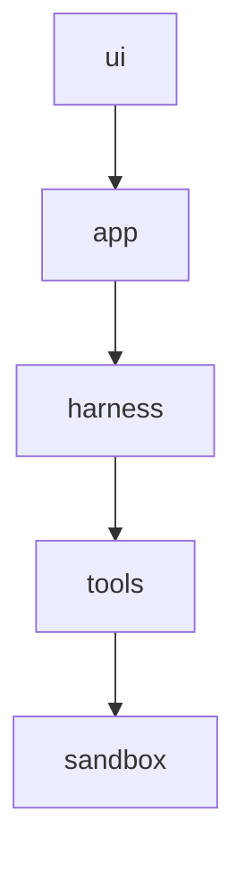
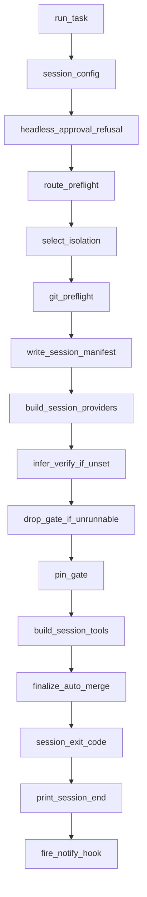
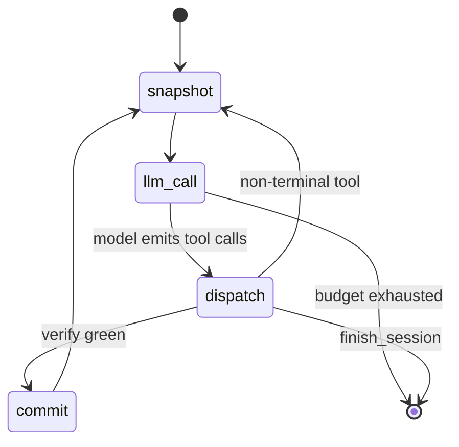
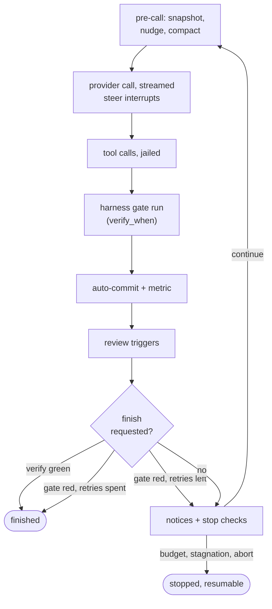
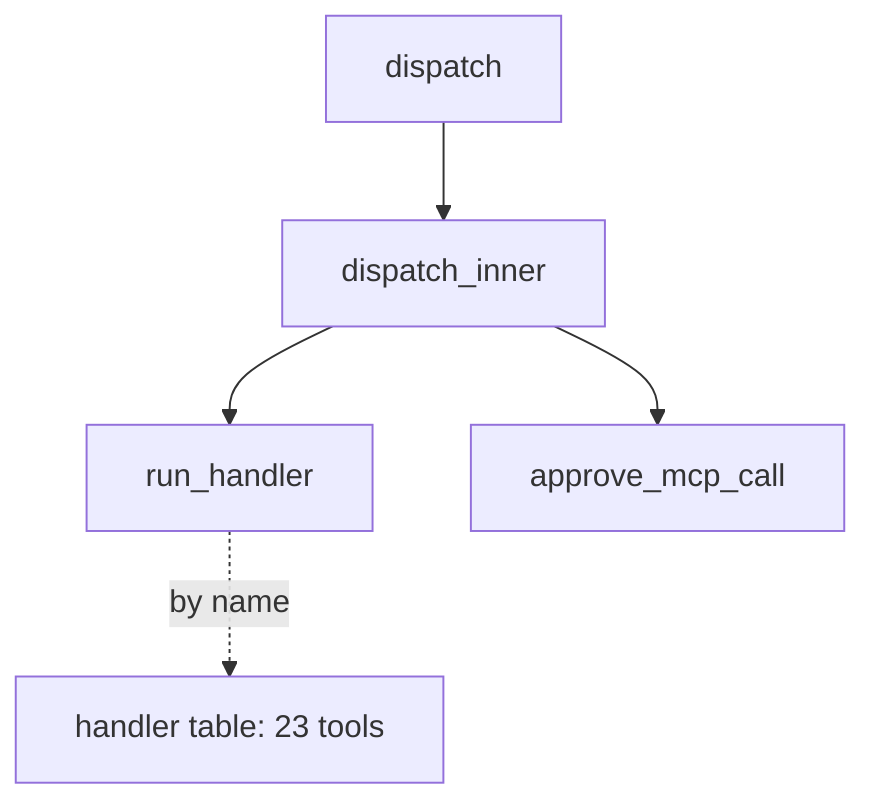
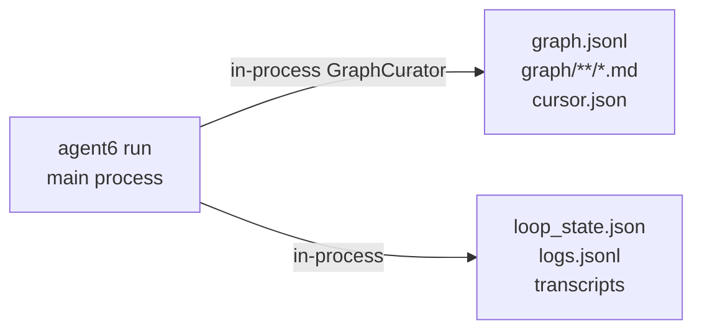

<!-- Generated from docs/architecture_template.md by docs/gen_diagrams.py; edit that, then regenerate. -->
# Architecture

How agent6 runs, end to end.
Three diagrams are built from the current source at site-build time (`docs/gen_diagrams.py`); the other three are drawn by hand, and each says so above its block.
[security.md](security.md) covers the threat model and what each isolation level enforces; [AGENTS.md](https://github.com/agent6-dev/agent6/blob/master/AGENTS.md) covers per-file conventions and stability rules.

## Layering

The engine stack is `ui -> app -> harness -> tools -> sandbox`.
An edge is "imports from"; a dashed edge would mark an import climbing the stack.
[tach](https://docs.gauge.sh/) records the map ([tach.toml](https://github.com/agent6-dev/agent6/blob/master/tach.toml)); `loop` and `review` never import each other, and the engine never imports the UI.

Any layer may also use the shared substrate: `_data`, `budget`, `child_env`, `config`, `directive`, `errors`, `event_log`, `evidence`, `graph`, `kinds`, `machine`, `memory`, `models`, `paths`, `portable`, `prompts`, `providers`, `review_records`, `secret_store`, `sessions`, `skills`, `task_text`, `terminal`, `vcs`, `verify_infer`, `viewmodel`.

The `vcs` package holds agent6's own git operations: `git_ops.py` writes, `git_read.py` queries, and `git_history.py` reads for display.
Only its modules import the runner, `_git_command.py`.
It runs each git command with a 120-second timeout.
By default, it switches off the repository's hooks, fsmonitor, external diff, textconv, commit signing, and filter and merge drivers.
`git_policy.py` holds those switches and the hook and driver policy; `errors.py` owns `GitError`.

- **ui** ([src/agent6/ui/](https://github.com/agent6-dev/agent6/tree/master/src/agent6/ui)): the presentation layer and composition root, over the shared read-model fold (`viewmodel`)
    - the four front-ends: `ui/cli`, `ui/tui`, `ui/web`, `ui/acp`
    - `ui/mcp_server.py`: agent6 as an MCP server
    - the write helpers: `ui/spawn`, `ui/notify`, `ui/steer` (the steer-file seam every front-end writes) and `ui/btw` (the side question a run answers without losing its place)
- **app** ([src/agent6/app/](https://github.com/agent6-dev/agent6/tree/master/src/agent6/app)): the pipelines composed over the engine: run/resume/fork/machine-agent lifecycles, merge and finalize, provider construction, the sandbox cross-checks (`app.confine`), the `--parallel` fan-out
    - never imports `agent6.ui`
    - what it cannot do itself (own a terminal, render, spawn detached) arrives as frozen injected callables (`SessionFrontend`, `LaneRuntime`); output goes through the injected `Reporter`
- **harness** ([src/agent6/harness/](https://github.com/agent6-dev/agent6/tree/master/src/agent6/harness)): `loop` (the agent loop behind `agent6 run` and `resume`), `code_review` (the single call behind `agent6 review`), `run_review` (the read-only pass behind `agent6 sessions review`) and the review panel (`_panel`, `_review_seat`, `_reviewer`); the agent loop makes its own provider calls inline.
  `harness/_loop_resume.py` owns snapshot carryover and persistence; `harness/_loop_steer.py` applies steering at execution boundaries.
- **tools** ([src/agent6/tools/](https://github.com/agent6-dev/agent6/tree/master/src/agent6/tools)): the fixed tool surface the LLM sees, plus dispatch.
  `harness/_toolset.py` picks the subset each mode exposes, and appends the MCP tools in the modes that edit.
- **sandbox** ([src/agent6/sandbox/](https://github.com/agent6-dev/agent6/tree/master/src/agent6/sandbox)): the `agent6-jail` launcher and its policy.
  The jail bounds commands, one launcher per run; the agent process itself is never confined.

**Where the CLI resolves things.** `ui/cli` parses arguments, optionally spawns the TUI, and picks a mode.

- `cli_main` is the one error boundary: `OperatorError` (with `ConfigError`, `MemoryStoreError`) prints an `ERROR:` refusal at exit 2; a closed output pipe (`agent6 ... | head`) ends quietly at exit 141; anything else crash-reports with a saved traceback at exit 1
- config resolves through [config/layer.py](https://github.com/agent6-dev/agent6/blob/master/src/agent6/config/layer.py) (defaults, global, per-repo, `--config FILE`, then a machine agent's per-state overlay; a selected preset sits just above the layer that named it); paths and sudo/root through [paths.py](https://github.com/agent6-dev/agent6/blob/master/src/agent6/paths.py); keys through [secrets.py](https://github.com/agent6-dev/agent6/blob/master/src/agent6/secret_store.py)
  `config/_layer_data.py` discovers and merges layers with per-leaf provenance; `config/_presets.py` selects and lists presets.
- per-repo state lives out of the workspace at `$XDG_STATE_HOME/agent6/<repo-id>/`, written `<state-dir>` below, keyed on the repository (a subdirectory reaches the same runs, memory and config, and so does a linked worktree, through its `.git` file)
- every config edit goes through [config/write.py](https://github.com/agent6-dev/agent6/blob/master/src/agent6/config/write.py): one lock-held validate + revalidate + rollback cycle, or "kept as written" when the fail-open lock was not held

Three model roles route independently: `worker` drives `run` and `resume`, `planner` drives `plan`, `reviewer` drives `review`, the in-loop panel and the loop's side calls (the context summariser and gister, the prompt reviser).
Unset roles fall back to `worker`.

## Units of work

Largest first; each unit is bounded by the one above it.

| unit | what it is | bounded by |
|---|---|---|
| machine | a state-machine instance; each of its agent states hands one task to the harness | the `.asm.toml` and its journal |
| fan-out | a `/parallel` group: N sessions on one task, compared and one imported | the coordinator's session |
| session | one task's durable record: its dir, journal, task graph, chain of commits and memory use | the id; it holds several executions |
| execution | one continuous run of the harness over a session, from a `run`, `resume` or `fork` to an end | `max_turns` and the budget cap, re-armed per execution |
| turn | one model call and everything the harness does with its answer: the tool dispatch, the advisors, the gates, the notices; a prose-only answer is a turn too; `turn` is its index | one provider call |
| tool call | one tool the model asked for inside a turn; a finish is the last one executed | one dispatch |

A step is a commit on the session's chain, taken after a turn that changed the tree (a verified step or an un-gated checkpoint).
`git.commit_per_turn` controls whether editing turns commit; the diff pane's step picker counts those commits.
`run` is the mode beside `plan` and `ask`, and the command that opens a session.

## The run lifecycle

`app/run.py`'s `run_task` composes one stage per step.
The diagram draws them in call order: refusals and clamps, the route preflight, isolation, git preflight, the manifest, provider construction, gate inference, tool assembly, the loop, then auto-merge and the end report.
The stash finalize is last because it runs from `finally`, on every exit path, refusals included.

## A run

A run keeps one message history with one provider and one model.

- the model drives by calling tools; the harness dispatches, snapshots, tracks budget
- multi-step work is the next tool call in the same conversation: no planner-to-worker handoff, no separate reviewer by default
- the in-loop review panel is opt-in (`[review]`), layered on the same history
- `_context.review_rules` loads base-tree rule blobs through `vcs.review`; `loop.review.start` records the paths, blob IDs, byte counts and completeness, shared by the panel and standalone code review
- under `api_format = "claude_code"` the provider keeps one `claude` process per execution and replays that history as text whenever a call is not a continuation of its last round ([Config](config.md))

An in-loop panel records the run base and chain commit's tree IDs, full grounded seat verdicts, and findings with durable IDs in `loop.review.*` events.
It does not capture a separate snapshot or move the operator's index, HEAD or run chain.
`harness/_review_history.py` restores those records on resume.
Only exact normalized finding content, location and the cited blob identify a repeat.
The journal keeps repeated observations even when the worker feedback omits them.
`vcs/review.py` owns diff hunk ranges and line-origin classification.
Before the panel event is written, each observation records its line origin against the immutable base and head blobs.
An exact unchanged range carries its base location and bounded blame attribution.
Unsupported files, ambiguous mappings and unavailable history carry an unknown reason.
Findings cut from the feedback notice remain eligible for a later notice.
Every execution start carries an `execution_id`, every panel has a unique `panel_id`, and every durable event has an `event_id`.
Journal append order, not timestamps, orders events.

`harness/loop.py` holds the turn: the request, the model call, the tool dispatch, what the tools did, and the ends.
What the turn leans on sits beside it, one module each: `_chain` (the run's commit chain), `_operator` (the operator's callables, the steer verbs, the pin cap, and what a steer's text means), `_advice` (what an advisor answers with, a nudge, a stop or a refusal, and the turn's context it reads), `_guards` (the advisors, one function per heuristic with its counters: no progress, settled, stagnation, the memory flip, the loop guard, the tool-error ladder, reachability, focus, the budget nudges), `_metric` (a metric run's plateau, ceiling and early-finish rules) and `_metric_sampler` (the readings a run takes), `_quiet_turns` (the nudges an empty or prose-only turn draws), `_finish_gates` (what a finish call declares, what it must satisfy and what an end is called), `_standing` (the standing goal's re-entry), `_operator_tasks` (the operator's writes to the task graph: the root, the goal, `/task` and `/retire`), `_parallel_dispatch` (the `/parallel` fan-out), `_checkpoint` (the per-turn commit and the final one), `_compactor` (the compaction driver over `_compaction`'s tier-1 rules, `_compaction_result`'s markers and caps, and `_compaction_window`'s sizing and restart rules), `_memory_touch` (what a tool call did to the memory store), and the settings each sibling owns (`_review`, `_compaction_window`, `_provider_call`, `_prompt_revision`).
The loop runs the advisors and the gates in a declared order and applies each answer; a heuristic is one function and one test file.

Drawn by hand against `harness/loop.py`, the turn as a state machine:

The same turn with its decisions, also by hand, against `harness/loop.py`'s drive tier:

**Snapshot before every call.** `loop_state.json` is rewritten in the session directory before each provider request, with a per-turn copy under `checkpoints/<NNNN>.json`.
`agent6 resume` rehydrates from `loop_state.json` and `agent6 fork --at-turn N` from the matching checkpoint.
With the per-call transcripts, an interrupted run replays deterministically up to the next model call.
A turn's tool calls and each result that returned are recorded in `turn_in_flight.json` while they dispatch.
A resume after a death there runs none of the turn's calls again: the model gets the results that returned, and one line for each other call saying it was interrupted and not re-run.

**The harness runs the gate** (`[harness].verify_when`, default `finish`).

- When `finish_session` arrives over a tree no verify verdict covers (green or red, nothing edited since), the loop runs `verify_command` itself, through the same dispatcher path as the model's `run_verify_command`, approvals included.
- A denied approval withholds the gate for the rest of the run, and the run ends unverified.
- `turn` also runs it after every editing turn; `never` leaves every run to the model.
- A pytest gate naming no paths that overruns `verify_timeout_s` (the harness's run, or the model's own unless `verify_when = "never"`) re-runs scoped to the tests nearest the run's diff.
  It stays scoped until a full run of the gate passes.
  The notice lists the selected files, `session.end` carries `scoped`, and a `finish_session` over a scoped green reads `passed · scoped gate` on every surface.
- A red finish certification returns to the model with the gate's output `verify_retries` times (default 2), then the finish stands and the run is reported finished, never passed.
- The settled stop ends a plain run after `harness.verify_settled_stop_after` consecutive idle turns (default 12) following a green verify of the run's own edits or a gateless editing step.
- A green on the untouched base tree, from the start gate or the model's own call, is the baseline's verdict and arms nothing.
- A verify run is neutral; an edit, a commit, a memory write, a tree change or an operator steer restarts the streak.
- `0` disables the stop, but the nudge at three idle turns still fires without announcing a stop; over a red gate the model must fix, the nudge is withheld while a finish would still go back.
- Over a green gate the stop reads `finished · settled` and exits 0, since the worker called no `finish_session`.
- Over a red gate it returns under the same cap, counted apart from the model's own finishes.

**Per-turn commits** fire when a gate run returns 0, through `git_ops.py` outside the jail, onto the run's detached chain (`refs/agent6/<id>/head`, temp-index staged).

- a turn no gate judged commits as a checkpoint: a gateless run, a gate nobody may run (under `run_commands = "deny"`, or after a denial), or `verify_when = "finish"` between the model's own gate runs
- `branch_per_run` also advances a visible `agent6/<id>` branch
- HEAD never moves; when the run's own branch is the checked-out one, the index and the working tree are brought forward for the paths the commit changed, each only where it still matches the old tip
- consolidation is chosen at `sessions merge` time (`git.merge_method`: `squash`, `merge`, `ff_only`)
- `[git].control = "model"` turns the block off: no chain, no run branch, the model's own commits are the record, and `sessions diff`/`commits`/`merge`, `/undo` and `fork` refuse for such a run

**The task DAG is a curator-owned side store.** `add_task` and `update_task` write it, with `depends_on` edges, cycle-checked; `list_tasks` reads it back. None of them picks the next tool.

- each turn the current task surfaces into the prompt (the cursor's subtask while it stays open, dependency-satisfied and undecomposed, else the first such subtask in tree order, else a ready standing task), advances as tasks pass, marks `in_progress`
- `finish_session` refuses while the worker's own subtasks are open, capped so an unclosable task cannot stall the run
- the surfaced banner survives tier-1 elision and re-injects after each tier-2 restart
- a focus task held without forward motion draws a split/pass/skip nudge, re-firing up to a small cap; progress resets it
- an end is final: `passed` takes only `obsolete`, and a `skipped` or `obsolete` task stays retired (needed again means a new task)

**A standing goal parks a run instead of ending it.** The operator's goal (`run --standing "<goal>"`, `/standing` on a live run) is the never-passing fallback, worked only when no ordinary subtask is ready; the model's `add_task` cannot set the flag.

- only the operator retires it: `/standing` with a new goal, or stopping the run
- while one exists, the soft out-of-work endings (`finish_session`, the settled family, a quiet turn) convert into re-entry
- faults, operator verbs, the turn cap, and a spent budget still end the run
- a re-entry round landing no executed tool call escalates the nudge; `[harness].standing_patience` bounds the streak (`-1` default: never self-ends; landed work resets)
- an interactive run parks the same way on a quiet turn: the conversation waits on the steer bridge; any composer or the pause menu continues it in place

**Context compaction has two tiers**, thresholds in `[context]`.

- tier 1, `drop_at_chars`: the oldest tool results become placeholders naming the elided call; reads of recently-edited files elide last
- a large `read_file` decays in two stages: a model-written gist first, the bare marker under continued pressure (oldest gists first); files changing under edits are never gisted
- tier 2, `summarise_at_chars`: the elided history is summarised by the `reviewer` model; the conversation restarts from the task, that summary, the pins and decisions block, and the last `keep_recent_chars` (default 80000) of history verbatim
- the DAG survives the restart: the current task re-surfaces, the summariser reports finished/new tasks (finished marked `passed`, new queued)
- compaction is visible: events carry the elisions and the restart summary, every view marks them in place, `/status` shows counts
- `/now <text>` steers at once, aborting the call in flight (the CLI's `steer --now`)
- `/compact [focus]` compacts on demand
- `/pin <text>` survives every restart verbatim and persists in the snapshot; over the 4000-char total cap the pinning is refused loudly and the text still lands as an ordinary steer

**Repo memory**: one fact per markdown file under `<state-dir>/memory/`, with an index rendered from each file's first non-empty line.
A fact file is `<name>.md` under the name rule, a regular file; any other entry in the store is ignored, and `agent6 memory list` names it.
Outside the store, `<state-dir>/decisions.md` holds the operator's rulings beside `memory-use.json`.
The harness appends every `ask_user` answer and every steer that answered a question, verbatim with its question, session and time; an identical ruling already on file is recorded once.
The model sees it first (a `<decisions>` block, re-shown after a compaction restart) and never opens or writes the file; `agent6 memory decisions` prints it.
A `memory/DECISIONS.md` with no `decisions.md` beside the store is renamed once, by the next run start, `run --parallel` or `agent6 memory` command, which says so; a run start creates an empty `decisions.md`, and a `memory/DECISIONS.md` beside one is reported and ignored, never merged.
A finish-time check reports any ruling missing from the file.

- the index injects into every run's prompt as a capped `<memory>` block; depth is a file read
- the worker writes through the ordinary edit tools under a narrow grant, in-process only; the jail never mounts it
- run mode writes; plan and ask read; machine modes see none
- models never write unprompted, so the loop sends one advisory per run, when verify first recovers green with nothing recorded; `[harness].memory_advisory = false` turns it off
- `agent6 memory add/list/show/rm` is the operator surface over the same files
- `<state-dir>/memory-use.json`, harness-written at each execution's end: per fact, the write that created it (when the record saw it), every write as a (session, when) touch in order, and its reads (count, last reader), the entry gone once the fact is deleted (by the model or `memory rm`); `memory list` prints it under each entry, so a stale or never-read fact is visible where it is pruned

**Skills** resolve at run start from `<data-dir>/skills/` plus `[skills].extra_dirs`, through one resolution: the `<skills>` index and what `use_skill` serves cannot diverge.

- `always` skills inject full text; the rest get an index line and load on demand; run mode only
- small models never call `use_skill` from the index alone; the reliable paths are `always`, `/name`, and `run --skill`

**The terminal tool** is `finish_session(summary)` in run mode and `finish_planning` in plan mode; ask mode has neither and ends on its final prose.
Either call emits a `session.end` event and returns control to the CLI.

## Tool dispatch

Every LLM tool call passes the same gates: audit events wrap it, the mode backstop refuses an out-of-surface name, MCP calls take an approval, and the handler table routes the rest by name.
Commands and verify run jailed; file tools resolve through the workspace boundary.
`tools/_command_tools.py` holds jailed execution, command check-ins, and background read and stop handlers.
`tools/dispatch.py` owns routing, approvals, verify and metric events, and the jail-session lifecycle.

Command streams lose terminal escape sequences before their 20,000-character tail cap and the model's result-byte cap.
Background reads scrub the decoded tail before selecting lines; the 1 MiB file-read cap still counts raw bytes.
The shared patterns live in `terminal.py`; command shaping preserves non-escape characters, including carriage returns, while rendering drops stray controls.
Metric scores parse raw, unclipped output, including escape bytes.

The table routes `agent6_docs`, `read_file`, `list_dir`, `outline`, `find_definition`, `find_references`, `apply_edit`, `apply_patch`, `run_verify_command`, `run_command`, `read_session`, `fetch`, `read_background`, `stop_background`, `run_metric_command`, `finish_session`, `finish_planning`, `ask_user`, `list_findings`, `add_task`, `update_task`, `list_tasks`, `use_skill`.

## A review

A single read-only pass ([harness/code_review.py](https://github.com/agent6-dev/agent6/blob/master/src/agent6/harness/code_review.py)) over a diff: the working tree, a branch against a base, or an arbitrary range.
It prints a markdown review, and makes no edits, no commits, and no `run_command`; `--reviewers N` runs the adversarial panel instead, which returns structured findings.
Either output is also saved as `<stamp>-review.md` under `<state-dir>/reviews/`, beside the provider transcripts, so a later session reads a module's review there.

[Review records](data-contracts.md#review-records) owns the shared findings, seat replies, verdicts, immutable target identifiers, observations and operator request models in `review_records.py`.

`viewmodel/review.py` folds panel evidence and finding history for both live `SessionState` updates and `scan_session_log`.
`SeatReply` and `ReviewVerdict` retain each seat's bounded risk text verbatim; the receipt labels it with the model route and uses no second model summary.
An observation opens a new finding but does not reopen a resolved one.
Only resolution and reopening events change that state.
A Fix request leaves the finding open and reads as delivery unknown until a submission or failure event arrives.
The fold retains action reasons in append order and never treats a fixed disposition as proof that verification passed.
Freshness compares both tree IDs and path coverage with an explicit requested comparison.
Without that comparison, freshness is unknown.
Legacy counts carry an unknown-evidence notice; an unreadable journal or structured record retains its error in `MergeReviewGuard`.
`app.merge.execute_merge()` enforces the guard for CLI, web, TUI and auto-merge.
It holds the existing session writer lock while re-reading the review fold, merging a pinned source commit, and recording that tip.
Auto-merge uses the lock its lifecycle already holds; live dispositions wait in the IPC queue.
An open grounded block or unreadable evidence refuses the merge with its reason.
Missing, stale and legacy count-only reviews do not block a merge.
A finding's location names a repository-relative path, a base or head side, and an optional positive, inclusive line range.
The record types do not capture Git trees or persist panel events.

`app/review_actions.py` owns Fix, Resolve and Reopen for the CLI and HTTP routes.
Live requests cross `sessions.ipc` as typed envelopes; `app/_execution.py` drains them before polling the steer bridge.
The worker checks the expected version and journals the action in append order.
Offline actions use the existing session writer lock and recheck that no worker is alive.
A repeated request ID returns its journal result or retained worker reply before checking the supplied version.
A worker refusal is final for that request ID; a new attempt needs a new ID.
Fix records its request before submitting the server-built instruction, so a crash between those writes leaves delivery unknown rather than a claimed success.
An explicit resume releases the writer lock before the injected launcher runs; the resumed worker records submission when it takes that instruction.

The web Findings card reads the same review fold as the merge guard.
`ui/web/review_routes.py` serves recorded comparisons and files from immutable tree IDs, without a checkout or private review refs.
`client_git_diff.js` owns each diff request's lifetime; `client_review.js` attaches findings through the source renderer's line attributes only when both comparison trees match.
Reviewed file links keep the panel and side, so Files reads the cited version rather than the working tree.

`agent6 sessions review <id>` ([harness/run_review.py](https://github.com/agent6-dev/agent6/blob/master/src/agent6/harness/run_review.py)) reviews a finished session's record the same way: the journal folds into a digest (the task, the steers and rulings, the verify runs, the tool errors, the harness notices, the memory facts the session wrote, the conversation's tail, every list capped and the cap named), the reviewer role reads it beside the repo's memory index, and the markdown names how the run ended, what went wrong and why, what the operator corrected, candidate memory facts and AGENTS.md lines with their evidence, and the memory entries the record contradicts.
It writes nothing to the repo or the memory: the operator turns a candidate into `agent6 memory add` or an AGENTS.md line, or leaves it.

## Parallel runs

The primitive is a task run as a subordinate isolated run whose branch joins back.
Three consumers drive it: `run --parallel`, the web and TUI composers' `/parallel` new-work directive, and a live run's `/parallel` steer.

All three share `parse_spec` in [directive.py](https://github.com/agent6-dev/agent6/blob/master/src/agent6/directive.py), a pure-stdlib leaf both `harness` and `ui` import.
It maps a lane count or model list to one model per lane.
The composers and steering use `parse_directive` to split `/parallel [SPEC --] TASK` segments ([grammar and examples](usage.md#parallel-directive)).

Before any clone, a spec's models are checked against what a lane can run.

- a lane keeps the worker's provider unless the spec names another configured one; the model is checked against what the roles name on that provider plus its cached listing ([models/validate.py](https://github.com/agent6-dev/agent6/blob/master/src/agent6/models/validate.py))
- unknown model: a miss against an existing cache re-checks that provider's live listing, and refuses with a did-you-mean only when the fresh listing confirms it; no cache, or a re-fetch that fails, proceeds with a warning (offline machines never block on a regenerable cache)
- all three consumers validate through the one helper, keeping `harness` free of a models dependency

The primitive is git plumbing in [subrun.py](https://github.com/agent6-dev/agent6/blob/master/src/agent6/harness/subrun.py), with no LLM, no UI, and no process spawning:

- `clone_workspace(origin, dest)`: a plain `git clone` of a disposable lane workspace.
- `import_run(origin, lane_repo, branch, lane_session_dir, origin_state)`: fetches the lane's branch into the origin and moves its session dir under `<origin_state>/sessions/runs/`, refusing to overwrite an existing branch or session dir.
- `LaneSpawner` / `GroupLaneSpawner`: the Protocols for dispatching one lane, or a sibling group, and awaiting completion.

[app/lanes.py](https://github.com/agent6-dev/agent6/blob/master/src/agent6/app/lanes.py) implements those Protocols: it holds the front-end's `LaneRuntime`, plans the lanes, clones, spawns, awaits and imports one lane, and builds the coordinator's `/parallel` dispatcher.
[app/parallel.py](https://github.com/agent6-dev/agent6/blob/master/src/agent6/app/parallel.py) drives the fan-out session: spawn, await, import, rank, report.
[app/_parallel_results.py](https://github.com/agent6-dev/agent6/blob/master/src/agent6/app/_parallel_results.py) imports the finished lanes, carries memory and decisions back, and stamps and prints the ranking.
[app/_workdirs.py](https://github.com/agent6-dev/agent6/blob/master/src/agent6/app/_workdirs.py) resolves `[workspace].base_dir` for clones and linked worktrees, writes lane configs, recovers orphaned lanes and removes imported or safely swept clones.
The detached spawn it drives (`ui.spawn`'s `spawn_and_locate`, the path the web and TUI hubs start a run with) is injected as a `LaneRuntime` by the CLI adapter `ui/cli/parallel.py`, and liveness probes use `sessions.process` and stop requests use the run-dir bridge (`sessions.ipc`).

**`agent6 run --parallel N|[provider/]model,...`** plans one `LaneSpec` per lane, each spawned as an ordinary detached `agent6 run` with its own jail and `run_commands` policy.

- the fan-out is a session of its own under the origin's runs, named by the fan-out id; `stop <id>` ends it with its lanes, and `resume` refuses it
    - a manifest with the fan-out stamp and no run branch
    - a journal: the dispatch, the judge's streamed `role.*` events (`role = "judge"`), `loop.parallel.compared` with the ranking and rationale, the judge's cost as its own spend, the end
    - a worker pid while the lanes run and the judge ranks them
- every lane's manifest names the session that dispatched it (`parallel.coordinator`, stamped from the spawn env), so each listing nests lanes under their coordinator, folded into a count
- each lane's live session dir symlinks into `<origin_state>/sessions/runs/` on locate: a fan-out is visible in every hub while it runs
- on completion a lane imports and the symlink becomes the real directory; a failed-to-start, still-running, or refused lane keeps its clone and symlink (never the only copy lost)
- imported candidates auto-compare into a ranked report with `sessions merge <id>` lines: a structured judge ([judge.py](https://github.com/agent6-dev/agent6/blob/master/src/agent6/harness/judge.py)) where a reviewer model exists, else verify-then-cost
- the compare stamps each lane's manifest (`compare`, one writer): every view shows placement and why; listings star the winner
- nothing merges automatically
- `--max-usd` is per lane and caps the judge like one more lane; the `$X/lane x N + judge = $Y total` line prints before spawning

**A `/parallel` steer dispatches a sibling group** through `OperatorBridge.lane_spawner`, on `Harness.bridge` (the injection point keeping `harness` from importing `ui`; `run.py`/`resume.py` wire the real spawner, run mode only).

- the loop blocks with no provider calls while lanes run, in this order:
    - expand each segment into its lanes
    - chain-commit the worktree (lanes cut from the chain tip)
    - clone, spawn, await and import the lanes
    - merge each branch onto the chain in dispatch order (`chain_merge` syncs merged files into the worktree)
- each segment gets one DAG node: `passed` with the last joined sha, or `failed` when every lane failed or conflicted; a conflict aborts that merge and tells the model; the run continues either way
- `loop.parallel.dispatched` / `joined` / `failed` render as conversation markers, so the blocked wait is visible

**Depth is 1.** Every spawned lane carries `AGENT6_SUBRUN=1`, and both `--parallel` and `build_coordinator_spawner` refuse to wire a `lane_spawner` when it is set.

## Enforcement layering

- `git_ops.py` runs outside the jail, in the agent's own process, so the read-only bind of `.git` stops the worker without stopping the harness's commits.
- `protect_git = "on"` requires `full` `sandbox.isolation` to bind-remount `.git` as read-only; `auto` is on under `full`
- Run state is out of reach of jailed commands because it lives outside the workspace, at `<state-dir>`, unreachable from the repo cwd.

[security.md](security.md) states which guarantee each layer provides.

## The curator and its locks

An in-process `GraphCurator` (`graph/curator.py`) owns the task graph; the agent constructs one per run, and the worker, the planner and the operator's own steering all mutate through it.
The same process writes the rest of the run state.
Every mutation validates against a pydantic schema before it applies.

Drawn by hand, the one writer and what it writes:

One curator per run is an invariant (two live curators cache independently; the second write drops the first's parent-child links).

- `run`/`resume`/`fork` take a single-writer flock on `<run-dir>/worker.lock`; a second process refuses
- a crashed writer releases on death: resume-after-crash never blocks
- a per-mutation flock on the session dir guards concurrent operator-CLI reads/writes
- a write-path fault after the in-memory update reloads from disk before surfacing: no read ever observes an unpersisted node

One live run-mode worker per checkout is the level above (`sessions/lock.py`, a flock on `<state-dir>/locks/<checkout-id>.lock`).
Run-mode workers share one working tree, so a second would interleave two runs' edits into each other's chain commits.
A second `agent6 run` parks.
The submitted task is saved verbatim in the new run's manifest (`parked_task`, with `parked_reason`, shown as "parked · checkout busy" in listings), and `agent6 resume <id>` starts it once the checkout is free.
The message also offers `agent6 run --worktree "<task>"`, which runs it at once in its own worktree, and a `/parallel 1 -- <task>` steer that hands it to the live run as an isolated lane.
Plan and ask expose no edit tools and spawn freely; a `run --parallel` fan-out takes no checkout lock, and its lanes work in isolated clones.

The working tree at start is the run's next gate, in the same shape.
Files that are untracked then are the operator's: the run records them (`untracked-at-start`) and neither commits them nor counts them as dirt. A resume adds the files that appeared between executions and the run cannot show it wrote, and its note names them.
An edit to one of them, or to a path git ignores, stays out of the run's commits: the edit's tool result says so (`loop.edit.left_out`), and the end summary lists the paths still on disk and absent from the commits.
After an execution that died mid-turn the rule turns over: a call of that turn may have written what appeared, so those files stay the run's, and the note names them.
Uncommitted changes to tracked files are asked about over the `ask_user` channel: stash for the run, include them in its commits, or cancel, which parks the run with `parked_reason` "uncommitted changes".
`[git].dirty_tree = "stash"` and `"include"` answer without asking, and a run nobody can answer refuses before writing a manifest, discarding the empty dir.
An included tree that is exactly an unmerged run's tip is recorded (`includes` in the manifest): when the including run merges and that run is still at the tip, it is stamped merged too (`merged.via`), so its own merge has nothing left to land.
Every end the loop reaches records the tree the run left (`session.end.tree`), and a resume applies the same policy to the paths that differ from it: those changed outside the run.
`stash` sets aside those tracked changes, including staged renames and deletions.
It refuses when the run also changed one of those paths, since stashing it would take the run's work with the edit.
A resume after a death, a detach or an older session has no recorded tree: its note names the changes no commit has, and the next commit takes them.

A resume whose merge stamp covers everything the run committed, in a checkout whose HEAD holds the landing commit, continues from HEAD (`app/_resume_chain.py`).
The chain ref and run branch only move forward: to HEAD after a `merge` or `ff_only` landing, else to a commit that joins the landed tip to HEAD's tree, so the earlier steps stay reachable for `fork --at-turn`.
The manifest's `base_sha` and the merge stamp's tip move to that commit, so `sessions diff`, `sessions commits`, the squash message, the review diff and the next merge read only the new work.
`base_branch` moves to the branch the merge landed on when the checkout has it out.
Where the workspace's HEAD does not hold the landing commit (a worktree run, a fork of a squash-merged run), the chain stays as it is and a resume moves `base_sha` alone, to the commit the next merge into `base_branch` starts from.
`app/_merge_message.py` builds the squash message from the commits after the base its own merge starts from, so it names what that merge lands.
A run branch that is not at the chain tip (a commit made on `agent6/<id>`) refuses the resume, naming the commit; `--force` continues on the chain and leaves the branch.

## Session state on disk

Each session directory is `<state-dir>/sessions/<bucket>/<session-id>/`, where the bucket is the mode plus `s`: `runs/`, `plans/`, `asks/`, and `machines/` for `machine create` authoring.
Ids are one namespace across every bucket, since every surface addresses a session by bare id.
Minting picks an id no bucket holds; `run --session-id` refuses one another bucket holds (reusing a same-bucket id is the resume or parked-start path), and `fork --session-id` refuses one any bucket holds.

| File | Holds |
|---|---|
| `manifest.json` | the run's record: the task, where it started (`base_sha`, `base_branch`), its run branch, mode, isolation, the model and preset that drove it, the caps its `--max-usd`, `--max-tokens-fallback` and `--max-plan-points` flags set, and the later stamps (`parked_task`, `compare`, fan-out and lane lineage) |
| `graph.jsonl` | append-only journal of every task-graph mutation (curator-owned) |
| `graph/**/*.md` | one markdown file per task node, nested under its parent, rewritten atomically (curator-owned) |
| `cursor.json` | the curator's current task pointer |
| `logs.jsonl` | the structured event stream |
| `loop_state.json` | the latest resume snapshot, written before each LLM call and at turn end |
| `checkpoints/<NNNN>.json` | per-turn snapshots at the pre-call boundary, carrying the run's chain tip (`head_sha`) and the curator `graph_version` |
| `turn_in_flight.json` | the turn whose tool calls are dispatching, with each result that returned; gone once the snapshot holds the turn or the execution ends itself |
| `plan.md` | the plan itself, in plan sessions |
| `transcripts/` | full provider request and response pairs for replay |
| `worker.pid` | the live worker's pid and start time; every surface reads liveness here |
| `approvals/`, `questions/` | one `<id>.answer` file per prompt, whichever front-end answers; `approvals/` also holds the session-wide allow and deny marker per scope |
| `frontends/` | one file per front-end registered to answer this run, named for its pid |
| `review-actions/` | one request and one reply file per finding action (Fix, Resolve, Reopen) a surface put to the run |
| `queue/` | the operator's queued tasks, standing goal and retirements (`/task`, `/standing`, `/retire`), read at the step boundary |
| `shells/` | the roster of background commands the run started |
| `steer.request`, `stop.request`, `compact.request` | the operator's pending asks, which the loop reads at its step boundary |
| `untracked-at-start` | the files the run treats as the operator's (repo-root-relative, NUL-separated): those untracked when it started, plus those that appeared between executions and it cannot show it wrote; left out of every chain commit and dirty check; a fork records its own checkout's set, and an `/undo` fork the set of the checkout it keeps |

`loop_state.json` is the latest pointer for resume; `checkpoints/` is the per-turn history `fork --at-turn` addresses, kept in full.
`finish_planning` is `plan.md`'s only writer and `agent6 plan edit` its only editor.
The planner re-reads it before every turn and is shown it whenever it differs from what it last saw, so answers written there survive the next `finish_planning`.
`agent6 run --from` feeds it as a new run's task.

**A fork** clones a source run's state as of a checkpoint into a new session dir with a new id, and gives it a linked git worktree of its own:

- adds the worktree detached at the turn's sha (`<[workspace].base_dir>/<repo-id>/<new>`)
- copies the checkpoint as the new `loop_state.json` and seed `checkpoints/0000.json`
- rebuilds the curator DAG at the checkpoint's `graph_version`
- writes a manifest with `parent_session_id` / `forked_from_turn` / `forked_from_sha` / `worktree` / `worktree_git_dir` (the repository git dir the worktree points into, recorded so the jail grant never depends on the worktree's own `.git` pointer)
- cuts the chain ref `refs/agent6/<new>/head` at the turn's sha, and the visible `agent6/<new>` branch there too under `[git].branch_per_run`; a plan or ask fork commits nothing and cuts neither

The source run and the operator's checkout are never mutated, and one fork edge per line lands in a per-repo `lineage.jsonl`.
`agent6 resume <new>` runs the execution in that worktree; the repository's state dir and config apply there.
The jail policy grants the recorded `worktree_git_dir` read-only, and refuses when the worktree's `.git` pointer no longer resolves to it.
The worktree's checkout lock is removed with the worktree.
The worktree shares the repository's refs, so `sessions diff|commits|merge <new>` work from the repo like any run's; `sessions prune` removes the worktree once the fork is merged, and `sessions rm <new>` removes it with the record.
An unstarted fork keeps its branch, chain ref and worktree even when its tip is reachable from the checkout's HEAD.
The manifest is the only thing that names a worktree as agent6's.
The clone sweep deletes a group dir of `lane-*` clones once the origin reaches every one of their tips, and leaves every other directory under `[workspace].base_dir` alone; a worktree two sessions name (an `/undo` fork and its source) stays while either still needs it.
A clone with no lane session record stays because a spawn timeout can leave a child alive before its first write, even after the coordinator exits.
Prune names each kept group with its reason, and for a missing lane record the command that removes it.

The rebuild (`graph/replay.py`) undoes every journal-stamped mutation newer than that version, so a fork's tasks, statuses, cursor, and journal match the turn its conversation came from.
Node content the journal never records (title, rationale, acceptance, paths) is immutable after creation and comes from the current nodes; `notes` and `updated_at` cannot be unwound and stay current.
A checkpoint whose `graph_version` is 0 or less has no version to rebuild at, so its fork copies the DAG verbatim.

A fork's tree is the repo as of that committed sha.
On a gated run, an edit not yet committed at the forked turn is absent from the fork's tree, even though the copied transcript mentions it.
The forked run picks it up by re-reading the real files.
A fork is a commit plus the conversation up to that turn; no checkpoint holds uncommitted bytes.
An `/undo` fork adds no worktree: it keeps the undone session's checkout.

## Machines

`agent6 machine` runs a journaled reducer ([machine/engine.py](https://github.com/agent6-dev/agent6/blob/master/src/agent6/machine/engine.py)): each impure step's result is validated and appended before the new blackboard replaces the old, so a restart after a crash replays the journal to rebuild state and continues live from the last completed step, and `machine replay` reproduces the same path offline with no world at all.
[machine/journal.py](https://github.com/agent6-dev/agent6/blob/master/src/agent6/machine/journal.py) owns one instance directory, `<state-dir>/machines/<id>/`: the source the run started from, `journal.jsonl`, the snapshots, and the single-writer lock.
That is a different place from the `sessions/machines/` bucket, where `machine create` authoring sessions live.
[State machines](state-machines.md) has the spec and the state kinds.

## Events

Four front-ends share one headless core: the CLI, the Textual TUI, the browser UI (`agent6 web`), and the ACP agent an editor drives.
All four fold the same event stream and render their own way.
One listing row shape (`viewmodel.summary_row`) serves `sessions list --json` and `/api/hub`, and `sessions show --json` names the state with the same `status` word.
Two shared layers sit under them.

- the read side, [viewmodel/](https://github.com/agent6-dev/agent6/tree/master/src/agent6/viewmodel): the `SessionState` and `MachineState` fold plus its wire form, exactly what `agent6 attach --json` and the web endpoints emit
- tolerant session journal scan: `viewmodel/_session_log.py`; shared labels and status decisions: `viewmodel/_session_status.py`; directory discovery and listing rows: `viewmodel/listing.py`; the review queue's groups: `viewmodel/review_queue.py`; the telemetry projection: `viewmodel/telemetry.py` folds, `viewmodel/telemetry_records.py` holds the spans, log records and open work, `viewmodel/telemetry_metrics.py` the metric table and meter
- session view records: `viewmodel/_state_types.py`; status, context usage and wire rendering: `viewmodel/_state_view.py`; event handling stays in `viewmodel/state.py`
- machine execution and spend reads: `viewmodel/_machine_logs.py`; watcher cursors: `viewmodel/_machine_watch.py`; journal folding, probes and verb refusals: `viewmodel/machine_state.py`
- transcript event ordering: `viewmodel/transcript.py`; tool previews and marker text: `viewmodel/_transcript_text.py`
- the write side: [ui/spawn.py](https://github.com/agent6-dev/agent6/blob/master/src/agent6/ui/spawn.py) for detached spawns, and [sessions/ipc.py](https://github.com/agent6-dev/agent6/blob/master/src/agent6/sessions/ipc.py) for the approval, question, finding-action, task-queue, steer, stop-request and compact-request file contract the harness polls
- process identities, worker and network pid records, and front-end claims: `sessions/process.py`, shared by the bridge and its callers

A run started from a hub, or detached mid-run with `/detach`, keeps going with no terminal on it (`ui/spawn.py`); `agent6 attach <id>` opens it again, tailing the same journal every other surface folds.

**Stopping a run** is one function ([app/stop.py](https://github.com/agent6-dev/agent6/blob/master/src/agent6/app/stop.py)) behind `agent6 stop`, the TUI's Run menu, `/stop` in every composer, the web stop route and an ACP cancel.

- It writes an abort steer, which cuts a model call in flight, and the `stop.request` marker with its `now` urgency, which ends a running foreground command at once.
  Unless it is request-only, it waits for the run to end.
- The loop logs `operator stop during step N` and the `stopped` end block says `operator stopped the run during step N`; both add `running command was cut short` when the stop ended a running command, or `model call was cut short` when it cut the model call.
- A worker still alive after that wait (5 s for a run, 30 s for a fan-out draining its lanes) gets SIGTERM and, 3 s later, SIGKILL, along with the background commands it started on the host.
- A run's worker and a fan-out's coordinator take the SIGTERM as a Ctrl-C stop (an `interrupted` end at exit 130).
- Every target is named by process identity (pid plus start time), so a recycled pid is never signalled.
- `--after-step` writes the plain marker alone, so the step's running command finishes (or reaches `[harness].command_checkin_s`) and its tool results and auto-commit land first.
- While that marker is pending on a live run, every listing's status adds `stopping after this step` (`running · stopping after this step` on `sessions`, `sessions show`, `ps`, the TUI hub and the web list); a starting or waiting run keeps its own detail beside it.
- The end block then says `operator stopped the run after step N`.
- A fan-out stops its lanes with the `now` marker.
- An ACP cancel is request-only: it writes both requests without waiting for or signalling the worker, which is the ACP server itself.
- An immediate stop ends a foreground `run_command` the launcher hands back.
  Its tool result carries `stopped_by_operator: true` and the output so far, without `still_running` or `background_id`, so the conversation a resume reads says the stop ended the command.
- A check-in with no immediate stop still returns a running command and its background id.

`evidence.VerificationEvidence` records each configured verification attempt, including harness-started attempts, with its ID, execution, command, scope, before and after trees, outcome and capture limits.
`VerifyVerdict` and `SessionSnapshot` carry the final verification ID and tested tree across resume.
A pass covers the final tree only when both observations and the end tree match; commit identity alone does not invalidate unchanged content.
`viewmodel/receipt.py` derives `ReceiptView` from the journal and manifest, with no second receipt file or duplicate event.
The CLI `sessions receipt`, web receipt route, TUI screen and ACP `/receipt` read that view without a provider call or verification run.
`VerifyRun` in `harness/run_review.py` retains IDs, trees and capture facts in the bounded digest supplied to `sessions review`.

The manifest's optional `MergeStamp.method` and `target_before` own reversal bounds.
`RevertPlan` uses those facts and `vcs/commit_graph.py` to check parents and enumerate landed commits without depending on source refs.
Missing evidence yields guidance rather than guessed git commands; the receipt's reversal action opens existing new-work controls.
See [Session receipts](usage.md#session-receipts) for output caps and reversal limits.

The journal is durable by contract.
An append failure on anything but the streaming deltas stops the run loudly (`EventWriteError`), and in-process listeners see an event only after its write landed.

The `logs.jsonl` vocabulary is small and stable, and is the data contract for any external viewer.
[Data contracts](data-contracts.md) owns the typed event union the fold parses these into.

| Event | Notable fields |
| --- | --- |
| `session.start` | `user_task` |
| `loop.resume.start` | the execution a `resume` opens: `session_id`, `mode`, `turn`, `messages` |
| `loop.resume.interrupted` | the resumed execution found a turn its predecessor died in: `turn`, and `tools`, the calls that never returned and are not re-run |
| `tool.call` / `.result` | `name`, `args` (preview), `ok`, `summary`; a pair for every dispatched tool, including one a guard rejects (`ok=false` with the reason), so no call is unaccounted for. Execution tools also carry capped `stdout_tail` / `stderr_tail`; a `run_command` ended by an immediate operator stop carries `stopped_by_operator: true` |
| `verify.start` / `.end` | `verify_id`, `execution_id`, command, scope, selected paths, timeout and `tree_before`; end adds `tree_after`, outcome, exit code, duration, 2,000-character stdout and stderr tails and nullable truncation flags |
| `loop.decision.recorded` / `loop.decision.unrecorded` | an operator ruling appended to `decisions.md` (`question`, `answer`, clipped), or one the harness could not write / found missing at finish (`error` or `missing`) |
| `loop.verify_inferred` | `command` (argv, `[]` if none), `source` (`resumed`: an adopted gate carried into a new execution; `agents_md`; a repo signal: `verify.sh`, `package.json`, `Makefile:<target>`, `pyproject`, `Cargo.toml`, `go.mod` or `test_*.py`; `llm`; `none`; `disabled`; `unadopted`), and `adopted_at` when a gateless run adopts one mid-run or drops an adopted gate that cannot run (`command: []`, `source: unadopted`) |
| `role.call` | `role`, `model`, `provider`, `model_call_id` (shared with its result), `seat_index` under a review panel |
| `role.result` | `role`, `model`, `provider`, `model_call_id`, `seat_index` under a review panel, `ok`, `text`, `tokens_in`, `tokens_out`, `cache_read`, `cache_creation`, `stop_reason`; a failure carries `error` (the reason, clipped) instead |
| `role.text_delta` | streamed assistant text chunk |
| `role.thinking_delta` | streamed reasoning chunk |
| `session.steer_requested` | `source` (`"sigint"`): mid-run Ctrl-C |
| `session.undone` | `/undo`: the turn taken back and the fork that continues from it |
| `btw.opened` / `.answered` | a `/btw` side question and its answer block |
| `command.backgrounded` | a `run_command` handed back at its check-in as a background job (`id`, `pid`, `seconds`), not one ended by an immediate stop |
| `metric.start` / `.end` | `cmd` (argv); the end adds `exit_code`, `duration_s`, `*_tail`, `score` |
| `jail.degraded` | `detail`: the sandbox came up weaker than asked, or a process survived the sweep at the run's jail session or a spawned MCP server's close |
| `workspace.setup` | the setup command of a session's own worktree or clone finished: `cmd` (argv), `exit_code`, `duration_s`, `exec_failed`, `stdout_tail` and `stderr_tail` (up to 2,000 characters each); one per workspace, since the manifest's `workspace_set_up` keeps a resume from running it again |
| `mcp.server_unavailable` | a configured MCP server that did not start; the run continues without it |
| `budget.update` | input/output token totals, the cached read and creation totals, and the fallback cap, plus `usd_total`, `usd_partial`, `usd_cap`, `tokens_unmetered`, and the plan meter (`plan_used_percent`, `plan_consumed`, `plan_cap`, `plan_resets_at`) |
| `approval.prompt` / `.answer` | `id`, `prompt`, `standing`, `call_id` (the gated tool call; null for a verify the harness runs itself) / `id`, `approved`, `source` (`stdin`, `frontend`, `await-frontend`, `away-deny`, `session`, `headless`, `acp`) |
| `question.prompt` / `.answer` | `id`, `questions` (each `question`, `options`), `call_id` (null for the dirty-tree start question), `wait` (false for a queued question, answered later) / `id`, `answers` (aligned to the questions; an unanswered one is `""`), `source` (`stdin`, `frontend`, `await-frontend`, `away-deny`, `headless-default`, `headless`, `acp`, `late`: a queued question's answers taken at a turn boundary, in a park or at a resume's opening), `unseen` (nobody could answer and nothing is queued; the listings count these for the current execution): the `ask_user` tool and the start question |
| `diff.updated` | what a chain commit changed: `sha` and its `patch`, capped at 8000 bytes; every fold counts commits and shows the latest diff from this event alone |
| `graph.update` | the task DAG after this turn: `nodes` (title, status, parent_id, children, created_by, standing), `cursor` |
| `loop.task.queued` | a task the operator added to a live run (`/task`): `id`, `title` |
| `loop.standing.set` | the standing goal the operator set mid-run (`/standing`): `id`, `title` |
| `loop.task.retired` | a task the operator dropped from the graph (`/retire`): `id`, `title` |
| `loop.request.refused` | a `/task`, `/standing` or `/retire` the run could not apply: `kind`, `text`, `error` |
| `loop.*` | agent progress: `loop.auto_commit`, `loop.compact.*`, `loop.edit.left_out`, `loop.metric.*`, `loop.parallel.dispatched` / `.joined` / `.failed` / `.compared`, `loop.review.*`, `loop.operator.presence` (the operator's presence as told to the model), `loop.question.delivered` (queued questions' answers delivered, `ids`), `loop.steer.*` |
| `loop.budget` | per-turn usage heartbeat; the fold keeps only its timestamp (the idle anchor) and reads totals from `budget.update` |
| `loop.review.finding.*` / `loop.review.fix.*` | `resolved` / `reopened` retain the reason and disposition; `requested` retains the target and delivery action; `submitted` names the destination execution; `failed` retains the delivery error. Each carries the finding ID, request ID, source and resulting review version |
| `loop.review.*` | `start` (panel and execution IDs, trigger, target, resolved seats), `seat` (indexed full grounded verdict, summary, verbatim risk, error), `panel` (target, finding observations, injected IDs, blocking decision, completion), `skipped` (identity, reason), and the finish gate's rejections |
| `session.end` | `reason`, `turns`, `all_passed` (true = final tree observed verify-green, or a plan or ask that finished clean; false = not green; null = a run no verify command gated), `scoped` (true = the gate that judged the tree ran scoped to the tests nearest the diff; a verify-green end carries it), `verified` (the gate's word for the final tree, on every end the loop writes: `passed`, `failed`, `unverified` or `not_applicable`; `sessions show` prints it and `sessions merge` warns on `failed` and `unverified`), `final_verify_id` (the final observation, including unsuccessful attempts), `tree` (a run's end the loop reached: the tree id of the working tree it left, with no commit made for it); a `setup_command_failed` end also carries `summary` (the failure diagnostic and output tail, including the no-route-out line when it applies); one shape from every exit path |
| `session.stranded` | written after `session.end` when a finished run left its edits uncommitted and no commit landed (exit `5`); the status every surface prints then reads `not committed` |

A `run_command` approval publishes as `approval.prompt`.

- one gate (`tools/operator_prompts.py`, held by the dispatcher) mints the ids and journals every prompt/answer pair, whichever front-end answers; a front-end's approver and questioner only answer and name their source
- the TUI's Allow/Deny writes the literal choice to `approvals/<id>.answer`; the gate clears that slot before journaling the prompt, and the approver reads it before the gate records `approval.answer`
- the transcript fold marks the call a prompt's `call_id` names as awaiting (`sessions show`, the web and TUI conversation, ACP's `pending`)
- the asking side decides what a choice grants: each prompt names its "allow all" scope (`command`, or one MCP server), and standing answers record per scope
- a no-standing gate sets `standing: false`, and no front-end shows the button
- the answer poll falls back headless (stdin, or deny for a machine state) only after the front-end stays dead 30 consecutive seconds
    - a page reload or a locked phone never converts a pending approval into a deny
- a watching browser registers as the run's answer front-end; prompts bridge to the page
- the task DAG rides as `graph.update` (`nodes`: title, status, parent_id, children, created_by, standing; `cursor`), once per turn that mutated the DAG, plus the root seed, a surfaced task, the finish auto-pass, the compaction check-off and each parallel stamp; every mutation is curator-owned in `graph.jsonl`, read via `sessions graph`

## Where things live

| Concern | File or directory |
| --- | --- |
| Config schema | [config/](https://github.com/agent6-dev/agent6/tree/master/src/agent6/config) (`model.py` holds `Config` and the model roles; each section has its own module: `_sandbox.py`, `_harness.py`, `_git.py`, `_surfaces.py`, `_providers.py`) |
| Tool surface | [tools/schema.py](https://github.com/agent6-dev/agent6/blob/master/src/agent6/tools/schema.py) |
| Tool dispatch | [tools/dispatch.py](https://github.com/agent6-dev/agent6/blob/master/src/agent6/tools/dispatch.py) |
| Agent loop | [harness/loop.py](https://github.com/agent6-dev/agent6/blob/master/src/agent6/harness/loop.py) |
| Prompt text | [prompts/](https://github.com/agent6-dev/agent6/tree/master/src/agent6/prompts) (pure strings the loop, review, judge, and machine assemble; `revision.py` holds the loop's prompt-revision, summariser, gist and restart-notice prompts) |
| Review pass | [harness/code_review.py](https://github.com/agent6-dev/agent6/blob/master/src/agent6/harness/code_review.py); the panel is `harness/_panel.py`, `harness/_review_seat.py` and `harness/_reviewer.py` |
| Jail sessions and detached jobs | [sandbox/jail_session.py](https://github.com/agent6-dev/agent6/blob/master/src/agent6/sandbox/jail_session.py), [sandbox/jail_jobs.py](https://github.com/agent6-dev/agent6/blob/master/src/agent6/sandbox/jail_jobs.py) |
| Jail launcher | [sandbox/jail.py](https://github.com/agent6-dev/agent6/blob/master/src/agent6/sandbox/jail.py) (Python), [jail/src/main.rs](https://github.com/agent6-dev/agent6/blob/master/src/agent6/jail/src/main.rs) (Rust) |
| Git policy | [git_policy.py](https://github.com/agent6-dev/agent6/blob/master/src/agent6/vcs/git_policy.py) |
| Subordinate-run primitive | [harness/subrun.py](https://github.com/agent6-dev/agent6/blob/master/src/agent6/harness/subrun.py) |
| Run-dir single-writer lock | [sessions/lock.py](https://github.com/agent6-dev/agent6/blob/master/src/agent6/sessions/lock.py) |
| Compare judge | [harness/judge.py](https://github.com/agent6-dev/agent6/blob/master/src/agent6/harness/judge.py) |
| Fan-out orchestrator | [app/parallel.py](https://github.com/agent6-dev/agent6/blob/master/src/agent6/app/parallel.py) (pipeline), [app/lanes.py](https://github.com/agent6-dev/agent6/blob/master/src/agent6/app/lanes.py) (lanes), [app/_parallel_results.py](https://github.com/agent6-dev/agent6/blob/master/src/agent6/app/_parallel_results.py) (import and comparison reporting), [app/_workdirs.py](https://github.com/agent6-dev/agent6/blob/master/src/agent6/app/_workdirs.py) (working directories), [ui/cli/parallel.py](https://github.com/agent6-dev/agent6/blob/master/src/agent6/ui/cli/parallel.py) (CLI adapter) |
| Provider clients | [providers/](https://github.com/agent6-dev/agent6/tree/master/src/agent6/providers) (`claude_code.py` orchestrates rounds; `_claude_code_protocol.py` handles control messages and tool continuations; `_claude_code_session.py` owns session state and pipe I/O; `_claude_code_stream.py` folds stream events and scrubs email; `_claude_code_wire.py` holds wire shapes) |
| Task graph | [graph/](https://github.com/agent6-dev/agent6/tree/master/src/agent6/graph) |
| Event log and fold | [event_log.py](https://github.com/agent6-dev/agent6/blob/master/src/agent6/event_log.py) (writer), [viewmodel/](https://github.com/agent6-dev/agent6/tree/master/src/agent6/viewmodel) (fold) |
| Front-end write bridge | [ui/spawn.py](https://github.com/agent6-dev/agent6/blob/master/src/agent6/ui/spawn.py), [ui/notify.py](https://github.com/agent6-dev/agent6/blob/master/src/agent6/ui/notify.py), [sessions/ipc.py](https://github.com/agent6-dev/agent6/blob/master/src/agent6/sessions/ipc.py) |
| Telemetry export | [ui/telemetry/](https://github.com/agent6-dev/agent6/tree/master/src/agent6/ui/telemetry): the journal reader that encodes `viewmodel/telemetry.py` as OTLP JSON and Prometheus text, started by `agent6 telemetry export` |
| Web UI | [ui/web/](https://github.com/agent6-dev/agent6/tree/master/src/agent6/ui/web) (stdlib HTTP server and one embedded page) |
| Repo memory | [memory.py](https://github.com/agent6-dev/agent6/blob/master/src/agent6/memory.py) (store), `<state-dir>/memory/` (data) |
| Machine engine | [machine/engine.py](https://github.com/agent6-dev/agent6/blob/master/src/agent6/machine/engine.py) (replay and live loop), [machine/_execution.py](https://github.com/agent6-dev/agent6/blob/master/src/agent6/machine/_execution.py) (state execution and reducer), [machine/_contracts.py](https://github.com/agent6-dev/agent6/blob/master/src/agent6/machine/_contracts.py) (world protocol and execution records), [machine/journal.py](https://github.com/agent6-dev/agent6/blob/master/src/agent6/machine/journal.py) (journal and instance dir) |

## Bench and development switches

These env vars are switches for benchmark arms, harness experiments and debugging, listed here so no behaviour keys off undocumented state:

- `AGENT6_SYMBOL_TOOLS`: selects a symbol-tool arm, hiding part of the navigation surface; a call to a hidden tool says so.
- `AGENT6_DISABLE_APPLY_EDIT=1`: withholds `apply_edit`, forcing the patch path; the refusal names the switch.
- `AGENT6_REASONING_EFFORT`: a default reasoning effort for OpenAI-compatible reasoning models, below any configured `[models.<role>].effort`.
- `AGENT6_FORCE_STREAM=1`: streams the run's reasoning to stderr with no TTY, for a bench or CI log.
- `AGENT6_DEBUG=1`: re-raises an unexpected error with its traceback instead of writing a crash-report file, and prints the notices a run would keep to its log.

agent6 also sets markers for its own children:

- `AGENT6_SUBRUN=1`: subordinate work (a lane, a machine state, a `/btw` question), which never fans out itself ([Parallel runs](#parallel-runs)).
- `AGENT6_STREAM_TO_LOG=1`: a detached spawn or lane emits its stream deltas as events with no console echo.
- `AGENT6_PARALLEL_LINEAGE=<coordinator>:<group>:<lane>`: the lineage a lane's manifest records.

## Pre-1.0 stability

Every public shape (config TOML, IPC frames, the on-disk graph, CLI flags, transcript layout) is liquid until 1.0; a change breaks the old shape and carries no shim.
See [AGENTS.md](https://github.com/agent6-dev/agent6/blob/master/AGENTS.md).
