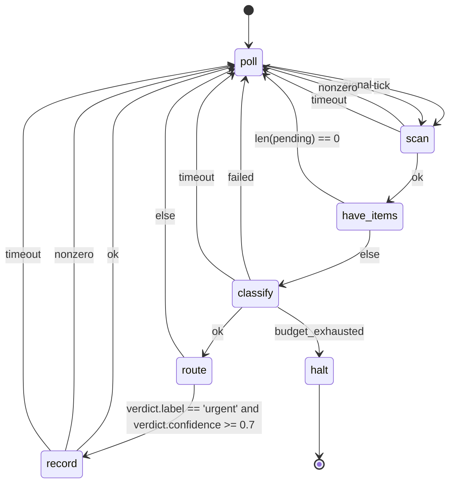

# Agent state machines

An agent state machine is a declarative, human-editable, machine-parseable program whose building blocks are agent6 runs, sandboxed tool calls, timed waits, and branches.
It lets an operator compose small deterministic agents that run for a long time, and agent6 is the runner.

This document specifies the format and its runtime.
The runtime lives under `src/agent6/machine/` (the engine and the format), with the lifecycles around it in `src/agent6/app/machine*`.
The `agent6 machine` subcommands drive it: `list`, `create`, `check`, `test`, `graph`, `run`, `status`, `poke`, `stop`, and `replay` ([CLI surface](#7-cli-surface)).
It changes neither the security model nor the tool surface [AGENTS.md](https://github.com/agent6-dev/agent6/blob/master/AGENTS.md) binds; [Security considerations](#9-security-considerations) records how each invariant holds.

---

## 1. Motivation

`run` and `review` are single-shot.
A machine expresses the long-running shape: timed polling, branches on agent output, side-effecting steps, and terminal states.
The operator authors the flow as a static graph, and the LLM works inside one state at a time.
The same inputs take the same path, and a crash loses no state: the snapshot-and-replay posture `run` has internally, one layer up.

---

## 2. Non-goals

- Not a general programming language
    - the branch/predicate grammar is non-Turing-complete: no loops inside a predicate, no arbitrary code
    - loops exist only as graph edges
- Not a distributed scheduler
    - one supervisor process per machine (systemd / cron-friendly), each `agent` state a child process; restartable
    - one active state at a time; compose by running independent machines
- Not a new network surface
    - anything that talks to the outside world is a *tool*, gated by the existing audit rules
- Not run unreviewed
    - `machine create` may draft a machine; in a repository `machine run` refuses the draft until the operator commits it

---

## 3. Design principles

- **Control flow is static and operator-owned; work is dynamic and model-owned**
    - the graph of states/edges is fixed at author time
    - inside an `agent` state runs the usual agent6 loop
- **Authored in a text editor**
    - TOML: diff-friendly, commentable
    - a state can *be* an agent6 run, so mini-agents are wired together rather than written in Python
- **Everything nondeterministic is journaled as a fact**
    - wall-clock reads, tool stdout, agent outputs: appended to an immutable event log once observed and reduced
    - the engine is a pure reducer over `(machine, blackboard, event) → blackboard'`
    - replay reads the journal instead of re-observing the world: a run backtests offline
- **Fail loudly** (repo convention)
    - one file parses to one validated machine or a precise error
    - a missing transition target, an unreachable state, a blackboard type mismatch, an unknown key: load-time errors
- **No implicit defaults** (mirrors `Config`: `extra="forbid", frozen=True`)
    - every variable declares a type and an explicit initial value (`value` for `[vars.operator]`, `default` for mutable `[vars.code]`/`[vars.agent]`)
    - every state declares every outcome edge it can produce

---

## 4. The format

A machine is a single TOML file, suffix `.asm.toml` ("agent6 state machine").
TOML because the project already standardizes on it and `tomllib` parses it.
The parsed document is validated by a pydantic v2 model at the trust boundary (`extra="forbid", frozen=True`), like `Config`.

> **Naming.** `load_machine` accepts any path; shell completion globs `*.asm.toml`.

### 4.1 Top-level shape

```toml
machine = "item-classifier"                # stable id; names the instance dir
version = 1                                # schema version; bumped on changes
initial = "poll"                           # name of the entry state

[budget]                  # required; max_transitions always binds
max_usd         = 25.0    # optional cap on metered spend (Spend bounds, section 9)
max_transitions = 100000  # hard stop on total edges taken (runaway guard)

# The blackboard is three subtables, named by who may write each variable.
# The subtable header is the owner; there is no per-entry discriminator.
[vars.operator]           # written at author time; immutable at runtime
inbox_dir = { type = "str", value = "/srv/inbox" }
poll_secs = { type = "int", value = 300 }

[vars.code]               # written deterministically by a tool state's capture
pending = { type = "list[str]", default = [] }
cursor  = { type = "str",       default = "" }

[vars.agent]              # written by an agent state's validated finish_session
verdict = { type = "classification", default = {} }  # a [schemas.*] record type

[schemas.<name>]          # named record types; see 4.6
...

[states.<name>]           # one table per state; see 4.3
...
```

### 4.2 The blackboard: three owners

The key/value store is split into three subtables, named by who may write each variable.
The subtable header carries the owner, so who may write a value is checkable at load time.

| subtable          | written by                                        | mutability        | declared with | example |
|-------------------|---------------------------------------------------|-------------------|---------------|---------|
| `[vars.operator]` | the human, at author time                         | immutable at runtime | `value`    | `inbox_dir`, `poll_secs`, thresholds, an API base |
| `[vars.code]`     | a `tool` state's `capture`                         | mutable (deterministic) | `default` | `pending`, `cursor` |
| `[vars.agent]`    | an `agent` state's validated `finish_session` payload | mutable (LLM)     | `default`     | `verdict` (a `[schemas.*]` record) |

Only `tool` states (into `[vars.code]`) and `agent` states (into `[vars.agent]`) ever mutate the blackboard; `branch`/`wait`/`terminal` only route, sleep, or end.

- **`[vars.operator]`**: the machine's parameters, set once at author/commit time, never written by any state
    - declared with a concrete `value` (not a `default`)
    - a `capture`/`set` targeting an operator var is a load-time error
    - any JSON-serializable value; the names above are illustrative
- **`[vars.code]`**: change only as a pure function of journaled tool output (what keeps the path deterministic and replayable)
- **`[vars.agent]`**: change only through the single validated structured output of one `agent` state (the LLM's one sanctioned channel into the blackboard)

`machine check` enforces the ownership wall.

- a `tool` capture targets only `[vars.code]`; an `agent` capture only `[vars.agent]`; `[vars.operator]` is read-only to every state
- a `tool` cannot smuggle a write into an LLM-owned variable; an agent cannot overwrite a deterministic one

Allowed types (all three subtables): `str`, `int`, `float` (finite: `nan` and `inf` refuse), `bool`, `list[<scalar>]`, `json`, and any **named record type** declared in `[schemas.*]` (see [Record schemas](#46-record-schemas-schemas)).
The two structured types differ on one axis, **navigability**:

- `json` is an **opaque** blob: read or written wholesale only
    - passable to a tool/agent (`{{ x | json }}`) or captured whole, never dotted (`x.key` on `json` is a load-time error)
    - use it only when the machine never inspects the value's internals
- a **record type** (e.g. `classification`) is **navigable**
    - every `.field` read in a predicate or template checks against the schema at `machine check` time
    - a misspelled field is a load error

Declared types make branch predicates statically type-checkable: scalars by their declared type, record fields by their schema, and `json` forbidden from being dotted at all.

The blackboard (all three subtables) is the *only* state that flows between states.
The whole blackboard is snapshotted to disk after every transition; `[vars.operator]` is fixed for the life of the machine.

### 4.3 State kinds

Every state has a `kind`.

| kind       | what it does                                              | outcome labels (edges)               |
|------------|-----------------------------------------------------------|--------------------------------------|
| `agent`    | runs one agent6 loop (a `Harness`) on a prompt           | `ok` · `failed` · `budget_exhausted` · `timeout` |
| `tool`     | one sandboxed command via `run_in_jail`                   | `ok` · `nonzero` · `timeout`         |
| `wait`     | sleeps until a wall-clock tick or an external signal      | `tick` · `signal`                    |
| `branch`   | pure predicate over the blackboard → next state           | (chooses a `goto` directly)          |
| `terminal` | ends the machine                                          | (none; absorbing)                    |

- outcome labels are a fixed enum per kind, produced deterministically by the state executor
- a non-terminal, non-branch state declares `on = { ... }` mapping *every* label its kind can emit to a target; an omitted label is a load error
- the edge taken is a pure function of the closed label set

#### `agent`

```toml
[states.classify]
kind   = "agent"
prompt = """
Classify the item at path {{ cursor }}.
Call finish_session with JSON {label, confidence}.
"""
output_schema = "classification"   # a [schemas.*] entry; validates the payload
capture = { finish_json = "verdict" }   # payload -> blackboard var `verdict`
timeout_s = 600
on = { ok = "route", failed = "poll", timeout = "poll", budget_exhausted = "halt" }

# mode = "agent"                   # "agent" (default, read-only) | "run"
# max_usd = 1.5                    # this agent slice's metered-spend cap

# [states.classify.config.models.worker]   # this state's model; unset: your worker model
# provider = "anthropic"           # which [providers.*] entry backs this call
# model = "claude-haiku-4-5"
# effort = "high"                  # off | low | medium | high | xhigh | max
# temperature = 0.2

# [states.classify.config.budget]
# max_tokens_fallback = 100000     # this slice's unmetered-token cap (-1/0/>0)

# [states.classify.config.harness] # any other config key, for this state only
# max_turns = 20
```

An `agent` state spins up a normal agent6 run: its own snapshot dir, transcript, budget slice, jail.

- its only control-flow signal is the outcome label
- its structured product is the `finish_session` payload, validated against `output_schema`, captured into the blackboard
    - the state's task states the contract (the schema rendered field by field)
    - the loop refuses a non-conforming `finish_session` with the problems, so the model retries in-run; the engine's own validation of the recorded payload stays the authority
- the LLM cannot pick the next state; it populates variables a downstream `branch` reads

`mode` chooses the tool surface.

- `"agent"` (default): a read-only, structured-output loop: the read and navigation tools plus `finish_session`
    - withheld: `apply_edit`, `apply_patch`, `run_command`, `run_verify_command`, `run_metric_command`, `read_session`, `list_findings`, `fetch`, `read_background` and `stop_background`
- `"run"`: real coding work (edit + verify + commit tools), as `agent6 run` has

Where a run state's work lands:

- each run state executes in a fresh clone (the `--parallel` lane mechanism, `[workspace].base_dir` cache) checked out at the machine chain's tip
- its commits land per state on the visible `agent6/machine-<id>` branch; your checkout is never touched
- merge the branch when you want the work (the run's ending names it and the `git merge` line)
- the hub's machine card shows supervision state only; each run state is a session of its own in the [review queue](usage.md#the-review-queue), and merge eligibility is that run's, never the machine's
- a state's clone is removed as it lands, so nothing is left for `sessions prune` to sweep
- the chain ref (`refs/agent6/machine-<id>/head`) outlives the instance dir
    - a fresh instance over a leftover chain starts from HEAD once the chain's tip is in HEAD, dropping the ref
    - while the tip is not in HEAD it refuses, naming the merge and delete remedies
    - a branch left without its ref is an ordinary branch, and the instance starts from HEAD
- a machine with run states works its own tree everywhere: `tool` and read-only agent states also run in fresh clones at the chain tip
    - setup comes from `[workspace].setup_command`, else the AGENTS.md block at `machine.begin.base_commit` (the commit the machine started from), never the writable chain tip
    - setup runs per tool call, in each fresh clone, and gets the state's `timeout_s` before the tool receives its own `timeout_s`; setup time adds to the state's elapsed time
    - each clone runs the [workspace setup command](usage.md#isolated-workspaces) before the state executes; setup output tails, argv, exit code and duration are recorded as `workspace.setup` events in the instance's `states/<step>-<state>/logs.jsonl`, bounded by `machine.state_log_keep`
    - a failed setup command takes the tool state's `nonzero` edge (`timeout` for a timed-out setup); clone or jail host failures abort the machine instead
    - an agent state's failed setup command returns `setup_command_failed`
    - [setup approval policy](security.md#4-commands-and-environment) is checked at preflight
    - setup runs under the tool state's network with none of its `pass_env`: the file it runs is the tree's at the chain tip, which a run state can edit
    - instances started before `machine.begin.base_commit` was recorded must restart using the refusal's fresh-start remedy; this pre-alpha format has no compatibility shim
    - an edit-then-check loop sees the committed work with no plumbing
- a `tool` state's tree writes are scratch, discarded with its clone; durable output goes to the blackboard or `$AGENT6_MACHINE_DATA_DIR`
- a machine with no run states runs its tool states in your checkout, unchanged
- states are sequential continuations of the branch (each starts from the previous state's tree); lanes are parallel alternatives cut at base
- a `mode = "run"` state still returns only its outcome label and `finish_session` payload
- `machine run` resolves a git commit identity up front (`[git.commit]` or the repo's git config) and hands it to each run state as its `[git.commit]`, so the state's commits and a jailed `git commit` carry it; the supervisor's own environment never does

`run_command` in a `mode = "run"` state is gated by `sandbox.run_commands`:

- under the default `ask`, an unattended machine auto-denies every call (`machine run` warns up front when a `mode = "run"` state would hit this)
- a machine spawned from the web or TUI hub parks each approval and question for the front-end (the spawn carries the detached `wait` away-mode)
    - the answer never depends on when the viewer attached
- grant per invocation with `--auto-approve` or `AGENT6_AUTO_APPROVE=1` (ask upgrades to allow; a withheld `deny` stays deny), or set `sandbox.run_commands = "allow"` in the repo config
- `--no-commands` or `AGENT6_NO_COMMANDS=1` withholds every command tool
- agent states alone read the two env names
- an overlay cannot grant it: a `sandbox` key is never wider than your own config ([Machine config overlay](#47-machine-config-overlay-config))
- edits and the auto-commit need no approval; `run_verify_command` and the `verify_when` certification share the same gate: prefer `tool` states over shelling out

The state's `config` table tunes how that loop runs.

- `[states.<name>.config.models.worker]` selects and tunes the model (`provider`, `model`, `effort`, `temperature`); `[states.<name>.config.budget]` sets `max_tokens_fallback`; any other config key works the same way
- a key the table leaves out falls back through the effective config ([Machine config overlay](#47-machine-config-overlay-config))
- `max_usd` is the one knob that is a field of the state: it bounds this agent slice, and the engine clamps it to what the machine budget has left; setting it and `config.budget.max_usd` together is a load error
- `model`, `provider`, `effort`, `temperature` and `max_tokens_fallback` are not fields of the state: a machine file that sets one fails to load, with the `config` table that takes it named
- secrets are never expressed here, only a `provider` name that must exist in the effective config

#### `tool`

```toml
[states.scan]
kind = "tool"
command = ["scan-inbox", "--dir", "{{ inbox_dir }}", "--since", "{{ cursor }}"]
output_schema = "scan_result"          # types `result` so fields are navigable
capture = { set = { pending = "{{ result.pending }}", cursor = "{{ result.cursor }}" } }
timeout_s = 60
on = { ok = "have_items", nonzero = "poll", timeout = "poll" }
```

A single command, argv-style (never a shell string), through the existing `run_in_jail`.

- `nonzero` is any non-zero exit
- stdout parses as JSON, bound to the capture-scope name `result` ([Names, references, and namespaces](#45-names-references-and-namespaces))
- a capture binds only on `ok`: `nonzero` and `timeout` leave the blackboard as it was
    - a branch reading a captured var on those edges reads the previous iteration's value
- capture has two modes; a state uses at most one:
    - **Opaque whole-capture**: `capture = { stdout_json = "<var>" }` binds the entire parsed stdout to one variable
        - no `output_schema` needed; `result` is opaque and may not be dotted
    - **Typed field-capture**: `output_schema = "<record>"` types `result`; pull fields with `set = { <var> = "{{ result.<field> }}" }`
        - every `result.<field>` is statically checked, mirroring how an `agent` state validates `finish_session`

- a `list`-typed variable spliced as a bare argv element (`"{{ pending }}"`) expands to one argument per element, and an empty list contributes no argument at all ([Templating and list-splicing](#44-templating-and-list-splicing))
- `scan-inbox` is an illustrative stand-in: a `tool` state runs whatever audited command the operator names

**Network.**

- a state's network is `sandbox.network` in its own `config` table ([Machine config overlay](#47-machine-config-overlay-config)), for a `tool` and an `agent` state alike
    - `host`: the host network, honored only when your own `sandbox.network` resolves to it
    - `session`: a network of its own, refused below `full` `sandbox.isolation`
    - `auto` (default): its own where the host can give one, the host's with a warning where it cannot
- a `tool` state's network is never shared with another state: its processes die with the state
- the machine's `[config.sandbox] network = "session"` keeps every state offline; one state sets `host` back:

```toml
# your config, or a --config FILE for this machine: the ceiling
[sandbox]
network = "host"

# the machine file
[config.sandbox]
network = "session"                 # every state offline

[states.fetch.config.sandbox]
network = "host"                    # except this reviewed tool
```

- a `tool` command is fixed and operator-reviewed; `host` on an `agent` state gives the model's own commands the host network
- the engine is a host-netns supervisor (each `agent` state is its own subprocess; [Security considerations](#9-security-considerations)), so one state can be networked while every other jailed command stays offline

**Secrets (opt-in, none by default).**

- a `tool`'s `pass_env`: environment variable names its jailed command receives from the operator's environment, e.g. `pass_env = ["X_TOKEN"]`
- only names the operator lists in `[machine].pass_env` reach a jail (global/repo config, never the machine overlay)
- a state naming one not listed refuses the run at startup, naming the variable
- a provider's `api_key_env` is never allowed there, as for an MCP server's `pass_env`
- `machine check` names every variable a state declares

**Script bundles.** A machine is a bundle: the `.asm.toml` plus an optional sibling `scripts/` of operator-reviewed helpers (the kind `machine create` may draft).

- a `tool` references one by a relative path starting `scripts/` (`command = ["bash", "scripts/fetch.sh"]`), which names the bundle's own `scripts/`; every other relative path resolves against the jail's cwd, the directory you run `agent6` from
    - keep the bundle at or under that directory
- a bare binary in `command[0]` resolves against the jail PATH (the set `machine check` probes and `run_command` uses), never the host `PATH`; absolute paths for anything elsewhere
- `machine check` validates the bundle: every `scripts/` entry and static command reference resolves inside it (escaping symlinks rejected)
- the bundle is read-only in every jail, so a tool or agent cannot rewrite its own machine logic mid-run
    - under `partial` `sandbox.isolation`, a jailed command also cannot create a new top-level entry in a workspace that holds the bundle, so a tool writes its output to `$AGENT6_MACHINE_DATA_DIR`

Cross-iteration persistence: `$AGENT6_MACHINE_DATA_DIR`.

- a per-machine writable dir under the per-repo state dir (`<state-dir>/<repo-id>/machines/<id>/data/`, out of the workspace), RW in every tool jail
- the journal records every transition

#### `wait`

```toml
[states.poll]
kind = "wait"
delay_s = "{{ poll_secs }}"   # at most one of: delay_s | until
on = { tick = "scan", signal = "scan" }
```

A `wait` keeps a machine running for a long time without spending CPU or tokens.

- at most one of `delay_s` or `until` (an absolute ISO-8601 instant); both is a load error
- `delay_s` is a one-shot delay from state entry, in positive integer seconds (a bare integer, a string, or a template)
- a wait repeats only when the graph returns to that state
- on entry the engine persists the absolute next-wake instant (`wait.json`) before sleeping and journals it on the `WaitFact` after the wake: replay re-reads it and never sleeps
- resume reuses the persisted deadline instead of restarting the delay
- without `--exit-on-wait` the engine blocks in-process until the instant or an external `signal` (a file/IPC poke)
- the wake being journaled absolutely lets the `--exit-on-wait` persisted-wake driver ([Reliability](#6-reliability-for-247-operation)) run the identical file, no format change

**Wait-forever (no timer).** Declare *zero* timers to park indefinitely until an operator `signal` poke:

```toml
[states.park]
kind = "wait"
on = { signal = "handle" }        # no timer: a forever wait declares `signal`
```

- a no-timer wait can never `tick`: it declares only `signal` (a `tick` edge is a load error, unreachable)
- under `--exit-on-wait` the engine persists a signal-only pending wait (no wake instant) and resumes when poked

**Poke payloads.** `agent6 machine poke <id> [--data <json> | --message <text>]` carries an optional payload to the waking `wait`.

- one signal pending at a time: a second poke replaces the first, payload included
- the payload is journaled on the `signal` `WaitFact` (replay-safe) and materialized to `$AGENT6_MACHINE_DATA_DIR/poke.json` for the next `tool`
- no capture on `wait`: the payload flows through the existing tool -> capture -> branch pattern
- on replay the journaled payload reproduces the identical input

#### `branch`

```toml
[states.route]
kind = "branch"
when = [
  { if = "verdict.label == 'urgent' and verdict.confidence >= 0.7", goto = "record" },
  { else = true, goto = "poll" },
]
```

- `when` is ordered; the first matching `if` wins; a final `else = true` is required (total function, no stuck state)
- the predicate grammar is restricted and non-Turing-complete ([Execution semantics](#5-execution-semantics)): comparisons, `and`/`or`/`not`, membership, `len()`, `has()`, literals, blackboard references
- `has()` tests presence: the guard an `optional` record field needs before a read (`has(out.score) and out.score > 0` is safe; `and` short-circuits)
- no function calls beyond the fixed allow-list, no Python attribute access, no `eval`
- dotted references (`verdict.confidence`) are data navigation by agent6's own evaluator, never Python attribute resolution
- a hard security boundary: a `.asm.toml` must never execute arbitrary code

#### `terminal`

```toml
[states.halt]
kind   = "terminal"
status = "failed"        # "ok" | "failed"
reason = "machine budget exhausted"
```

- absorbing: emits `machine.end` and returns control to the CLI
- a machine may have many terminal states (success and failure variants)
- `reason` is a blackboard template, as `notify` is: `reason = "stopped after {{ count }} items"` is rendered when the machine ends, and `machine check` validates its references
    - a reference that cannot render at the end (an absent optional field) leaves the template in the reason with the error beside it; the status stands

#### `notify` (any state)

Any state may carry an optional `notify`, a templated message emitted on entry:

```toml
[states.escalate]
kind = "wait"
notify = "needs a human: {{ reason }}"        # or a table with a level
on = { signal = "resume" }

[states.done]
kind = "terminal"
notify = { message = "run finished", level = "info" }   # info | warn | error
status = "ok"
reason = "done"
```

- entering the state journals a `machine.notify` event (message + level) and fires the operator notify hook
- presentation only: no edge, no control-flow effect, no blackboard write
- `machine.end` is also a notify trigger, so a terminal need not set `notify` to be surfaced
- the message is a blackboard template, checked at `machine check`
- a `wait` state emits once per park: the armed wake record is the machine's memory that it already entered
    - a resume that re-enters mid-park does not page the operator again
    - every other state kind re-emits on a resume that re-enters it

Two channels render it; agent6 owns no push infrastructure:

- device-present front-ends (`agent6 web`, the TUI Machines page, `agent6 attach`): an ephemeral notification
- out-of-band: `[machine.notify].on_event` ([config.md](config.md)), an operator argv on the host, outside the jail, on every `machine.notify` and `machine.end` (fan out to ntfy/Pushover/email/Telegram)

### 4.4 Templating and list-splicing

Strings may contain `{{ ... }}` interpolations.
The templated fields are an agent's `prompt`, each element of a tool's `command`, a `capture.set` value, a wait's `delay_s` and `until`, any state's `notify` message, and a terminal's `reason`; every other string is literal.

- an interpolation is one reference plus at most one filter, nothing more
- no arbitrary expressions, no chained filters, no method calls; anything richer belongs in a `branch` predicate (itself restricted)
- this keeps validation and replay simple, and the format from quietly becoming a scripting language

There are two filters, both zero-argument:

| filter | applies to | result |
|--------|------------|--------|
| `len`  | `str`, `list`, or a `json`/record container | the integer length |
| `json` | any value | compact JSON, object keys sorted (deterministic) |

- no `join` filter: a delimited string a command must re-split is fragile and injection-prone; lists reach argv by **splicing** (below)
- an interpolation renders to a string, except a lone filter-less `{{ ref }}` in `capture.set`, which assigns the referenced value with its own type (it must match the target's declared type)
- elsewhere a bare `{{ x }}` is legal only for a scalar (`str`/`int`/`float`/`bool`); a bare `list`/`json`/record reference is a load error (apply `json`, or splice a list in argv)

**List-splicing (argv only).**

- a `command` element that is exactly `"{{ listvar }}"` (lone list reference, no filter, no surrounding text) expands to one argv element per item
- an empty list contributes no argument, so the command runs one element shorter: guard it with a `branch` on `len(x)` where that changes the command's meaning
- the only way a list crosses into a command; injection-safe (each element stays a distinct argument, never shell-re-parsed)
- two load errors guard it: splicing a non-list, and embedding `{{ listvar }}` inside a larger string (`"--x={{ items }}"`)
- filter and reference grammar are validated at `machine check`

### 4.5 Names, references, and namespaces

The rules for naming, writing, and reading variables.
`agent6 machine check` enforces each one, `machine run` re-checks them, and a violation is a load-time error.

**Identifier grammar.** A *variable name* and a *state name* each match `^[a-z][a-z0-9_]*$` (ASCII snake_case).
TOML quoted/dotted keys that would smuggle other characters (`"last-seen"`, `"a.b"`) are a load error.
The restriction exists because variable names appear as bare `Name` tokens in predicates (parsed by `ast.parse`); a non-identifier could not be one.

**Three owners, one flat reference namespace.** The `[vars.operator]`, `[vars.code]`, and `[vars.agent]` subtables decide *who may write* a variable.
They do not create three separate read namespaces.
Every variable is referenced everywhere (templates and predicates alike) by its bare name only: `positions`, never `vars.code.positions` and never `code.positions`.
The owner prefix never appears in a reference.

Three consequences, each a `machine check` error:

- **Global uniqueness across owners.** A name is declared in one of the three subtables only.
  Declaring `positions` in both `[vars.code]` and `[vars.agent]` is rejected: *"variable 'positions' declared in both `[vars.code]` and `[vars.agent]`; the three owner subtables share one read namespace"*.
  A bare reference is forbidden rather than resolved by precedence.
- **No bare top-level vars.** Every variable must live under one of the three owner subtables.
  A key written directly under `[vars]` (i.e. `vars.positions`) has no declared owner and is rejected: *"`vars.positions` has no owner subtable; put it in `[vars.operator]`, `[vars.code]`, or `[vars.agent]`"*.
  It is never silently ignored.
- **Reserved names.** The bare names `vars`, `operator`, `code`, `agent`, and `result` may not be used as variable names.
  `result` is reserved for capture scope (below); the rest are reserved so a reference can never be read as an owner path.

**Reference grammar (one grammar, used identically in predicates and templates).**

```
ref  := name ("." key)*
name := an identifier declared in one [vars.*] subtable
key  := an identifier (a declared field of a record type)
```

- the first segment is a declared variable; the validator checks it exists
- further `.key` segments are ordered dictionary lookups by agent6's own evaluator: never Python attribute access, never `getattr`
- a `.key` is legal only into a record type ([Record schemas](#46-record-schemas-schemas)); each segment checks against the schema at load (a misspelled field is a load error)
- dotting an opaque `json` or a scalar is a load error: `json` is wholesale-only, which keeps every navigable path statically checkable

**Capture scope and `result`.**

- inside a state's `capture` table, the reserved `result` denotes the structured output the state just produced, visible only there
- not a declarable blackboard variable; invisible outside the capturing state
- dottable only when typed by an `output_schema` record (mandatory for `agent` states; optional for `tool` states, which are otherwise whole-capture only)

A `capture` has two forms of target:

- a fixed source key (`stdout_json` for `tool`, `finish_json` for `agent`) naming one blackboard variable to receive the whole output;
- a `set = { <var> = "<template>" }` table assigning rendered templates (which may read `result`/`result.<field>`) to blackboard variables.

- what a capture may write is the ownership wall: `tool` -> `[vars.code]` only, `agent` -> `[vars.agent]` only; a `[vars.operator]` or undeclared target is a load error
- the captured value's runtime type must match the target's declared type, or the machine halts loudly

**State-name namespace.**

- state names are a separate namespace from variables: referenced only by `initial`, `goto`, and `on`, never in predicates or templates (a state and a variable may share a name)
- every `goto`/`on` target names a declared state; every declared state is reachable from `initial` (each a load error otherwise)

### 4.6 Record schemas (`[schemas.*]`)

A **record type** is a named, field-typed structure declared once under `[schemas.<name>]`.

- used as a variable's `type` (navigability) and as an `agent` state's `output_schema` (payload validation at the trust boundary)
- one mechanism for both
- the schema language is inline TOML
- each entry is `field = "<type>"` or `field = { type = "<type>", ... }`:

```toml
[schemas.classification]
label      = { type = "str", enum = ["urgent", "normal", "spam"] }
confidence = "float"
note       = { type = "str", optional = true }
```

Rules (all enforced at `machine check`):

| Rule | Behavior |
|---|---|
| **Field types** | `str`, `int`, `float`, `bool`, `list[<scalar>]`, another **schema name** (recursive; cycles are a load error), or `json` (opaque escape hatch; itself not dottable, [The blackboard](#42-the-blackboard-three-owners)) |
| **Required by default** | every field must be present in a validated payload unless `optional = true` (mirrors `Config`'s `extra="forbid"`); unknown fields are rejected. An absent optional field is absent, not null: reading it unguarded is a runtime halt, `has()` is its predicate guard, and `machine test` exercises absence (dry-run synthesizes required fields only) |
| **`enum`** | string fields only; constrains a `str` to a fixed literal list, checked at the `finish_session`/capture boundary (earlier than a `branch` would re-check it) |
| **Dotting** | a `.field` in a predicate/template is type-checked against the schema (field must exist); a `list`/`json`/non-record field may not be dotted further |

### 4.7 Machine config overlay (`[config]`)

A machine file may carry a top-level `[config]` table, and each `agent` or `tool` state a `config` table of its own: agent6 config fragments layered on the effective config.

- the stack: defaults < global < repo < `--config FILE` < the machine's `[config]` < the state's `config`
- most knobs `agent6 config show` lists are valid inside either; the refusals are below
- a list replaces the list beneath it, as in every config layer

```toml
[config.harness]
verify_command = ["uv", "run", "pytest", "-q"]

[config.budget]
max_usd = 50.0

[states.review.config.review]       # this state only
trigger = "on_verify_fail"
```

Unset keys read straight through to the lower layers, so a machine only states what it wants to change.

**Operator-only keys.** Refused in both tables, each a load-time error:

- `providers.*`, `presets.*`, `mcp.*`, a top-level `preset`, `budget.allow_plan_overage`, `git.run_repo_hooks`, `git.run_repo_drivers`, `machine.notify`, `machine.pass_env`, `notify.on_complete`, `workspace.base_dir`, `prompt.system_prompt_file`, `skills.extra_dirs`
    - endpoints, key-env names, and secrets live in the global config / secrets store; presets, MCP servers, host-argv hooks, host-side read and work dirs, and paid credits are operator decisions in the global/repo config
    - a machine file may be LLM-drafted or shared: it must not route keys elsewhere or run host code through an overlay
- a state's table also refuses `machine.*`, `parallel.*`, `workspace.*` and `git.commit.*`, which are read once for the whole machine: set them in `[config]`

**Sandbox keys: never wider than your own config.** An overlay may set any `sandbox` key, bounded by your own layers alone (defaults, global, repo, preset, `--config FILE`).

- the machine's `[config.sandbox]` narrows for every state; a state's `config.sandbox` sets its own value, bounded by your config and not by the machine's, so it can widen back up to yours
- `machine check` and `machine run` refuse every wider value before anything runs, one line per table and key, naming the state, the key, its value, yours and the command that grants it

| key | an overlay may set |
|---|---|
| `extra_read_paths`, `extra_write_paths` | paths at or below one of yours, compared by real path (a symlink that leaves your tree is refused); a read entry may sit under your write list |
| `extra_device_paths`, `fetch_approved_hosts` | a subset of your list, entry for entry |
| `hide_paths` | every entry of yours, or a directory above it, plus more |
| `network`, `isolation` | yours or tighter, compared by what the value resolves to on this host |
| `run_commands` | yours or tighter (`allow`, then `ask`, then `deny`) |
| `protect_git`, `home` | yours, or a tighter value (`on` over `auto` over `off`; `tmp` over `auto` over `cache`); `protect_git` is compared by what it resolves to, so `git.control = "model"` under your `auto` is wider |
| `memory_limit_mib` | a cap no larger than yours; any value when you set none |

```toml
# your config: the ceiling
[sandbox]
extra_read_paths  = ["/srv/inbox"]
extra_write_paths = ["/srv/outbox"]

# the machine file
[config.sandbox]                    # narrow for every state
extra_read_paths  = []
extra_write_paths = []

[states.scan.config.sandbox]        # only this state reads the inbox
extra_read_paths = ["/srv/inbox"]
```

- the ceiling is your regular config, so a grant a state needs is a grant a plain run under that config gets too; `agent6 --config ops.toml machine run <file>` keeps it to the machine
- a machine file that narrows nothing gets your sandbox in every state, as a plain run does
- a grant bounds what a state touches directly, not what it passes on to later states ([security](security.md#11-state-machines))
- a state's grant below a folder another state writes is refused, exists or not: that state can replace it with a link; grant the folder itself instead
- the configs are resolved when `machine run` starts and hold until it exits

---

## 5. Execution semantics

### 5.1 The engine as a pure reducer

```
load(file) -> Machine            # pydantic, extra=forbid, frozen
blackboard = Machine.initial_vars()
state = Machine.initial
loop:
    event   = execute(state, blackboard)     # the only impure step
    blackboard = reduce(blackboard, event)   # pure; a fact that cannot reduce halts
    journal.append(event)                    # append-only, fsync
    state   = next_state(Machine, state, event, blackboard)  # pure
    snapshot(state, blackboard)              # atomic temp+rename
    if state is terminal: break
```

- `execute` is the only place the world is touched (run an agent, run a tool, read the clock)
- a fact is journaled only after it reduces; `reduce` and `next_state` are pure
- replaying the journal reproduces the exact path, branches included (the outputs a branch reads are in the journal)

### 5.2 Determinism guarantees and the predicate evaluator

- Branch edges are pure functions of the blackboard; the blackboard is a pure function of journaled events; no branch depends on un-logged state
- The predicate evaluator is a hand-written recursive walk over a small AST
    - `ast.parse(..., mode="eval")`, then a strict node allow-list: `Compare`, `BoolOp` (`and`, `or`), `UnaryOp` (`not`, `-`, `+`), `Name`, `Constant`, `List` and `Tuple` literals of constants, and a fixed-name `Call` list
    - `Attribute` is reinterpreted as record data navigation, never Python attribute access
    - anything outside the allow-list raises at `machine check`
    - it parses but never calls `eval`, `exec`, or `getattr`; an `Attribute` chain walks the blackboard dict, a `Name` must be declared, any other free name is a load error
- Wall-clock, randomness, and external reads are captured as facts
    - `agent6 machine replay <machine-id>` feeds the recorded facts instead of touching the world: a completed run replays to the identical path offline

### 5.3 Persistence layout

Mirrors the existing per-run layout under the per-repo state dir, out of the workspace:

```
<state-dir>/<repo-id>/machines/<machine-id>/
  machine.asm.toml           # the exact source the run started from (replay, status)
  journal.jsonl              # append-only, fsync'd, one event per line
  snapshots/<n>.json         # blackboard + current state, atomic temp+rename
  agent_transcripts/<utc-iso>-<seq>.json  # one lossless request/response per file
  states/<seq>-<state>/logs.jsonl  # per-execution event stream (role.*/tool.*),
                                   #   the watchable live view; pruned to recent;
                                   #   <seq> is four digits: 0003-classify
  states/<seq>-<state>/approvals/, questions/  # that execution's answer bridge
                                   #   (`<id>.answer` from a front-end), steer files beside them
  data/                      # writable scratch ($AGENT6_MACHINE_DATA_DIR)
  machine.lock               # single-writer guard (one process per machine)
  worker.pid                 # the live worker; absent or stale once it exits
  wait.json                  # the armed wait (state, seq, next wake), written before a
                             #   wait sleeps or parks, cleared when it fires
  signal                     # a poke awaiting the wait's next check (payload inside)
  signal.consuming           # a claimed poke, until the wake's step is acked
  stop                       # a stop request awaiting the next transition boundary
  frontends/<pid>            # live front-end claims (a TUI or web watcher)
  approvals/away.mode        # a hub-spawned instance's away mode ("wait")
```

- each `agent` state execution emits a `logs.jsonl` stream under `states/<seq>-<state>/` (the same `role.*_delta` / `tool.*` events a run emits): a running machine follows live like a run
- the heavy per-state logs prune to the most recent `state_log_keep` (default 50); the journal stays the complete transition history

Journal spend is the sum of agent facts in step records, `attempt.spend` records and any unbooked slice in `machine.end`.
The dollar and token fields on `machine.end` carry only an agent slice with no step record, such as a capture that could not be reduced; they are not machine totals.
A normal end records zeros because the steps already booked the spend.

Sizing for long-running machines:

- the journal grows one line per transition; a 10-minute-interval machine makes ~150k transitions a year (3 per idle tick)
    - a `wait` or `branch` line is ~200 B; a `tool` line carries the command's full stdout and stderr; an `agent` line carries its payload
- snapshots keep only the most recent `[machine] snapshot_keep` (default 5, `0` = all)
    - `machine status` reads the newest readable one, falling back through the retained tail when the newest is corrupt
    - replay and recovery fold the whole journal and never read a snapshot
- per-state reasoning logs grow with agent-state executions only, and self-prune
- the journal has no rotation: archive or delete an instance dir when replay no longer needs it; `[budget] max_transitions` is the primary runaway guard

Fresh-start refusals print a shell-quoted `mv` command that moves the instance to `<state>/<id>.archived-<UTC timestamp>`, beside `machines/`.
Keep archives outside `machines/`; renaming an instance inside it still lists the renamed directory.
Moving the directory preserves its journal and recorded bundle, but does not remove a run-mode machine's git chain; a fresh run names any chain work that must be merged or discarded.

### 5.4 Idempotency and crash recovery

- a state runs, then one fsync'd `StepEvent` records its outcome and captured fact: the commit point
- the capture validates before the StepEvent writes, so the journal never holds a fact a later `reduce` could not replay
    - a tool's malformed stdout halts the machine loudly
    - an agent's non-conforming `finish_session` is refused in-run, so the model retries; an execution that never conforms lands outcome `failed` and routes on that edge
- on restart the engine folds the journal and continues from the last StepEvent
    - replay holds the journal to its facts: a recorded label or goto its fact does not imply, a branch the replayed blackboard would not take, an agent payload outside its schema, a journal without its begin event, events after its end, or an end that disagrees with the replayed position refuses the instance and names the remedy (archive the directory)
- the crash window is side-effect-done to StepEvent-on-disk: a kill there loses the fact and the step re-runs on resume
- the posture is at-least-once: a `tool` with an external side effect must be idempotent (the examples move a file or write `$AGENT6_MACHINE_DATA_DIR`, so a re-run is a no-op)
- the journal is crash-tolerant: a torn final line drops on read and heals on the next append

---

## 6. Reliability for 24/7 operation

- **Restartable**
    - a `wait` blocks in-process or persists the next wake and exits 0, re-armed by a systemd timer / cron
    - the journal is the source of truth either way: a reboot loses nothing
- **Runaway guards**
    - `[budget]` USD and `[budget].max_transitions` stop a non-terminal machine when reached
    - a no-wait, no-spend loop is still bounded by `max_transitions`
- **Single writer**: `machine.lock` (flock) guarantees one process per machine id; a second invocation refuses
- **Health/visibility**
    - `machine status <id>`: current state, blackboard, last N events, spend, next wake
    - `agent6 attach <id>`: the unified watcher, live (state overview, each transition, the active agent state's reasoning)
    - the TUI Machines page wraps the same view (**Run** opens it; **Watch** `w` attaches)
    - `machine graph <file>`: mermaid or Graphviz DOT (`--format`)

---

## 7. CLI surface

| command                                   | effect                                            |
|-------------------------------------------|---------------------------------------------------|
| `agent6 machine create <task> [-o <file>] [--max-attempts N] [--max-usd USD] [--max-plan-points POINTS] [--max-tokens-fallback N]`| LLM-drafted bundle: `.asm.toml` + every `scripts/...` file + a mock test per script (external seam), written into a drafting workspace of its own; per-draft gate: `machine check`, ruff, ty, mock tests in a no-network jail, dry-run; failures hand the problems back (`--max-attempts`, default 3); output: a draft for operator review + commit ([Security considerations](#9-security-considerations)) |
| `agent6 machine check <file>`             | validate: the `[config]` overlay and every state's `config` against the config schema, their refusals and the sandbox bound; parse; type-check vars; every edge target exists; every state reachable; every `branch` total; names unique across owners, each owned by a subtable; every reference declared; every `capture` inside the ownership wall; `len()` args and `wait` timings well-typed; the script bundle contained; script health (ruff with its own config discovery, the nearest `.ruff.toml`, `ruff.toml` or `pyproject.toml` `[tool.ruff]` above the bundle; ty on a private temp copy with no config); no execution, no network |
| `agent6 machine test <file> [--blackboard FIXTURE.toml]` | everything `check` does; the bundle's `scripts/**/*_test.py` mock tests in a no-network jail (`full` `sandbox.isolation` only: elsewhere they count as not run on the verdict line); a pure dry-run (no provider, no clock): per state, synthesize the success fact, push through the real `reduce`, confirm capture binds and the label routes; per `branch`, evaluate each `when` against defaults + `--blackboard`, print the winning `goto`; the full offline simulation, every seam mocked |
| `agent6 machine graph <file> [--format mermaid\|dot]` | machine diagram; `--format mermaid` (default): `stateDiagram-v2`; `--format dot`: Graphviz DOT for `dot -Tsvg`/`dot -Tpng` and the Graphviz/`xdot` ecosystem; both pure renders of the same validated graph, reachability computed at load |
| `agent6 machine run <file> [--exit-on-wait] [--auto-approve\|--no-commands] [--disable-sandbox]` | machine start or resume; lock acquired, loop driven; `--exit-on-wait`: next wake persisted, exit 0 (status `waiting`) at the first not-ready `wait`, resume by an external scheduler (systemd timer / cron); approval and sandbox flags: same purpose and refusals as the run flags |
| `agent6 machine status <id>`              | current state, blackboard, spend, next wake; read-only |
| `agent6 machine` (`machine list`)         | repo's machines: each instance's status and current state joined with its authored `.asm.toml`, then authored files with no instance run; spec validity per file; read-only |
| `agent6 attach <id>`                       | live instance watcher, same command as for a run; state overview and current state, transitions as they land, active agent state's reasoning from its per-state `logs.jsonl`; read-only, Ctrl-C to stop; `agent6 attach --tui <id>`: machine screen, steer (`s`) for a running agent state as on the web machine page |
| `agent6 machine poke <id> [--data <json>\|--message <text>]` | wake signal for a waiting instance's next check; optional payload for the next `tool` at `$AGENT6_MACHINE_DATA_DIR/poke.json`; journaled, replay-safe |
| `agent6 machine stop <id>`                | park at the next transition boundary through a durable marker; in-flight state completed, fact journaled; sleeping `wait` woken but left armed; no `MachineEnd` journaled, resume with `machine run`; ended/not-running: note and exit 0, no marker; unreadable journal refused; same answers on the web machine page and TUI machine screen (`x`) |
| `agent6 machine replay <id>`              | deterministic journal replay, no world I/O; backtesting |
| `agent6 config show/get/set/unset/add/remove/fix --machine-file FILE` | reads and writes of the machine's own `[config]` overlay through the config surfaces; same refusals as hand-edits |

`check`, `test`, `graph` and `run` take the file's path or the name `agent6 machine` lists it under; an existing path wins.
Run instance commands from the repo where the instance was started.

`machine run` prints cumulative dollars and input/output tokens when it ends, waits or stops, as `machine status` does.
Its budget preflight judges the agent states' resolved model routes, including inherited roles, not an unused operator worker.

A foreground polling run prints each wait's wake time, with the poke command on its first wait line only; `machine status` always includes the poke command for an armed wait.

`machine create` prints dollars, plan points and input/output tokens summed across all drafting attempts; `--max-usd` and `--max-plan-points` cap those sums, each attempt getting what is left, and `--max-tokens-fallback` caps each attempt as it caps a run.
A leading `~` marks dollar totals that omit unpriced usage; the `run` and `status` summaries do not report subscription-plan usage.

`machine check` names each problem with its state and rule (``state 'act': branch is not total (no final `else`)``).
It warns when a `tool` state's binary is not on the jail's PATH.

`machine test` runs each `scripts/**/*_test.py` as `python3 <file>`, not through test discovery; a nonzero exit fails the script.
Plain assertions can run at top level; a file using `unittest.TestCase` must call `unittest.main()` after all test definitions, usually under `if __name__ == "__main__":`.
The verdict counts script files that ran and files skipped, not individual test cases.
Its state count includes the branches, matching `machine check`.

### 7.1 `machine create`

Describe a loop in plain language and get a first-cut bundle back.
It is an ordinary agent6 run handed this document's grammar, writing the `.asm.toml` and every `scripts/...` file with `apply_edit` in a drafting workspace of its own.

- no new tool: the edit tools only, since `run_commands = "deny"` withholds every command tool and drops the operator's `[harness].metric`
- no host is pre-allowed, so a headless `fetch` denies
- it never sees the operator's checkout; the workspace bounds its writes the way a repo bounds a run's

- the workspace is an empty git repo under `[workspace].base_dir` (where lane clones and fork worktrees live)
    - each turn commits, so the draft survives a failure for the operator to read
- every draft is gated: `machine check`, ruff (the destination's ruff config), ty, the `machine test` dry-run, and mock tests in a no-network jail
    - the mock tests run under `full` `sandbox.isolation` only: elsewhere agent6 reports them as not run
    - agent6 runs those validators itself between attempts (they need agent6, which no jailed command can reach) and hands the problems back
    - up to `--max-attempts` (default 3); the agent patches the files it wrote
- the result is a draft: `-o <file>` overwrites the file and same-named files in the `scripts/` directory beside it
    - without `-o`, `<name>.asm.toml` in the cwd and its script targets are never clobbered (a collision prints the machine to stdout, exits non-zero)
    - the OK line names the files it replaced
- each attempt is watchable: a draft dir under the state dir carries the prompt, the transcript, and a `logs.jsonl` the TUI/web follow live
    - the CLI streams in the foreground; the TUI and web start detached and follow the dir
- the [Security considerations](#9-security-considerations) invariant holds: `create` drafts into the working tree only; the operator reviews and commits; `machine run` refuses an uncommitted bundle

---

## 8. Module boundaries

The layering is `ui → app → harness → tools → sandbox`, with `agent6.machine` a top-level package beside them.
An `agent` state needs to *invoke* the harness, so the engine cannot itself sit inside `harness` without importing upward.

The engine does not import the harness, so the tach graph stays acyclic.

- `engine.drive` takes a `World`; the live one, `LiveWorld`, runs an `agent` state through an `agent_runner` callable (`Callable[[AgentRequest, Path | None], AgentExecResult]`), the path being the per-state event log (`<instance>/states/<seq>-<state>/logs.jsonl`)
- `app/` depends on both packages: it builds that runner (`build_machine_agent_runner` in `app/machine_agent.py`), wires it into the `LiveWorld` in `app/machine/run.py`, and holds the `machine create`/`run` orchestration under `app/machine/`
- `ui/cli` adapts argv and renders

Files (all `from __future__ import annotations`, strict pyright, pydantic only at the parse boundary, `@dataclass(frozen=True, slots=True)` for the internal value types):

- `machine/schema.py`: pydantic `MachineSpec`/state/var specs (the parse boundary).
- `machine/_semantics.py`: semantic validation and `finish_session` payload validation.
- `machine/dryrun.py`: the pure, no-I/O dry-run behind `agent6 machine test`.
- `machine/predicate.py`: the allow-list AST predicate evaluator.
- `machine/template.py`: the single interpolation/splicing engine shared by the validator and the runtime.
- `machine/graph.py`: the mermaid/DOT renderers.
- `machine/journal.py`: append-only event log, snapshots, locking, and persisted-wake state.
- `machine/engine.py`: the deterministic reducer loop.
- `machine/live_world.py`: the production `World` (the jail for a tool state, the injected runner for an agent state, the clock for a wait).
- `machine/authoring.py`: the per-attempt prompt builder for `machine create`, around the grammar guide in `agent6.prompts.machine`; it imports nothing from the harness.

No new runtime dependency (`tomllib` + `pydantic` + stdlib `ast`).

---

## 9. Security considerations

- **No new LLM tool surface**
    - the fixed set in `tools/schema.py` is unchanged; machines orchestrate existing capabilities
    - `machine create` is no exception: the drafting agent has the same edit tools any run has, pointed at a drafting workspace of its own
    - every command tool is withheld, and its `[harness].metric` and `fetch` reach are removed
- **No arbitrary code execution from a file**
    - predicates and templates are parsed-then-walked against an allow-list; never `eval`/`exec`, never `getattr`
    - dotted references are agent6-interpreted data navigation
- **All side effects stay jailed**
    - `tool` states go through `run_in_jail`; each `agent` state is an ordinary run in its own subprocess, commands jailed like any run's
    - `mode = "run"` machines never touch the operator's checkout: fresh clones per state, commits on `agent6/machine-<id>`, tool-state tree writes discarded with the clone
    - per-state network and refusals: [security.md, Network](security.md#5-network)
    - an overlay never widens the sandbox: [Machine config overlay](#47-machine-config-overlay-config)
- **Spend bounds**
    - `[budget].max_transitions` is required and always binds
    - `max_usd` (optional) caps cumulative metered spend; an unpriced model is bounded per state by the agent6 config's `[budget].max_tokens_fallback` (`0` refuses unmetered models outright)
    - a supervisor crash mid-state cannot re-grant its slice: the resume books the orphaned per-state totals as an `attempt.spend` journal event, counted everywhere
- **Machines are operator artifacts**
    - the threat model assumes the file is operator-written and reviewed like code; an LLM may propose (`machine create` drafts), running requires operator review + commit
    - `create` writes into its own workspace, publishes one reviewed bundle into the working tree, and never auto-runs
    - `run` operates on a committed bundle, records it under the instance dir at first run, and refuses a continuation whose bundle drifted from the recorded bytes
    - a live instance runs the logic it recorded; an edit takes effect on a new instance
    - drafting is assistance; authorization stays human
- **External-world tools remain out of scope**
    - adding a tool that reaches the network or an external service is a separate change: the `tools/schema.py` security-review note plus a network/jail audit
    - the examples here use illustrative stand-in tools only

---

## 10. Worked example

```toml
# item-classifier.asm.toml (illustrative). scan-inbox/archive-item are
# stand-in audited tools, not part of agent6; they only show the *shape*.
machine = "item-classifier"
version = 1
initial = "poll"

[budget]
max_usd         = 25.0
max_transitions = 100000

[vars.operator]                   # operator inputs, fixed for the machine's life
inbox_dir = { type = "str", value = "/srv/inbox" }
poll_secs = { type = "int", value = 300 }

[vars.code]                       # set deterministically by a tool capture
pending = { type = "list[str]", default = [] }  # set by the scan tool
cursor  = { type = "str",       default = "" }  # set by the scan tool

[vars.agent]                      # set by an agent state's finish_session
verdict = { type = "classification", default = {} }  # set by classify

[schemas.classification]          # validates the agent's finish_session payload
label      = { type = "str", enum = ["urgent", "normal", "spam"] }
confidence = "float"

[schemas.scan_result]             # types the scan tool's stdout
pending = "list[str]"
cursor  = "str"

[states.poll]
kind = "wait"
delay_s = "{{ poll_secs }}"    # at most one of delay_s | until
on = { tick = "scan", signal = "scan" }

[states.scan]
kind = "tool"
command = ["scan-inbox", "--dir", "{{ inbox_dir }}", "--since", "{{ cursor }}"]
output_schema = "scan_result"
capture = { set = { pending = "{{ result.pending }}", cursor = "{{ result.cursor }}" } }
timeout_s = 60
on = { ok = "have_items", nonzero = "poll", timeout = "poll" }

[states.have_items]
kind = "branch"
when = [
  { if = "len(pending) == 0", goto = "poll" },
  { else = true,              goto = "classify" },
]

[states.classify]
kind   = "agent"
prompt = """
Classify these pending items: {{ pending | json }}
Call finish_session with JSON {label:"urgent"|"normal"|"spam", confidence:0..1}.
"""
output_schema = "classification"
capture = { finish_json = "verdict" }
timeout_s = 600
on = { ok = "route", failed = "poll", timeout = "poll", budget_exhausted = "halt" }

[states.route]
kind = "branch"
when = [
  { if = "verdict.label == 'urgent' and verdict.confidence >= 0.7", goto = "record" },
  { else = true, goto = "poll" },
]

[states.record]
kind = "tool"
# `{{ pending }}` is a lone list reference -> spliced to one argv element per item
command = ["archive-item", "--label", "{{ verdict.label }}", "{{ pending }}"]
timeout_s = 30
on = { ok = "poll", nonzero = "poll", timeout = "poll" }

[states.halt]
kind   = "terminal"
status = "failed"
reason = "machine budget exhausted"
```

`agent6 machine graph` prints the control flow, one edge per transition, labelled with the state's `on` key or branch predicate as written, whitespace collapsed:


